<!-- 자동 생성: scripts/build_thesis.py (2026-11-12). 직접 고치지 말 것 — 장별 초안을 고치고 다시 생성한다. -->

# 비전-언어 모델과 확산 모델의 저정밀 배포를 위한 오버플로 진단 및 잔차 재조정

*Overflow Diagnosis and Residual Rescaling for Low-Precision Deployment of Vision-Language and Diffusion Models*

석사학위논문 초안 · 합본 생성 2026-11-12 · 학교 양식 적용 전

---

# 차 례

Abstract  
표 차례  
그림 차례

Ⅰ. 서론  
    1. 연구 배경  
    2. 연구 목적 및 기여  
    3. 논문 구성

Ⅱ. 관련 연구  
    1. 저정밀 형식과 형식 승격  
    2. 활성 이상치와 fp16 오버플로  
    3. 기존 fp16 오버플로 처방  
    4. 평가 데이터셋

Ⅲ. 진단 및 교정 방법  
    1. 출력 상실과 표현 범위 여유  
    2. 잔차 재조정  
    3. 배수 c 결정과 교정 확인  
    4. 자동 구성 도구  
    5. 배포 검증 절차

Ⅳ. 실험 구성  
    1. 대상 모델  
    2. 데이터와 진단 집합  
    3. 지표  
    4. 실행 환경

Ⅴ. 결과 및 분석  
    1. SDXL VAE: SDXL-VAE-FP16-Fix 대비  
    2. FLUX.1-schnell: Draw Things 대비  
    3. 공식 모델 진단과 교정  
    4. 배포 런타임과 엣지 보드  
    5. 자동 구성 도구 결과

Ⅵ. 결론  
참고 문헌  
부록  
    A. 측정 환경  
    B. 엣지 보드 측정 절차

---

# Abstract

**Overflow Diagnosis and Residual Rescaling for Low-Precision Deployment of
Vision-Language and Diffusion Models**\*

*○○○ (영문 성명, 예: Kim, Ji-Hye)*

*Department of ○○  
Graduate School, Chungbuk National University  
Cheongju, Korea  
Supervised by Professor ○○○*

Deploying vision-language models (VLMs) and diffusion models on edge accelerators without bf16 support requires fp16, and an
activation above the fp16 limit (65,504) destroys the entire output. The vision encoder of Qwen2.5-VL-3B loses its output on 71.5% of
799 DriveLM images, and that of Gemma 4 on all of them along a deployment path without upcasting; the SDXL VAE decoder loses it on all
100 generated latents, and FLUX.1-schnell on all 100 prompts without value clipping.

Existing remedies upcast overflowing operations to fp32, fine-tune the model (SDXL-VAE-FP16-Fix), or rescale fixed blocks (Draw Things);
they need an fp32 path, change the model's output, or must be tuned per model.

This thesis proposes a bf16 diagnostic that locates overflowing operations and their maximum on 100 diagnosis inputs disjoint from the
evaluation data, and **residual rescaling**, a training-free edit that shrinks the residual stream by a factor c set from that maximum
while leaving the fp32 function unchanged. The layers to edit are found automatically from the operation graph.

Residual rescaling removed fp16 output loss on every target and stayed closer to the original fp32 output than existing remedies: a
median PSNR of 67.2 dB versus 46.1 dB for SDXL-VAE-FP16-Fix, and a median final-latent error of 0.0602 versus 0.306 for Draw Things on
FLUX.1-schnell. On the VLMs, its error was about one third of that of bf16, and the corrected Qwen vision encoder kept its output on all
images with TensorRT fp16 engines on an A100 and a Jetson Orin Nano.

When the overflow lies in the residual stream, fp16 output loss can thus be removed without training while preserving the original
output.

**Keywords**: fp16 overflow, overflow diagnosis, residual rescaling, low-precision deployment, vision-language model, diffusion model

\* A thesis for the degree of Master in ○○ 20○○.

---

# 표 차례

표 1. fp16 오버플로 처방 비교  
표 2. 대상 모델에서 잔차 재조정이 변경하는 층  
표 3. 대상 모델과 형식을 변경한 범위  
표 4. 평가 데이터와 진단 집합  
표 5. SDXL VAE 디코더 실행 결과 (생성 잠재 100개, 원본 fp32 출력 대비)  
표 6. COCO val2017 재구성 결과 (5,000장, 원문 조건, LPIPS는 원문 재현 설정)  
표 7. FLUX.1-schnell 변환기 구성별 결과 (PartiPrompts 100개, 4스텝, 원본 fp32 출력 대비)  
표 8. 공식 VLM 진단과 fp16 상실 (진단용 DriveLM 학습 100장, 평가 DriveLM 검증 799장)  
표 9. Qwen2.5-VL-3B 비전 인코더 출력 차이 (799장, 원본 fp32 출력 대비)  
표 10. Gemma 4 비전 인코더 출력 차이 (경로 (ii), 799장, 원본 fp32 출력 대비)  
표 11. A100 TensorRT 엔진 상실과 지연 (공식 Qwen 비전 인코더, 799장, 896×1596)  
표 12. Jetson Orin Nano 상실과 지연 (공식 Qwen 비전 인코더, 799장, 896×1596, 15W)  
표 13. 자동 구성 도구 결과 (다섯 대상, 진단 집합 100개로 구성, 코사인과 상실은 평가 입력)  
부록 표 1. 측정 환경

---

# 그림 차례

그림 1. 16비트 부동소수 형식과 fp16 출력 상실  
그림 2. 진단과 교정 방법 흐름  
그림 3. 잔차 재조정 구조  
그림 4. Qwen2.5-VL-3B 비전 인코더 블록 출력 최댓값  
그림 5. 자동 구성 도구 영역 탐색 모식도  
그림 6. SDXL VAE 디코더 복호 결과 예  
그림 7. FLUX.1-schnell 생성 결과 예  
그림 8. 최댓값과 c  
그림 9. Qwen2.5-VL-3B 생성 답 예  
그림 10. 원본 fp32 출력 대비 상대 오차 중앙값  
그림 11. 공식 Qwen2.5-VL-3B 비전 인코더 배포 결과

---

# Ⅰ. 서론

## 1. 연구 배경

비전-언어 모델(vision-language model, VLM)은 장면 이해를 자연어로 설명할 수 있어 자율주행 인지와 같은 안전 관련 응용에서
판단 근거를 사람이 읽을 수 있는 형태로 제시한다. 그러나 실용 성능을 내는 VLM은 수십억 개의 매개변수를 가지며, 차량에 탑재되는
엣지 가속기의 메모리와 연산 예산은 데이터센터 GPU보다 훨씬 작다. 따라서 배포 단계에서는 16비트 부동소수 형식으로 연산과 메모리를
절감하는 것이 일반적이다.

16비트 부동소수 형식으로는 두 가지가 사용된다. fp16(IEEE 반정밀도)은 지수 5비트·가수 10비트로 표현 상한이 65,504이고, bf16(bfloat16)은
지수 8비트·가수 7비트로 지수 범위가 fp32와 동일하여 상한이 약 3.4×10³⁸이다[1]. bf16은 범위 문제가 없어 학습과 데이터센터
추론의 기본 형식이 되었으나, 이를 지원하지 않는 가속기가 있다. 예를 들어 Jetson의 딥러닝 가속기 DLA[2]는 fp16과 INT8만 지원한다.
이런 대상에서 사용할 수 있는 16비트 부동소수 형식은 fp16뿐이다.

fp16에서 어떤 연산의 결과를 반올림한 값이 상한 65,504를 초과하면 그 값은 무한대가 되고, 이어지는 연산에서 NaN으로 번져 그 입력에 대한 출력
전체가 무효가 된다. 본 논문은 이를 **출력 상실**이라 한다. 출력 상실은 정확도가 조금 떨어지는 현상이 아니라 결과 자체가 없어지는
현상이며, 활성값의 절대 크기로 결정된다. 본 연구가 측정한 공개 모델에서 이 현상은 예외가 아니었다. Qwen2.5-VL-3B-Instruct[3]의 공식
비전 인코더를 공식 처리기 기본값으로 nuScenes[4] 전방 카메라 이미지(DriveLM[5] 검증 799장)에 적용하면 fp16에서 71.5%의 이미지가 출력을
상실하였고, Gemma 4[6] 비전 인코더는 형식 승격이 없는 배포 경로에서 799장 모두 출력을 상실하였다. 이미지 생성 모델에서도 SDXL[7] VAE 디코더는 fp16에서 확산 모델이 생성한 잠재 표현(latent, 이하 잠재)
100개 모두, FLUX.1-schnell[8]은 fp16 범위를 초과하는 값을 클리핑하지 않으면 프롬프트 100개 모두 출력을 상실하였다(Ⅴ장). 16비트 부동소수 형식의 구성과 SDXL VAE 디코더의 출력 상실 예를 <그림 1>에 제시한다.

**<그림 1>** 16비트 부동소수 형식과 fp16 출력 상실. (a) fp32·bf16·fp16의 부호·지수·가수 비트 수와 표현 상한. (b) SDXL VAE 디코더로 같은 생성 잠재(PartiPrompts 4번)를 복호한 결과로, 왼쪽부터 원본 VAE fp32, 원본 VAE fp16(검정은 출력 상실), 잔차 재조정 fp16(c = 1/64)이다. 범례의 RR은 잔차 재조정이다.

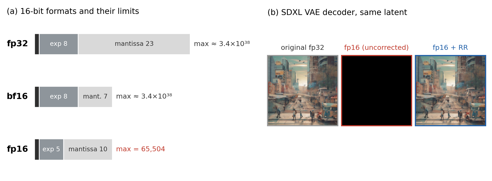

이 문제에 대한 기존 처방은 세 갈래이다. 첫째는 오버플로가 일어나는 연산만 fp32로 계산하는 형식 승격이다. Gemma 4의 공식 transformers 구현은
오버플로가 일어나는 두 연산을 fp32로 승격하여 계산하며, Draw Things[9]는 확산 트랜스포머의 잔차 흐름을 fp32로 유지한다. 둘째는 미세조정이다.
SDXL-VAE-FP16-Fix[10]는 출력은 유지하고 내부 활성이 작아지도록 VAE를 다시 학습하였다. 셋째는 고정 배수 축소이다. Draw Things는
특정 블록의 MLP 출력 투영 입력을 1/8 또는 1/4로 축소하고 출력을 fp32에서 복원한다. 세 처방은 각각 실효가 있으나 대가가 따른다. 형식 승격은 배포
그래프에 fp32 경로를 유지하므로 fp16만 지원하는 대상에서는 사용할 수 없다. 미세조정은 학습 비용이 들고 모델의 함수를 변경하므로 출력이
원본 모델과 달라진다. 고정 배수는 어느 블록을 몇 배로 축소할지를 모델마다 따로 정해야 하며, 그 배수가 충분한지를 배포 전에 확인하는
절차가 없다.

## 2. 연구 목적 및 기여

본 논문의 목적은 fp16 배포에서 출력 상실을 일으키는 오버플로를 배포 전에 진단하고, 학습 없이 fp16만으로 상실을 없애면서 원본 모델(fp32)의
출력을 지키는 교정을 제시하는 것이다. 이를 위해 두 가지 방법을 제안한다.

첫째는 **표현 범위 여유 진단**이다. 모델을 오버플로가 일어나지 않는 형식(bf16)으로 실행하며 모든 연산 출력의 최대 절댓값을 입력별로
측정하여, fp16에서 오버플로가 일어나는 연산(오버플로 지점)과 그 최댓값을 찾는다. 진단은 평가와 겹치지 않는 입력(진단 집합)으로 하며, 비용은
그 입력에 대한 bf16 순전파 한 번이다(Ⅲ장 1절).

둘째는 **잔차 재조정(residual rescaling, 표와 그림에서는 RR)**이다. 본 연구가 측정한 모델에서 큰 활성은 블록 사이를 흐르는 잔차 흐름, 그 흐름에
값을 기록하는 층의 출력, 그리고 흐름을 밖으로 내보내기 전의 연산에서 나타났다. 잔차 흐름에 값을 기록하는 층의 가중치와 편향을 c배 하고,
그 흐름을 입력받는 정규화의 eps를 c²배 하면 정규화 출력이 그대로이다. 정규화가 아닌 층이 흐름을 입력받아 내보내는 곳(출력부)이 있으면 그 가중치를 1/c배 한다.
따라서 모델의 함수는 fp32에서 변하지 않고, 잔차 흐름의 크기만 c배가 된다. c는 진단 집합의 최댓값으로 정하고, 교정 후 평가 입력에서 fp32 출력이 원본과
동일한지(등가성)와 fp16에서 오버플로가 사라졌는지를 확인한다(Ⅲ장 2~3절). 이 교정이 변경할 층을 연산 그래프에서 자동으로 탐색하는 도구(자동 구성 도구)를 함께
구현하였다(Ⅲ장 4절).

본 논문의 기여는 다음 네 가지이다.

1. SDXL-VAE-FP16-Fix가 다룬 SDXL VAE에서 잔차 재조정은 학습 없이 fp16 상실을 없앴고(생성 잠재 100개 상실 100/100 → 0), 원본
   VAE fp32 출력과의 차이가 미세조정본보다 작았다(PSNR 중앙값 67.2 dB 대 46.1 dB). 미세조정본의 원문 평가 조건(COCO[11] val2017 5,000장)에서도
   인코더와 디코더를 모두 fp16으로 실행한 잔차 재조정은 상실이 없고 LPIPS·SSIM[12]·MSE가 표기 자릿수에서 원본 VAE fp32와 같았다(Ⅴ장 1절).
2. FLUX.1-schnell에서 잔차 재조정은 fp16만으로 상실을 없앴고(100/100 → 0), fp32 출력과의 최종 잠재 상대 오차 중앙값이
   Draw Things 공개 설정(잔차 fp32, fp16 누산)의 0.306보다 작은 0.0602였다(Ⅴ장 2절).
3. 공식 Qwen2.5-VL-3B와 Gemma 4의 두 체크포인트(26B-A4B·31B)를 공식 가중치와 처리기 설정 그대로 측정하여(Gemma 4는 승격이 없는 배포 경로 포함), 무교정 fp16의 상실(Qwen 799장 중 71.5%,
   Gemma 4 배포 경로 100%)을 확인하고, 진단용 100장으로 정한 c(1/4)로 교정하였다. 잔차 재조정은
   평가 입력의 상실을 없애고 원본 fp32 출력에 bf16보다 가까웠으며, 교정한 Qwen 비전 인코더는 A100과 Jetson Orin Nano[13](GPU)의 TensorRT[14] fp16 엔진에서도
   799장 모두 출력을 유지하였다(Ⅴ장 3~4절).
4. 진단이 식별한 오버플로 지점에서 연산 그래프를 따라 교정 영역을 탐색하여 잔차 재조정을 구성하는 도구를 구현하였고, 검증한 다섯
   대상(SDXL VAE 디코더·인코더, 공식 Qwen, 공식 Gemma 4, FLUX.1-schnell) 모두에서 fp32 등가성 기준을 통과하고 fp16 상실을 없앴다(Ⅴ장 5절).

c는 모든 모델에서 평가와 겹치지 않는 진단용 100개로 정하였다. 본 논문은 과제 정확도나 화질 지표의 향상을 주장하지 않는다. 주장은
fp16에서 상실을 없애면서 원본 모델의 출력을 지킨다는 것이며, 비교의 기준은 원본 모델의 fp32 출력이다.

## 3. 논문 구성

Ⅱ장은 저정밀 배포와 fp16 오버플로에 관한 선행 연구와 기존 처방을 정리하고 평가 데이터셋을 소개한다. Ⅲ장은 진단 방법, 잔차 재조정,
배수 c 결정, 자동 구성 도구, 배포 검증 절차를 기술한다. Ⅳ장은 대상 모델과 데이터, 지표, 실행 환경을 정리한다. Ⅴ장은 SDXL-VAE-FP16-Fix 대비,
Draw Things 대비, 공식 모델의 진단과 교정, TensorRT와 엣지 보드에서의 배포, 자동 구성 도구의 결과를 차례로 제시한다. Ⅵ장은 결과를 요약하고
한계와 향후 연구를 정리한다.

---

# Ⅱ. 관련 연구

## 1. 저정밀 형식과 형식 승격

혼합 정밀도 학습[15]은 fp16 연산의 범위 문제를 손실 배율과 fp32 주 가중치로 다루었고, 이후 bf16[1]이
같은 16비트에서 fp32와 동일한 지수 범위를 제공하면서 학습과 추론의 기본 형식으로 자리 잡았다. 그러나 bf16은 가수가 7비트여서 같은
범위 안에서는 fp16(10비트)보다 정밀도가 낮고, 엣지 가속기 가운데는 bf16을 지원하지 않는 것이 있다. 따라서 fp16 배포는 정밀도와
지원 범위 측면에서 여전히 사용되며, 그때 잔존하는 문제가 상한 65,504이다.

추론 프레임워크는 오버플로가 일어나기 쉬운 연산을 fp32로 계산하는 국소 승격으로 이 문제를 피한다. Hugging Face transformers[16]의
Gemma 4[6] 비전 인코더는 풀링 뒤 스케일 곱과 표준화를 fp32로 승격하여 계산한다. TensorRT[14]는 fp16 엔진을 빌드할 때 층별로 fp32를 유지할 수
있으며, 정밀도를 그래프에 적힌 형식대로 강제하는 빌드도 제공한다. 국소 승격은 오버플로를 피하지만 그 연산을 fp32로 실행할 수 있는
대상에서만 사용할 수 있고, 어느 연산을 승격할지는 구현자가 미리 알아야 한다.

## 2. 활성 이상치와 fp16 오버플로

트랜스포머의 특정 채널에 매우 큰 활성이 나타나는 현상은 Massive Activations[17]가 보고하였고, 여러 모델 계열의
최대 활성을 측정한 연구[18]는 그 크기가 계열에 따라 네 자릿수까지 차이가 난다고 보고하였다. 이들 연구는 활성 크기를
아키텍처와 사전학습의 산물로 다룬다. 양자화 연구 가운데 SmoothQuant[19]는 이상치로 인한 양자화 오차를 낮추기 위해
활성의 크기를 가중치로 옮기는 등가 변환을 사용하여 출력을 변경하지 않고 활성의 동적 범위를 축소한다. 본 논문의 잔차
재조정도 함수를 보존하는 재매개변수화라는 점에서 같은 계열에 속하나, 목적은 양자화 오차 감소가 아니라 fp16 상한 초과 방지이고, 대상은 행렬곱
입력의 채널 분포가 아니라 정규화에 입력되는 잔차 흐름 전체의 크기이다.

fp16 추론에서의 수치 오버플로 자체는 알려진 문제이다. PASA[20]는 언어 모델 어텐션의 큰 진폭을 원인으로 지목하고 알고리즘적
완화를 제안하였다. vLLM 이슈 #40290[21]은 Gemma 4 비전 인코더를 fp16으로 실행하면 모든 이미지에서 출력이 무효가 되는 현상을 보고하였다.
이는 본 연구가 측정한 Gemma 4의 배포 경로 상실(Ⅴ장 3절)과 같은 현상으로 본다.

## 3. 기존 fp16 오버플로 처방

오버플로를 탐색하는 실무 도구로는 Hugging Face transformers의 디버깅 도구[22](`DebugUnderflowOverflow`)와 TensorRT의 Polygraphy[23]가 있다. 전자는
모듈마다 입출력의 절댓값 최대를 기록해 무한대나 NaN이 처음 생긴 모듈을 보고하고, 후자는 fp16 결과가 틀릴 때 층별 출력을 비교해
문제 층을 식별하여 fp32로 고정하도록 안내한다. 두 도구는 상실이 일어난 뒤 원인 층을 식별하는 사후 진단이다.

본 논문은 오버플로를 없애는 공개 처방 가운데 다음 두 사례와 비교한다. SDXL-VAE-FP16-Fix[10]는 SDXL[7] VAE가 fp16에서 NaN을 내는 문제를 미세조정으로 해결한
수정판이다. 모델 카드에 따르면 최종 출력은 유지하면서 내부 활성이 작아지도록 네트워크 안의 가중치와 편향을 축소하는 방향으로 다시
학습하였고, 원본 VAE와 출력에 약간의 차이가 있다고 밝힌다. 정량 평가는 카드가 연결한 토론 #7[24]의 COCO[11] val2017 재구성 실험(LPIPS·SSIM[12]·MSE)이
전부이다. Draw Things[9]는 확산 트랜스포머를 fp16으로 실행하기 위해 모델마다 정한 특정 블록(FLUX.1[8]은 double stream 블록 17·18)의 MLP 출력
투영 입력을 1/8 또는 1/4로 축소하고, MLP의 마지막 행렬곱 뒤 fp32로 승격하여 복원하며 적응 정규화의 게이팅을 fp32로 계산한다고 보고하였다.
블로그가 가리키는 구현 코드(draw-things-community[25])는 잔차 흐름도 fp32로 유지하는 한편, Q 투영·MLP 첫 선형층·어텐션은 fp16으로 누산한다. 블로그에는 정량 평가가 없다.

두 처방은 각각 실효가 있으나, 미세조정은 모델의 함수를 변경하고, 고정 배수 축소는 모델마다 블록과 배수를 따로 정하며 fp32 경로를
유지한다. 본 논문은 두 처방과 동일한 모델(SDXL VAE, FLUX.1-schnell)에서 같은 조건으로 잔차 재조정을 비교한다(Ⅴ장 1~2절). 비교 기준은 각 처방이
원본 모델의 출력을 얼마나 지키는가이다. 기존 처방과 잔차 재조정의 차이를 <표 1>에 정리한다.

**<표 1>** fp16 오버플로 처방 비교

| | 형식 승격 (fp32 경로) | 미세조정 (SDXL-VAE-FP16-Fix) | 고정 배수 축소 (Draw Things) | 잔차 재조정 (본 논문) |
|---|---|---|---|---|
| 변경하는 것 | 오버플로 연산을 fp32로 계산 | VAE 가중치를 다시 학습 | 특정 블록 MLP를 축소하고 fp32에서 복원, 잔차 흐름은 fp32 | 기록 층 ×c, 입력 정규화 eps ×c², 출력부 ×1/c |
| fp16만으로 실행 | 아니오 | 예 | 아니오 | 예 |
| 학습 필요 | 아니오 | 예 | 아니오 | 아니오 |
| 모델마다 정할 것 | 승격할 연산 | 학습 설정 | 축소할 블록과 배수 | c(진단 집합으로 결정), 편집 층(자동 구성 도구) |

## 4. 평가 데이터셋

DriveLM[5](nuScenes[4] 기반)은 장면별 키프레임에 대한 인지·예측·계획·행동 과제의 질의응답으로 구성된 데이터셋이다. 본 연구는 공개 검증 분할의 전방 카메라
(CAM_FRONT) 키프레임 799장을 VLM 비전 인코더의 평가 이미지로, 학습 분할의 전방 카메라 100장을 진단용으로 사용한다. 두 분할은 장면이 겹치지
않는다. VLM의 문장 수준 비교에는 같은 이미지에 대한 NuScenes-QA[26] 검증 문항을 질문으로 사용한다(Ⅳ장 2절).

SDXL VAE의 평가에는 미세조정본의 원문 조건을 따라 COCO val2017 5,000장을 사용하고, 진단용으로 COCO train2017 100장을 사용한다. 텍스트-이미지
생성 경로의 평가에는 PartiPrompts[27]의 프롬프트를 사용한다. PartiPrompts는 학습·평가 분할이 없는 평가용 프롬프트 집합이므로, 앞 100개로
평가하고 겹치지 않는 다음 100개(101~200번)를 진단용으로 사용한다. 두 기존 처방의 원문은 생성 이미지에 대한 정량 평가 프로토콜을 제시하지
않았다.

---

# Ⅲ. 진단 및 교정 방법

이 장은 fp16 출력 상실을 배포 전에 진단하고 학습 없이 교정하는 방법을 기술한다. Ⅲ장 1절은 bf16 측정으로 오버플로 지점과 최댓값을
찾는 진단을, Ⅲ장 2절은 잔차 흐름의 크기를 축소하는 등가 교정인 잔차 재조정을, Ⅲ장 3절은 재조정 배수 c를 정하고 교정을 확인하는
절차를 정의한다. Ⅲ장 4절은 잔차 재조정이 변경할 층을 연산 그래프에서 탐색하는 자동 구성 도구를, Ⅲ장 5절은 교정한 비전 인코더를 배포 런타임에서 검증하는
절차를 기술한다. 방법의 전체 흐름을 <그림 2>에 제시한다.

**<그림 2>** 진단과 교정 방법 흐름. 평가와 겹치지 않는 진단 집합을 bf16으로 진단하여 오버플로 지점과 최댓값 M을 찾고, M으로 c를 정한다. 자동 구성 도구는 오버플로 지점에서 출발해 편집할 층을 식별하고 c로 편집을 적용한다. 교정한 모델은 평가 입력에서 fp32 등가성과 fp16 실행의 상실을 확인한다.

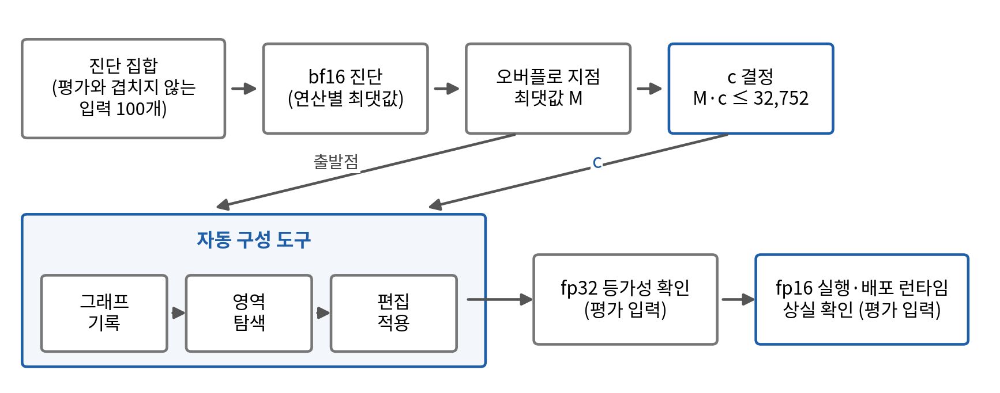

## 1. 출력 상실과 표현 범위 여유

fp16의 표현 상한은 65,504이다. 어떤 연산의 결과를 fp16으로 반올림한 값이 이 값을 초과하면 무한대가 되고 이어지는 연산에서 NaN으로 번진다. 본 논문은 모델
출력에 비유한 값(NaN 또는 Inf)이 하나라도 있는 입력을 **출력 상실**로 보고, 그 비율을 상실률이라 한다. 생성 모델에서는 여러 스텝
가운데 어느 스텝에서든 비유한 값이 생기면 상실로 센다.

입력 하나에 대해 연산 o의 표현 범위 여유를 다음으로 정의한다.

> **여유(o) = 65,504 ÷ max|출력(o)|**

여유가 1 미만이면 그 연산은 fp16에서 오버플로가 일어나는 것으로 판정한다. 분모의 크기는 오버플로가 일어나지 않는 bf16으로 실행하여 측정한다. fp16으로 측정하면 이미
오버플로가 일어난 입력이 무한대가 되어 크기를 알 수 없고, 유한한 입력만 집계되어 여유가 실제보다 크게 나타나기 때문이다. 측정은 PyTorch의
디스패치 계층(`TorchDispatchMode`)에서 모든 연산(aten 연산자)의 출력을 가로채 입력별 최대 절댓값을 모듈 경로와 함께 기록하는 방식으로
한다. 모듈 단위가 아니라 연산 단위로 측정하므로 선형층 안의 행렬곱이나 블록 뒤의 스케일 곱처럼 모듈 경계 안에서 생기는 큰 값도
놓치지 않는다. 다만 어텐션 마스크의 채움값(절댓값 10³⁰ 이상), 회전 위치 부호화 계산, 정규화 내부의 통계 연산은 활성이 아니므로 기록에서
제외하고, 모델 형식보다 넓은 형식으로 승격되어 계산되는 연산은 오버플로 지점과 최댓값의 집계에서 제외하므로, 승격이 있는 구현은 승격이 없는 배포 경로에서 측정한다. 비용은 측정할 입력에 대한 bf16 순전파 한 번이다.

진단은 c를 정하는 진단 집합(Ⅲ장 3절)에 대해 이 측정을 실행하여 두 가지를 얻는다. 첫째는 오버플로 지점, 즉 측정값이 상한을 초과하는 연산의 집합이다(실행 순서상 처음인 것을 처음 상한을 초과하는 연산이라 한다).
Ⅲ장 4절의 자동 구성 도구는 측정값이 Ⅲ장 3절의 목표를 초과하는 연산(오버플로 지점을 포함한다)을 출발점으로 교정할 영역을 탐색한다. 둘째는 진단 집합의 모든 입력과 연산에 대한
**최댓값 M**이며, Ⅲ장 3절은 M으로 배수 c를 정한다. 교정이 평가 입력에도 충분한지는 평가 입력의
fp16 실행으로 확인한다(Ⅴ장).

## 2. 잔차 재조정

트랜스포머 블록과 합성곱 VAE의 잔차 블록은 공통적으로 다음 구조를 가진다. 블록 사이를 흐르는 잔차 흐름 h에 각 블록이 갱신량을
더하고(h ← h + f(norm(h))), 대부분의 블록은 h를 정규화를 거쳐 입력받는다. 정규화(LayerNorm[28], GroupNorm[29],
RMSNorm[30])는 입력을 그 크기로 나누므로 입력에 상수를 곱해도 출력이 eps의 영향을 제외하면 변하지 않는다. 본 연구가 측정한
모델들에서 가장 큰 활성은 이 잔차 흐름, 그 흐름에 값을 기록하는 층의 출력, 또는 흐름을 출력부로 내보내기 전의 연산(Gemma 4[6]의 풀링 뒤
스케일 곱)에서 나타났다(Ⅴ장).

잔차 재조정(residual rescaling, 표와 그림에서는 RR)은 이 성질을 이용해 잔차 흐름 전체를 c배(0 < c < 1)로 축소한다. 흐름에 값을 기록하는 층(이하
기록 층), 즉 흐름의 시작에서 값을 기록하는 임베딩(이하 입력부)과 각 블록의 출력 투영은 가중치와 편향을 c배 한다. 흐름을
입력받아 다시 흐름에 기록하는 선형층(예: 채널 수를 맞추는 지름길 합성곱)은 입력이 이미 c배이므로 편향만 c배 한다. 흐름을 입력받는
정규화(이하 입력 정규화)는 eps를 c²배 한다. 정규화가 아닌 선형 연산(선형층 또는 채널별 배율)이 흐름을 입력받아 밖으로 내보내는 곳(이하
출력부)이 있으면 그 가중치를 1/c배 한다. eps를 c²배 하면 정규화가 계산하는 분산(RMSNorm은 제곱 평균)과 eps가 함께 c²배가 되므로 LayerNorm·GroupNorm·RMSNorm의
출력은 수식상 정확히 교정 전과 같다. 따라서 편집 뒤에는 잔차 흐름의 모든 값이 c배가 되고, 정규화 출력은 그대로이므로 블록의 갱신량도 교정 전과
같은 크기로 계산된 뒤 기록 층에서 c배가 되어 흐름에 더해진다. 출력부는 1/c로 교정 전 크기를 복원한다. 결과적으로 fp32에서 모델의 함수는
변경되지 않고, 잔차 흐름과 기록 층 출력의 크기만 c배로 작아진다. 잔차 재조정의 구조를 <그림 3>에 제시한다. 대상 모델별로 변경하는 층은 <표 2>와 같으며, 이 구성은 Ⅲ장 4절의 자동 구성 도구가 식별한 것이다.

**<그림 3>** 잔차 재조정 구조. 잔차 흐름의 기록 층(입력부와 블록의 출력 투영)을 c배, 입력 정규화의 eps를 c²배 하면 정규화 출력이 그대로이므로 fp32 함수는 변경되지 않고 잔차 흐름의 크기만 c배가 된다. 정규화가 아닌 층이 흐름을 입력받는 출력부가 있으면 그 층을 1/c배 한다. c는 진단용 입력의 최댓값에 곱했을 때 32,752(65,504의 절반) 이하가 되는 가장 큰 2의 거듭제곱(1 이하)이다.

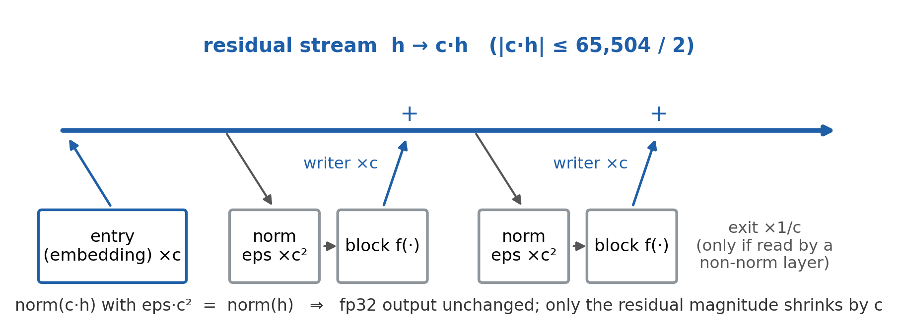

**<표 2>** 대상 모델에서 잔차 재조정이 변경하는 층

| 모델 | 기록 층 (×c) | 입력 정규화 (eps ×c²) | 출력부 (×1/c) |
|---|---|---|---|
| Qwen2.5-VL-3B[3] 비전 인코더 | 패치 임베딩, 블록 32개의 어텐션 출력 투영·MLP 출력 투영 | 블록 32개의 두 RMSNorm, 병합 층 정규화 | 없음 |
| Gemma 4 비전 인코더 | 패치 입력 투영, 위치 임베딩 표, 층마다 두 사후 정규화의 아핀 가중치, 표준화 편향 | 층마다 두 입력 정규화(RMSNorm) | 표준화 배율 |
| SDXL[7] VAE 디코더 | 마지막 업 블록 앞의 업샘플 합성곱, 마지막 업 블록 세 잔차 블록의 둘째 합성곱(지름길 합성곱은 편향만) | 그 세 잔차 블록의 첫 GroupNorm, 출력 GroupNorm | 없음 |
| SDXL VAE 인코더 | 마지막 다운샘플 합성곱, 마지막 다운 블록·중간 블록의 잔차 블록 둘째 합성곱, 중간 블록 어텐션 출력 투영 | 해당 잔차 블록의 첫 GroupNorm, 어텐션 GroupNorm, 출력 GroupNorm | 없음 |
| FLUX.1-schnell[8] 변환기 | 이미지·텍스트 입력 임베딩, 블록마다 어텐션 출력·MLP 출력 투영 | 블록마다 LayerNorm, 출력 LayerNorm | 없음 |

DriveLM[5] 학습 분할 100장(진단 집합)에서 Qwen2.5-VL-3B 비전 인코더의 블록 출력 최댓값은 블록을 지나며 커져 마지막 블록(31번)에서만
상한을 초과하였고(81,920), 잔차 재조정(c = 1/4) 뒤에는 모든 블록이 목표 아래였다(최대 20,352). 블록별 최댓값을 <그림 4>에 제시한다.

**<그림 4>** Qwen2.5-VL-3B 비전 인코더 블록 출력 최댓값. 진단 집합(DriveLM 학습 100장)을 bf16으로 측정한 블록별 최댓값이며, 세로축은 로그 축이다. 점선은 fp16 상한 65,504, 실선은 목표 32,752이다. 범례의 RR은 잔차 재조정(c = 1/4)이다.

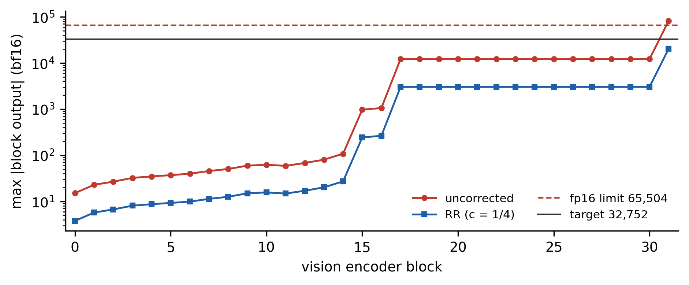

c는 2의 거듭제곱으로 정한다. 2의 거듭제곱을 곱하는 것은 지수만 변경하므로, 가중치가 fp16의 정규수 범위 안에 있는 한 편집 자체에
반올림 오차가 생기지 않는다. 잔존하는 차이는 교정한 모델을 fp16으로 실행할 때 생기는 반올림뿐이다.

잔차 재조정이 축소할 수 있는 것은 잔차 흐름, 그 기록 층의 출력, 그리고 출력부에 이르기 전까지 흐름에 선형으로 이어지는 연산이다.
정규화 뒤 블록 내부의 연산(MLP 중간 활성, 어텐션 점수)에서 오버플로가 일어나면 그 크기는 정규화가 정하므로 잔차 재조정으로 축소할 수 없다.
본 연구의 대상 모델에서는 32,752(Ⅲ장 3절의 목표)를 초과하는 연산이 모두 이 범위 안에 있었다(Ⅴ장).

## 3. 배수 c 결정과 교정 확인

c는 평가와 겹치지 않는 입력 100개(이하 진단 집합)로 정한다. 평가 데이터셋에 학습 분할이 있으면 그 분할의 100개를, 없으면 평가에 사용하지 않는
같은 집합의 100개를 사용한다. 진단 집합에서 Ⅲ장 1절의 최댓값 M을 구하고, 상한에 2배의 여유를 유지하도록 M·c ≤ 65,504 ÷ 2 = 32,752(이하 목표)를 만족하는
가장 큰 2의 거듭제곱을 c로 한다.

> **c = min(1, 2^⌊log₂(32,752 ÷ M)⌋)**

c = 1이면 교정이 필요하지 않다. 2배의 여유는 진단 집합 밖의 입력이 c를 정한 최댓값보다 클 수 있음에 대비한 설계 값이며, c를 2의 거듭제곱으로
내림하므로 실제 여유는 2배 이상이다(본 논문의 대상에서 2.2~3.8배).

교정은 평가 입력에서 두 가지로 확인한다. 첫째는 fp32 등가성이다. 교정 전후 모델을 fp32로 실행하여 최종 출력의 코사인 유사도를 입력별로 구하고, 그
최솟값이 0.99999 이상일 때 교정을 받아들인다. 둘째는 오버플로 제거이다. 교정한 모델을 fp16으로 실행하여 비유한 출력이 없는지 확인한다.
잔차 재조정은 구성상 fp32에서 원본 모델과 동일한 함수이며, 등가성 검사는 편집이 올바르게 적용되었는지 확인한다. 따라서 평가에서 원본
모델의 fp32 출력과 비교한 차이는 fp16 반올림에서 온 것으로 본다.

## 4. 자동 구성 도구

잔차 재조정을 적용하려면 기록 층, 입력 정규화, 출력부를 모델마다 식별해야 한다. 본 연구는 이를 연산 그래프에서 자동으로
탐색하는 도구(이하 자동 구성 도구)를 구현하였다. 도구는 세 단계로 동작한다.

첫째 단계는 그래프 기록이다. 작은 입력으로 모델을 한 번 실행하며 연산마다 입력 텐서의 출처(앞 연산의 출력, 매개변수, 외부 입력)와 모듈 경로를
기록한다. 그래프의 구조는 입력 해상도와 무관하므로 작은 입력으로 충분하다.

둘째 단계는 영역 탐색이다. Ⅲ장 1절의 진단이 식별한 목표 초과 연산(측정값이 32,752를 초과한 연산) 전부를 출발점으로 하여, 크기를 c배 해도 되는 텐서의
집합(영역)을 입력 쪽과 출력 쪽으로 넓힌다. 영역에 값을 만드는 생산자 가운데 선형층(행렬곱·합성곱)은 입력이 영역 밖이면 기록 층(가중치·편향
×c)이 되고, 입력이 이미 영역 안이면 편향만 c배 한다. 덧셈·뺄셈, 모양·인덱싱 연산, 평균과 평균 풀링, 영역 밖 텐서나 상수와의 원소별 곱은
영역 쪽 입력과 출력을 함께 영역에 포함하며, 이 연산으로 영역에 직접 들어가는 매개변수(위치 임베딩 표, 정규화의 아핀 가중치, 편향)는 기록 층과 같이
c배 한다. 영역의 값을 입력받는 소비자 가운데 정규화는 입력 정규화(eps ×c²)가 되고, 정규화가 아닌 선형 연산(선형층 또는 매개변수와의
곱)은 출력부(가중치 ×1/c)가 된다. 정규화는 LayerNorm·GroupNorm 연산자와, RMSNorm을 이루는 연산 패턴(제곱 →
평균 → eps 덧셈 → 역제곱근 → 곱)으로 인식한다. 영역에 비선형 연산이 생산자나 소비자로 닿으면 그 영역은 잔차 재조정으로 교정할 수 없으므로 실패로
보고한다. 하나의 매개변수에 서로 다른 배수가 필요한 경우(공유 가중치 등)도 실패로 보고한다.

셋째 단계는 적용과 확인이다. 식별한 기록 층·입력 정규화·출력부에 Ⅲ장 3절의 c로 편집을 적용하고 평가 입력에서 fp32 등가성과 fp16 오버플로 제거를 확인한다(Ⅲ장 3절). 영역 탐색의 규칙을 모식도로 <그림 5>에 제시한다.

**<그림 5>** 자동 구성 도구 영역 탐색 모식도. 실제 모델이 아닌 예시이다. 목표(32,752)를 초과한 연산(빨강)에서 출발해 c배가 되는 텐서의 영역(파란 띠)을 넓히고, 영역에 값을 만드는 선형층은 기록 층(×c, 입력이 이미 영역 안이면 편향만 ×c), 영역의 값을 입력받는 정규화는 eps ×c², 정규화가 아닌 선형층은 출력부(×1/c)로 식별한다.

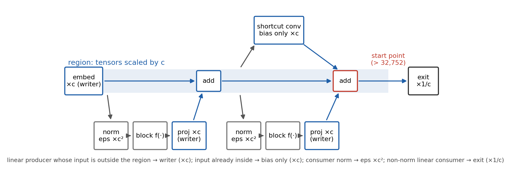

## 5. 배포 검증 절차

PyTorch에서 확인한 결과가 배포 런타임에서도 유지되는지 보기 위해, 공식 Qwen2.5-VL-3B 비전 인코더를 ONNX로 내보내 TensorRT[14] 엔진으로
빌드하고 A100과 Jetson Orin Nano[13]에서 실행한다. 비전 인코더는 입력의 격자 크기(`grid_thw`)에 따라 회전 위치 임베딩, 창 인덱스, 어텐션 구간을
매번 계산한다. 배포 해상도는 하나로 고정되므로, 고정 형상 그래프로 내보내기 위해 격자에 의존하는 값을 미리 계산해 상수로 삽입하고 블록
연산만 유지한 래퍼를 내보낸다. 엔진은 해상도마다 형상이 고정된다. 8GB 보드의 빌드 메모리에 부합하도록 그래프를 블록 16 앞뒤의 두 엔진으로 분할하고,
어텐션을 일정 크기의 조각으로 나누어 계산하는 형태(조각난 어텐션)로 내보낸다. 어텐션 마스크의 채움값은 fp16에서 −∞가 되지 않도록 −10⁴으로 둔다(exp(−10⁴)은
fp32에서도 0이다).

엔진은 그래프에 적힌 정밀도대로 빌드한다(`--stronglyTyped`). 따라서 fp16 그래프는 빌더가 층별로 fp32를 유지하지 않고 PyTorch의 fp16과 동일한
형식으로 실행된다. 이하 이 엔진을 **TensorRT fp16 엔진**이라 한다. 비교용으로 같은 래퍼의 fp32 그래프를 그대로 빌드한 fp32 엔진과, fp32 그래프에 bf16 사용을
허용해 빌드한 bf16 엔진(빌더가 층별로 fp32를 유지할 수 있다)도 측정하며, 엔진 사이의 출력 비교는 fp32 엔진 출력을 기준으로 한다. 같은 이미지를 같은 순서로 입력하여 무교정 엔진과 잔차 재조정 엔진의 상실을
집계하고, 래퍼의 fp32 엔진과 PyTorch 구현의 출력을 비교하여 내보내기 자체의 오차를 확인한다(Ⅴ장 4절).

---

# Ⅳ. 실험 구성

## 1. 대상 모델

대상은 네 모델이다(<표 3>). 두 VLM은 공식 체크포인트를 공식 저장소 설정 그대로 사용하고, 두 이미지 생성 모델은 기존 처방과
동일한 모델을 사용한다. 모든 실험에서 형식(fp32·bf16·fp16), 교정 여부, 그리고 아래에
밝힌 실행 경로(Gemma 4[6]의 두 경로, FLUX.1-schnell[8]의 클리핑과 Draw Things[9] 구성)만 변경하고 나머지 설정은 동일하게 두었다.

**<표 3>** 대상 모델과 형식을 변경한 범위

| 모델 | 체크포인트 | 형식을 변경한 범위 | 비교한 구성 |
|---|---|---|---|
| Qwen2.5-VL-3B-Instruct[3] | `Qwen/Qwen2.5-VL-3B-Instruct` (공식) | 비전 인코더 비교는 비전 인코더, 문장 비교는 모델 전체, 언어 모델 확인은 언어 모델 | bf16, 무교정, RR |
| Gemma 4 26B-A4B·31B | `google/gemma-4-26B-A4B-it`·`google/gemma-4-31B-it` 비전 인코더 (공식) | 비전 인코더 | bf16, 무교정(두 경로), RR |
| SDXL[7] VAE | `stabilityai/sdxl-vae` (원본), `madebyollin/sdxl-vae-fp16-fix` (FP16-Fix) | VAE 인코더·디코더 | bf16, 무교정, FP16-Fix, RR |
| FLUX.1-schnell | `black-forest-labs/FLUX.1-schnell` | 변환기(transformer) | bf16, 무교정(두 설정), Draw Things 공개 설정, RR |

Qwen2.5-VL-3B는 공식 처리기의 기본값(`max_pixels` 12,845,056, `min_pixels` 3,136)을 사용하며, 이 설정에서 nuScenes[4]
전방 카메라 이미지(1600×900)는 축소되지 않고 896×1596으로 처리된다. 어텐션 구현은 지정하지 않아 기본값(sdpa)을 사용하고, 프롬프트는 질문
원문에 공식 채팅 템플릿을 적용하며, 생성은 탐욕 해독에 공식 생성 설정의 반복 벌점 1.05를 사용한다. Gemma 4는 공식 처리기의 기본 비전 토큰
수 280과 최대 지원값 1,120의 두 조건을 측정한다.

Gemma 4는 두 경로로 구분한다. 공식 transformers 구현은 비전 인코더 마지막의 풀링 뒤 스케일 곱과 표준화를 fp32로 승격하여 계산한다. 본 논문은 이
구현을 경로 (i), 이 두 연산을 모델 형식(fp16) 그대로 계산하는 배포 경로(vLLM의 수정 전 구현, fp16 추론 엔진)를 경로 (ii)라 한다.
진단과 잔차 재조정은 경로 (ii)에서 실행한다.

원본 SDXL VAE와 SDXL-VAE-FP16-Fix[10]는 각 저장소의 공개 가중치를 그대로 사용한다. 텍스트-이미지 생성 경로의 잠재는 SDXL base 1.0
(`stabilityai/stable-diffusion-xl-base-1.0`, fp16 UNet)으로 생성한다. 생성 설정은 1024×1024, 30스텝, 안내 배율 5.0, 시드 = 프롬프트 번호이다.

FLUX.1-schnell의 생성 설정은 1024×1024, 4스텝, 안내 0, 시드 = 프롬프트 번호이다. 프롬프트 임베딩은 파이프라인 기본값(bf16, 최대 256토큰)으로
미리 계산해 모든 구성에 동일하게 입력하고, 잠재를 이미지로 변환하는 VAE는 모든 구성에서 fp32로 실행한다. 형식을 변경하는 것은 변환기뿐이다.
diffusers 구현은 fp16에서 일부 출력을 ±65,504로 클리핑하므로, 이 클리핑을 끈 구성(Draw Things가 다룬 조건)과 그대로 둔 구성을 함께 측정한다. 잔차 재조정과 Draw Things 공개 설정은 클리핑을 끈 상태로 실행한다.
Draw Things 공개 설정은 블로그가 가리키는 구현 코드(draw-things-community[25]의 `Flux1.swift`)의 정밀도 처리를 PyTorch로 옮겨 재현하였다.
잔차 흐름을 fp32로 두고 블록 안은 fp16으로 계산하며, double stream 블록 17·18의 MLP 출력 투영 입력을 1/8로 축소한 뒤 출력을 fp32에서
8배로 복원하고, 그 블록의 게이팅을 fp32로 계산한다. 구현 코드가 fp16 누산으로 지정한 연산(Q 투영, MLP 첫 선형층, 어텐션의 점수와
가중합)도 fp16으로 누산하고, q·k 정규화와 RoPE도 구현 코드와 같이 fp16으로 계산한다.

## 2. 데이터와 진단 집합

평가와 c의 진단 집합은 겹치지 않게 분할하였다(<표 4>).

**<표 4>** 평가 데이터와 진단 집합

| 모델 | 평가 | 진단 (c) |
|---|---|---|
| Qwen2.5-VL-3B, Gemma 4 | DriveLM[5] 검증 전방 카메라 799장 | DriveLM 학습 전방 카메라 100장 |
| SDXL VAE (재구성) | COCO[11] val2017 5,000장 | COCO train2017 100장 |
| SDXL VAE (생성 잠재) | PartiPrompts[27] 1~100번 | PartiPrompts 101~200번 |
| FLUX.1-schnell | PartiPrompts 1~100번 | PartiPrompts 101~200번 |

DriveLM은 공개 검증 분할(149개 장면)의 전방 카메라 키프레임 799장 전부를 공개 파일에 수록된 장면·키프레임 순서대로 사용한다. 진단용 100장은 학습 분할의 전방 카메라
키프레임에서 시드 0으로 무작위 추출하였으며, 검증 분할과 장면이 겹치지 않는다. Qwen의 문장 수준 비교에는 이미지마다 같은 키프레임에 대응하는
NuScenes-QA[26] 검증 문항의 첫 문항을 질문으로 사용한다(799문항). 이 질문은 입력일 뿐이며 정답 대비 정확도는 주장에 사용하지 않는다.

COCO는 SDXL-VAE-FP16-Fix의 원문 평가(토론 #7[24])를 따라 val2017 5,000장 전부에서 크기를 축소하지 않고 256×256 영역을 무작위 위치에서
잘라 낸다(`RandomCrop(256, pad_if_needed=True)`, 시드 = 이미지 번호; 256보다 작은 이미지는 0으로 채운다). 원문이 밝히지 않은 설정은
라이브러리 기본값으로 정하였다. 진단용 100장은 train2017 목록의 첫 100장(이미지 번호 순)이며 같은 방식으로 잘라 낸다.

PartiPrompts는 학습·평가 분할이 없는 프롬프트 집합이므로 파일 순서의 앞 100개로 평가하고, 다음 100개(101~200번)를 진단용으로 사용한다.
이 집합으로 두 기존 처방과 같은 조건에서 비교한다.

## 3. 지표

출력 상실은 출력에 비유한 값이 있는 입력의 수로 세어 k/N으로 적는다(Ⅲ장 1절). 진단은 진단 집합의 최댓값과 그로부터 정한 c를 적고, 교정이 평가 입력에도
충분한지는 평가 입력을 fp16으로 실행한 상실로 확인한다.

원본 출력과의 차이는 모든 모델에서 원본 모델의 fp32 출력을 기준으로 구한다. 비전 인코더는 출력 토큰 전체를 펼친 벡터의 상대 오차
`‖y − y₃₂‖ ÷ ‖y₃₂‖`와 코사인 유사도를 이미지별로 구한다. SDXL VAE 디코더는 복호 이미지의 상대 오차와 PSNR을, FLUX.1-schnell은 최종
잠재의 상대 오차와 그 잠재를 fp32 VAE로 복호한 이미지의 PSNR을 구한다. PSNR은 [0,1] 범위로 제한한 이미지에서 최대 신호값 1로 이미지별로 구한다.
상실한 입력은 차이를 계산하지 않고 상실로만 센다. 이미지별 값의 중앙값과 최악값(상대 오차는 최대, PSNR과 코사인은 최소)을 적는다.

문장 수준 일치는 Qwen2.5-VL-3B를 fp32·bf16·fp16·fp16+잔차 재조정으로 실행해 같은 질문에 탐욕 해독으로 최대 128토큰을 생성하고, 앞뒤 공백과
마침표를 제거하고 소문자로 바꾼 출력 문자열이 fp32 생성과 일치하는 문항의 비율로 구한다. 비율은 비전 인코더 출력을 상실한 문항을 포함한
799문항 전체 기준이다.

COCO 재구성에서는 FP16-Fix의 원문 평가와 같이 입력 사진 대비 LPIPS[31], SSIM[12], MSE를 구하고(LPIPS의 특징 망은
AlexNet), 평균을 적는다. SSIM은 `skimage`의 구현(채널 축, 값 범위 1)으로 [0,1] 이미지에서, MSE는 [0,1] 이미지에서 구한다. LPIPS는 원문 값을 재현하는
설정(AlexNet, [0,1] 이미지를 그대로 입력)으로 원문과 나란히 적고, 라이브러리 규약([-1,1] 입력)의 값도 함께 적는다(Ⅴ장 1절). 원본 VAE fp32
출력 대비 PSNR도 이미지별로 구해 평균을 적는다.

등가성은 교정 전후 fp32 출력의 입력별 코사인 최솟값으로 나타내고(Ⅲ장 3절), 표본 수를 함께 적는다.

TensorRT[14] 엔진의 지연은 두 분할 엔진을 차례로 실행한 시간을 이미지마다 측정하여 799장의 p50·p95로 적고, 가중치는 빌드 기록에 적힌 엔진의
가중치 메모리이다. 엔진 사이의 코사인은 fp32 엔진 출력 대비 이미지 출력 전체를 펼친 벡터의 코사인이며, 래퍼 그래프 검증에는 토큰마다
구한 코사인의 이미지별 중앙값을 사용한다. Jetson Orin Nano[13]의 지연과 메모리는 부록 B의 절차로 구한다.

## 4. 실행 환경

PyTorch 측정은 NVIDIA A100-SXM4-80GB 한 장에서 수행하였다. Qwen2.5-VL-3B는 torch 2.3.0과 transformers 4.49.0, Gemma 4는 torch 2.11.0과
transformers 5.20.2 환경에서 측정하였다. SDXL VAE와 FLUX.1-schnell은 torch 2.11.0과 diffusers 0.41.0 환경에서 측정하였다.
배포 검증은 A100의 TensorRT 10.13.3.9와, Jetson Orin Nano Super 개발자 키트(8GB, L4T R36.4.7, TensorRT 10.3.0.30, 15W 전원 모드)에서
수행하였다. 지연 측정은 다른 작업이 GPU를 사용하지 않는 상태에서 수행하였고, 측정 동안 GPU 사용 프로세스를 5초마다 기록해 겹침이 없었음을
확인하였다.

---

# Ⅴ. 결과 및 분석

이 장은 주 기여의 순서로 결과를 제시한다. Ⅴ장 1절과 Ⅴ장 2절은 기존 처방이 다룬 모델(SDXL[7] VAE, FLUX.1-schnell[8])에서 같은 조건으로 잔차 재조정과
비교하고, Ⅴ장 3절은 공식 VLM 두 가지의 진단과 교정, Ⅴ장 4절은 교정한 비전 인코더의 배포 런타임 결과, Ⅴ장 5절은 자동 구성 도구의 결과를 제시한다.
모든 비교의 기준은 원본 모델의 fp32 출력이다.

## 1. SDXL VAE: SDXL-VAE-FP16-Fix 대비

### 1.1 텍스트-이미지 생성 경로

SDXL base 1.0이 PartiPrompts[27] 1~100번으로 생성한 잠재를 VAE 디코더로 복호하였다. 프롬프트 101~200번의 생성 잠재(진단 집합)로 원본 디코더를 진단한 최댓값은
1,409,024(마지막 업 블록의 셋째 잔차 블록 덧셈)였고, 여기서 c = 1/64를 정하였다. 원본 디코더를 fp16으로 실행하면 생성 잠재 100개 모두
출력을 상실하였다. 잔차 재조정을 적용한 디코더는 fp32에서 원본 디코더와 등가였다(코사인 최소 0.9999999999999997, 100개). 실행 결과는 <표 5>와 같다.

**<표 5>** SDXL VAE 디코더 실행 결과 (생성 잠재 100개, 원본 fp32 출력 대비)

| 디코더 | 상실 | 상대 오차 중앙 (최대) | PSNR 중앙 (최소) |
|---|---|---|---|
| 원본 VAE bf16 | 0/100 | 0.0195 (0.0478) | 49.6 dB (41.7) |
| 원본 VAE fp16 | 100/100 | — | — |
| SDXL-VAE-FP16-Fix[10] fp16 | 0/100 | 0.0292 (0.0773) | 46.1 dB (39.5) |
| fp16 + RR (c = 1/64) | 0/100 | 0.00262 (0.00585) | 67.2 dB (59.1) |

두 처방 모두 상실을 없앴으나 원본 출력 대비 상대 오차는 FP16-Fix가 잔차 재조정의 10배 이상이었다(0.0292 대 0.00262). 원본 VAE를 bf16으로
실행하면 상실 없이 상대 오차가 0.0195로, FP16-Fix fp16(0.0292)보다 원본 출력에 가까웠다.
FP16-Fix의 차이는 형식이 아니라 미세조정으로 변경된 함수에서 온 것으로 본다. 아래 COCO[11] 평가에서 FP16-Fix를 fp32로 실행해도 원본 VAE와의 PSNR이 fp16 실행과 같았다(38.3 dB 대 38.2 dB). 복호 결과의 예를 <그림 6>에 제시한다.

**<그림 6>** SDXL VAE 디코더 복호 결과 예. PartiPrompts 1~8번으로 SDXL base 1.0이 생성한 잠재(1024×1024)를 복호해 256×256으로 축소하여 제시하였다. 위에서부터 원본 VAE fp32, 원본 VAE fp16, SDXL-VAE-FP16-Fix fp16, 잔차 재조정 fp16(c = 1/64)이며, 비유한 출력은 검정으로 표시하였다.

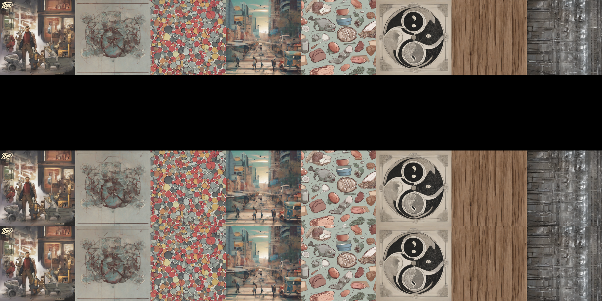

### 1.2 FP16-Fix 원문 조건: COCO val2017 재구성

FP16-Fix의 원문 평가와 같이 COCO val2017 5,000장에서 256×256 영역을 잘라 내어 인코딩하고 다시 복호하였다. 원본 VAE를 fp16으로 실행하면 5,000장 모두
출력을 상실하였으며, 인코더 출력에서 이미 5,000장 모두 비유한 값이 나왔다. 따라서 이 조건에서는 디코더뿐 아니라 인코더에도 잔차 재조정이 필요하다.
인코더의 구성도 Ⅲ장 4절의 자동 구성 도구가 식별한 것이다(<표 13>). c는 COCO train2017 100장에서 정하였다. 인코더의 최댓값은 552,960(중간 블록 둘째 잔차
블록 덧셈), 디코더는 630,784(마지막 업 블록 셋째 잔차 블록 덧셈)로 둘 다 c = 1/32이다. 인코더와 디코더 잔차 재조정의 fp32 등가성은 평가
5,000장에서 인코더 출력 잠재와 디코더 출력 모두 코사인 최소 0.9999999999999996이었다. 재구성 결과는 <표 6>과 같다.

**<표 6>** COCO val2017 재구성 결과 (5,000장, 원문 조건, LPIPS는 원문 재현 설정)

| 구성 | 상실 | LPIPS | SSIM[12] | MSE | 원본 fp32 출력 대비 PSNR |
|---|---|---|---|---|---|
| 원본 VAE fp32 | 0/5,000 | 0.0543 (원문 0.055) | 0.732 (원문 0.73) | 0.00477 (원문 0.0048) | 기준 |
| 원본 VAE bf16 | 0/5,000 | 0.0567 | 0.728 | 0.00484 | 34.7 dB |
| 원본 VAE fp16 | 5,000/5,000 | — | — | — | — |
| FP16-Fix fp32 | 0/5,000 | 0.0562 (원문 0.056) | 0.732 (원문 0.73) | 0.00472 (원문 0.0048) | 38.3 dB |
| FP16-Fix bf16 | 0/5,000 | 0.0574 | 0.730 | 0.00477 | 35.4 dB |
| FP16-Fix fp16 | 0/5,000 | 0.0562 | 0.732 | 0.00472 | 38.2 dB |
| fp16 + RR (인코더·디코더, c = 1/32) | 0/5,000 | 0.0543 | 0.732 | 0.00477 | 45.1 dB |

LPIPS·SSIM·MSE는 입력 사진 대비 평균, PSNR은 원본 VAE fp32 출력 대비 평균이다. 원본 VAE와 FP16-Fix의 fp32 값은 원문의 표를 재현하였다
(<표 6>). LPIPS는 AlexNet에 [0,1] 이미지를 그대로 입력한 설정에서 원문 값과 일치하였다. 라이브러리 규약인 [-1,1] 입력으로
측정해도 결론은 동일하였다(원본 VAE fp32 0.0673, FP16-Fix fp16 0.0695, 잔차 재조정 모두 fp16 0.0673). bf16으로 실행하면 원본 VAE와 FP16-Fix 모두
상실은 없었으나 원본 출력 대비 PSNR이 34.7 dB와 35.4 dB였다.

잔차 재조정을 적용한 VAE는 인코더와 디코더를 모두 fp16으로 실행해도 상실이 없고 LPIPS·SSIM·MSE가 표기 자릿수에서 원본 VAE fp32와 같았다. 이미지별로 짝지어 보면,
원본 VAE fp32 대비 LPIPS 차이의 평균은 잔차 재조정 +0.00003으로 5,000장 중 52.8%에서 원본보다 컸고(이미지별 차이 절댓값의 중앙 0.00030), FP16-Fix fp16은
+0.00190으로 84.7%에서 원본보다 컸다. FP16-Fix와 잔차 재조정의 LPIPS 차이는 평균 0.00187(표준오차 0.000032)이다. FP16-Fix fp32도 +0.00186(84.3%)으로
fp16과 같아, 이 차이 역시 형식이 아니라 미세조정에서 온 것으로 본다. 원본 출력 대비 PSNR은 잔차 재조정이 FP16-Fix fp16(38.2 dB)보다 6.9 dB 높았다.

텍스트-이미지 생성 경로의 진단용 프롬프트(101~200번)로 정한 c(디코더 1/64는 생성 잠재에서, 인코더 1/32는 그 잠재를 복호한
이미지에서 정함)로 같은 평가를 해도 상실은 없었고, 원본 출력 대비 PSNR도
COCO 진단용 100장으로 정한 c와 소수 넷째 자리까지 같은 45.1154 dB였다.

## 2. FLUX.1-schnell: Draw Things 대비

프롬프트 101~200번(진단 집합)으로 FLUX.1-schnell 변환기를 진단한 최댓값은 233,472(single stream 블록 37의 잔차 덧셈)로 c = 1/8이다. 처음 상한을
초과하는 연산은 double stream 블록 18의 게이트 곱이었다. fp16 범위를 초과하는 값을 클리핑하지 않고 실행하면 평가 프롬프트 100개 모두 출력을
상실하였다. 잔차 재조정은 입력 임베딩
두 개를 포함해 기록 층 116개를 c배 하고 LayerNorm 115개의 eps를 c²배 한다. fp32 등가성은 평가 100개의 4스텝 최종 잠재에서
코사인 최소 0.9999999999999225였다. 정규화 뒤 블록 내부 연산에서 목표(32,752)를 초과하는 연산은 없었다. 구성별 결과는 <표 7>과 같다.

**<표 7>** FLUX.1-schnell 변환기 구성별 결과 (PartiPrompts 100개, 4스텝, 원본 fp32 출력 대비)

| 구성 | 상실 | 최종 잠재 상대 오차 중앙 (최대) | PSNR 중앙 (최소) |
|---|---|---|---|
| bf16 | 0/100 | 0.125 (0.401) | 29.2 dB (18.1) |
| fp16, 클리핑 끔 | 100/100 | — | — |
| fp16, diffusers 기본(±65,504 클리핑) | 0/100 | 0.138 (0.839) | 27.8 dB (10.9) |
| Draw Things[9] 공개 설정 (잔차 fp32) | 0/100 | 0.306 (1.14) | 20.3 dB (7.8) |
| fp16 + RR (c = 1/8) | 0/100 | 0.0602 (0.264) | 36.0 dB (20.2) |

상실이 없는 네 구성 가운데 잔차 재조정이 fp32 출력에 가장 가까웠다. Draw Things 공개 설정은 잔차 흐름을 fp32로 유지하면서도
최종 잠재 상대 오차가 0.306으로 잔차 재조정의 약 5배였다. diffusers 기본 설정의 클리핑은 비유한 값을 막았으나 오차는 0.138이었으며, 클리핑된 값이 클리핑 전 값과 다르기 때문으로 본다. 4스텝 생성은
스텝마다의 작은 차이가 다음 스텝의 입력이 되어 궤적 전체로 번지는 것으로 보이며, 오버플로가 없는 bf16도 오차가 0.125였다. 잔차 재조정의 오차는 이 bf16의 절반이었다. 평가 프롬프트 1~4번(번호 순)의 생성 결과를 <그림 7>에 제시한다.

**<그림 7>** FLUX.1-schnell 생성 결과 예. PartiPrompts 1~4번(번호 순, 4스텝, 시드 = 번호)을 원본 fp32, fp16 클리핑 끔(검정 = 상실), Draw Things 공개 설정, fp16 + 잔차 재조정(c = 1/8)으로 생성하였다. 이미지 아래 값은 원본 fp32 대비 최종 잠재 상대 오차이다. 범례의 RR은 잔차 재조정이다.

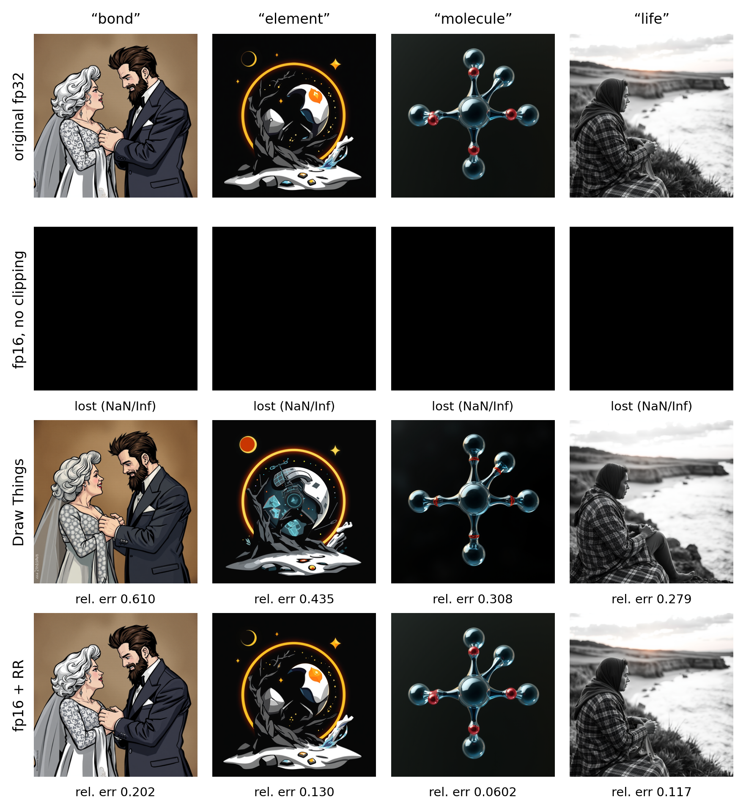

## 3. 공식 모델 진단과 교정

### 3.1 Qwen2.5-VL-3B

공식 Qwen2.5-VL-3B[3]를 공식 처리기 기본값으로 DriveLM[5] 검증 799장에 적용하였다. DriveLM 학습 분할 100장(진단 집합)으로 진단한 비전 인코더의 최댓값은
81,920으로 마지막 블록 MLP 출력 투영(`blocks.31.mlp.down_proj`)의 행렬곱 출력이었다. 여기서 c = 1/4를
정하였다. 무교정 비전 인코더를 fp16으로 실행하면 799장 중 571장(71.5%)이 출력을 상실하였다(<표 8>).

언어 모델에서는 오버플로가 없었다. 비전 인코더를 bf16으로 고정하고 언어 모델 디코더를 fp16으로 실행하면 799문항 모두 상실이 없었다. 이 모델의 fp16 위험은 비전 인코더에 있다.

**<표 8>** 공식 VLM 진단과 fp16 상실 (진단용 DriveLM 학습 100장, 평가 DriveLM 검증 799장)

| 모델 · 비전 토큰 | 최댓값 M | c | 무교정 fp16 상실 | 경로 (i) 상실 | RR fp16 상실 |
|---|---|---|---|---|---|
| Qwen2.5-VL-3B | 81,920 | 1/4 | 571/799 | — | 0/799 |
| Gemma 4[6] 26B-A4B · 280 | 91,136 | 1/4 | 799/799 | 0/799 | 0/799 |
| Gemma 4 26B-A4B · 1,120 | 93,696 | 1/4 | 799/799 | 0/799 | 0/799 |
| Gemma 4 31B · 280 | 91,136 | 1/4 | 799/799 | 0/799 | 0/799 |
| Gemma 4 31B · 1,120 | 93,696 | 1/4 | 799/799 | 0/799 | 0/799 |

Qwen의 상실은 PyTorch fp16 실행 결과이고, Gemma 4의 무교정 상실은 경로 (ii)의 결과이다. Gemma 4의 최댓값은 비전 인코더 마지막 풀링 뒤 스케일 곱(×√1152)에서 나왔다.
Ⅴ장 1·2절의 두 생성 모델을 포함하여 최댓값과 c를 <그림 8>에 제시한다.

**<그림 8>** 최댓값과 c. 세로축은 로그 축이고, 점선은 fp16 상한 65,504, 실선은 목표 32,752이다. 진단 집합은 Qwen2.5-VL-3B와 Gemma 4 26B-A4B·31B(비전 토큰 280·1,120)가 DriveLM 학습 100장, SDXL VAE 디코더와 FLUX.1-schnell 변환기가 PartiPrompts 101~200번이다. 막대 위의 값은 c이다.

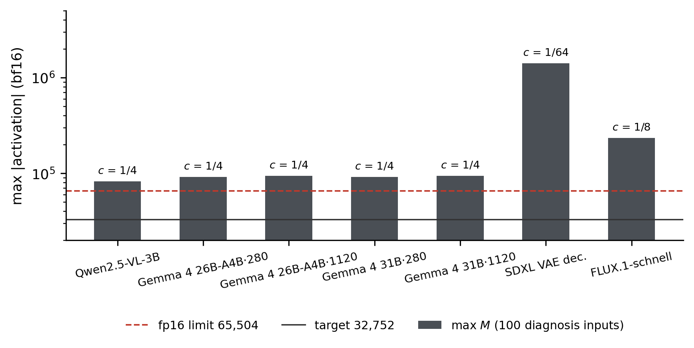

잔차 재조정을 적용한 비전 인코더는 fp32에서 원본 비전 인코더와 등가였고(코사인 최소 0.9999999999997387, 799장), fp16에서 799장 모두
출력을 유지하였다. <표 9>는 비전 인코더 출력을 원본 fp32 출력과 비교한 결과이다.

**<표 9>** Qwen2.5-VL-3B 비전 인코더 출력 차이 (799장, 원본 fp32 출력 대비)

| 형식 | 상실 | 상대 오차 중앙 (최대) | 코사인 최소 / 중앙 |
|---|---|---|---|
| bf16 | 0/799 | 0.183 (0.303) | 0.9546 / 0.9832 |
| fp16 무교정 | 571/799 | — | — |
| fp16 + RR (c = 1/4) | 0/799 | 0.0558 (0.207) | 0.9783 / 0.9984 |

잔차 재조정의 상대 오차 중앙은 0.0558로 bf16(0.183)의 약 1/3이었다. 무교정 fp16은 앞서와 같이 571장이 출력을 상실하여 비교에서 제외하였다.

문장 수준에서도 같은 경향이었다. 799문항에서 fp32로 생성한 답과 출력 문자열이 동일한 문항의 비율은 잔차 재조정이 73.1%로 bf16의 40.9%보다
높았고, 무교정 fp16은 22.7%였다. 무교정 fp16은 비전 인코더 출력을 상실한 571문항에서 모두 「!」만 반복하는 답을 생성하였다. 평가 순서에서 무교정 fp16이 출력을 상실한 첫 세 문항의 답을 <그림 9>에 제시한다.

**<그림 9>** Qwen2.5-VL-3B 생성 답 예. DriveLM 검증 799장의 평가 순서에서 무교정 fp16 비전 인코더가 출력을 상실한 첫 세 문항(0·1·2번)이며, 답의 내용과 무관하게 이 규칙으로 골랐다. 질문은 NuScenes-QA 검증 문항이고, 답은 탐욕 해독으로 최대 128토큰까지 생성한 것을 줄여 표시하였다. 범례의 RR은 잔차 재조정이다.

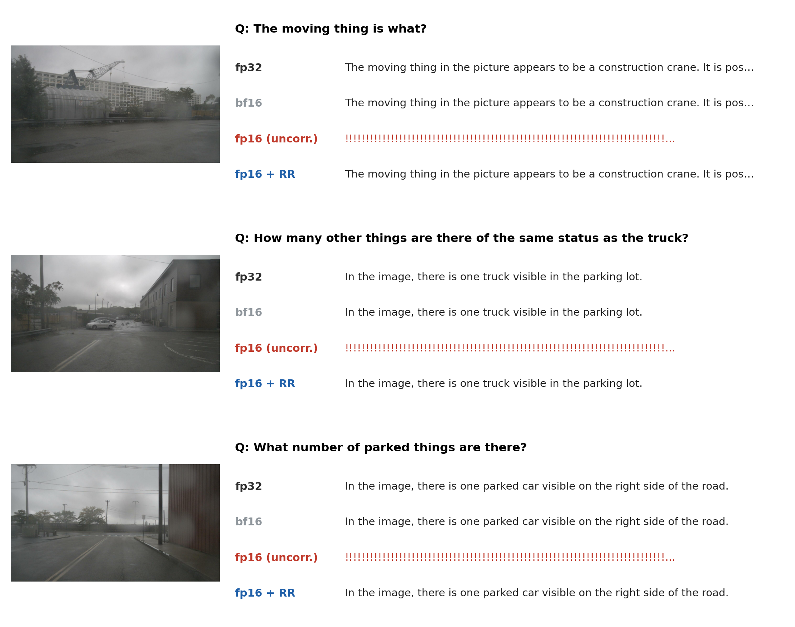

### 3.2 Gemma 4

Gemma 4의 두 체크포인트와 두 비전 토큰 조건 모두에서 경로 (ii)에서는 799장 모두 출력을 상실하였고 경로 (i)에서는 상실이 없었다(<표 8>). 공식 구현은 오버플로가 일어나는 연산을 fp32로 승격해 상실을 피하고, 승격이 없는 배포
경로에서는 모든 이미지가 출력을 상실한다.

경로 (ii)에 잔차 재조정을 적용하면 네 조건 모두 상실이 0이었다(<표 10>). 원본 fp32 출력(경로 (i)과 동일한 fp32 계산) 대비 상대 오차 중앙은
0.0380~0.0433으로 bf16의 0.119~0.131의 약 1/3이었다. 잔차 재조정 구성은 비전 인코더의 표준화 배율을 출력부로 삼아 1/c배 한다(Ⅲ장 2절). fp32 등가성은 네 조건
모두 799장에서 코사인 최소 0.9999999999998634 이상이었다.

**<표 10>** Gemma 4 비전 인코더 출력 차이 (경로 (ii), 799장, 원본 fp32 출력 대비)

| 모델 · 비전 토큰 | 무교정 fp16 상실 | bf16 상대 오차 중앙 (최대) | bf16 코사인 최소 | RR 상실 | RR 상대 오차 중앙 (최대) | RR 코사인 최소 |
|---|---|---|---|---|---|---|
| 26B-A4B · 280 | 799/799 | 0.119 (0.248) | 0.9693 | 0/799 | 0.0381 (0.0929) | 0.9957 |
| 26B-A4B · 1,120 | 799/799 | 0.130 (0.194) | 0.9811 | 0/799 | 0.0432 (0.0778) | 0.9970 |
| 31B · 280 | 799/799 | 0.119 (0.219) | 0.9760 | 0/799 | 0.0380 (0.0904) | 0.9959 |
| 31B · 1,120 | 799/799 | 0.131 (0.193) | 0.9813 | 0/799 | 0.0433 (0.0764) | 0.9971 |

### 3.3 원본 출력 대비 오차 종합

앞의 세 절의 결과를 모으면, 잔차 재조정은 모든 대상에서 비교한 방법(bf16, SDXL-VAE-FP16-Fix, Draw Things 공개 설정)보다 원본 fp32 출력에
가까웠다(<그림 10>).

**<그림 10>** 원본 fp32 출력 대비 상대 오차 중앙값. 세로축은 로그 축이다. SDXL VAE 디코더는 생성 잠재 100개, FLUX.1-schnell은 PartiPrompts 100개(4스텝, 최종 잠재), Qwen2.5-VL-3B와 Gemma 4는 비전 인코더 출력(DriveLM 검증 799장)이다. 잔차 재조정과 FP16-Fix는 fp16, Draw Things는 공개 설정(잔차 fp32, 구현 코드의 fp16 누산 포함)의 재현, 회색 막대는 bf16이다. 무교정 fp16은 상실하므로 표시하지 않았다. 범례의 RR은 잔차 재조정이다.

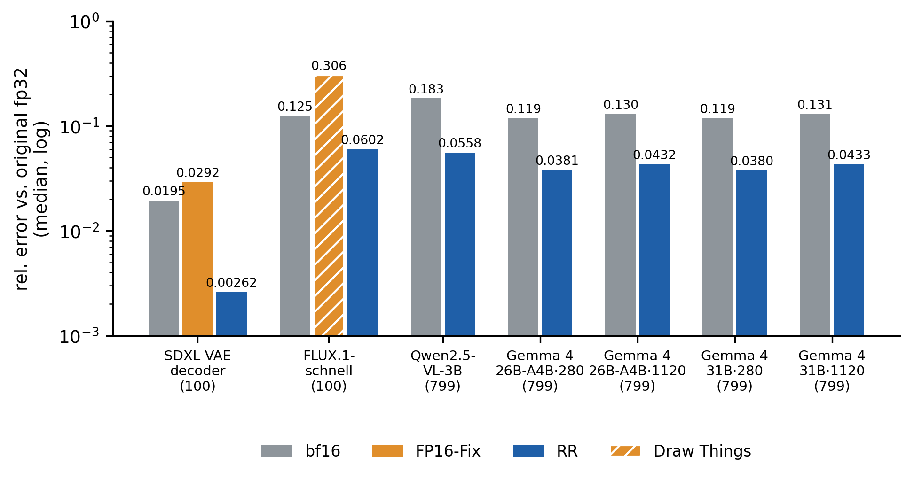

## 4. 배포 런타임과 엣지 보드

### 4.1 A100 TensorRT fp16 엔진

공식 Qwen 비전 인코더를 Ⅲ장 5절의 절차로 내보내 TensorRT[14] fp16 엔진을 빌드하였다. 무교정 엔진은 799장 중 550장(68.8%)이 출력을 상실하였고,
잔차 재조정 엔진은 0장이었다(<표 11>). PyTorch fp16의 상실(571장)과의 차이는 런타임의 연산 순서와 커널 차이에서 오는 것으로 본다.

**<표 11>** A100 TensorRT 엔진 상실과 지연 (공식 Qwen 비전 인코더, 799장, 896×1596)

| 엔진 | 상실 | 지연 p50 / p95 | 가중치 | fp32 엔진 대비 코사인 최소 / 중앙 |
|---|---|---|---|---|
| fp32 | 0/799 | 193.7 / 195.5 ms | 1,348 MiB | 기준 |
| bf16 | 0/799 | 109.8 / 111.9 ms | 674 MiB | 0.9685 / 0.9893 |
| fp16 무교정 | 550/799 | 113.1 / 116.6 ms | 677 MiB | — |
| fp16 + RR (c = 1/4) | 0/799 | 103.0 / 104.5 ms | 677 MiB | 0.9832 / 0.9961 |

코사인은 이미지 출력 전체를 펼친 벡터의 코사인이다. bf16 엔진은 잔차 재조정 엔진보다 지연이 6.6% 길었다(p50 109.8 ms 대 103.0 ms).

TensorRT는 빌드 때 커널 후보를 실측해 고르므로 같은 그래프에서도 빌드마다 커널이 달라질 수 있다. 무교정 엔진을 다섯 번 다시
빌드하면 다섯 번 모두 550장이 출력을 상실하였고 상실한 이미지 집합도 동일하였다. 잔차 재조정 엔진은 두 번 빌드해 두 번 모두 상실이
0이었다. 같은 엔진을 두 번 실행한 결과는 두 번 모두 동일하였다.

래퍼 그래프를 TensorRT fp32 엔진으로 실행해 PyTorch 구현과 비교하면, 이미지별 토큰 코사인의 중앙값은 799장
전체에서 0.9993 이상이었고 743장은 0.9999 이상이었다. 격자 불일치와 비유한 토큰은 없었다.

### 4.2 Jetson Orin Nano

같은 ONNX 그래프를 Jetson Orin Nano[13](15W 전원 모드)에서 TensorRT fp16 엔진으로 빌드해 799장 전부를 실행하였다(<표 12>). 무교정 엔진은
555장(69.5%)이 출력을 상실하였고 잔차 재조정 엔진은 상실이 없었다. 무교정 상실률은 A100 엔진(68.8%)과 PyTorch(71.5%) 사이에 있다. 잔차 재조정의 지연은
무교정 엔진과 같은 수준(+0.4%)이었다.

**<표 12>** Jetson Orin Nano 상실과 지연 (공식 Qwen 비전 인코더, 799장, 896×1596, 15W)

| 엔진 | 상실 | 지연 p50 / p95 | 메모리 정점 |
|---|---|---|---|
| fp16 무교정 | 555/799 | 2,090 / 2,094 ms | 2,387 MiB |
| fp16 + RR (c = 1/4) | 0/799 | 2,098 / 2,102 ms | 2,250 MiB |

PyTorch, A100 TensorRT, Orin Nano의 무교정 fp16 상실은 68.8~71.5%였고, 잔차 재조정은 세 실행 경로 모두에서 상실이 0이었다. 세 실행 경로의 상실과
A100 지연을 <그림 11>에 제시한다.

**<그림 11>** 공식 Qwen2.5-VL-3B 비전 인코더 배포 결과. 입력은 DriveLM 검증 799장(896×1596)이다. (a) PyTorch, A100 TensorRT fp16 엔진, Jetson Orin Nano TensorRT fp16 엔진(15W)에서 무교정과 잔차 재조정의 상실. (b) A100 TensorRT 엔진의 지연 p50(다른 작업이 없는 GPU). 범례의 RR은 잔차 재조정이다.

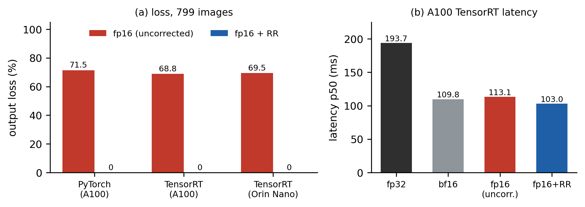

## 5. 자동 구성 도구 결과

Ⅲ장 4절의 자동 구성 도구를 다섯 대상에 적용하였다(<표 13>). 다섯 대상 모두 영역 탐색이 성공하였고 fp32 등가성 기준(코사인 0.99999)을 통과하였으며, 교정 후 fp16 상실이 없었다.
도구가 식별한 기록 층, 입력 정규화, 출력부는 <표 2>와 같고, Gemma 4에서는 표준화 배율을 출력부로 식별하였다. Gemma 4의 나머지 세 조건(31B, 1,120 토큰)에도 같은 위치의 층을 같은 규칙으로 편집하였다. 본 논문의 모든 교정은 이 구성을 사용하였다.

**<표 13>** 자동 구성 도구 결과 (다섯 대상, 진단 집합 100개로 구성, 코사인과 상실은 평가 입력)

| 대상 | 출발점 | 영역 연산 | 기록 층 / eps / 출력부 | 평가 입력 | fp32 코사인 최소 | 교정 후 fp16 상실 |
|---|---|---|---|---|---|---|
| SDXL VAE 디코더 | 10 | 11 | 4 (+편향만 1) / 4 / 없음 | 생성 잠재 100개 | 0.9999999999999997 | 0/100 |
| SDXL VAE 인코더 | 16 | 24 | 6 / 6 / 없음 | COCO val2017 5,000장 | 0.9999999999999996 | 0/5,000 |
| Qwen2.5-VL-3B 비전 인코더 | 2 | 135 | 65 / 65 / 없음 | DriveLM 검증 799장 | 0.9999999999997387 | 0/799 |
| Gemma 4 26B-A4B 비전 인코더 (280 토큰) | 3 | 124 | 매개변수 57 / 54 / 표준화 배율 | DriveLM 검증 799장 | 0.9999999999999386 | 0/799 |
| FLUX.1-schnell 변환기 | 42 | 574 | 116 / 115 / 없음 | PartiPrompts 1~100번 | 0.9999999999999225 | 0/100 |

출발점은 진단이 식별한 목표(32,752) 초과 연산의 수, 영역 연산은 c배가 되는 텐서를 생성하는 연산의 수이다. Gemma 4의 기록 층은 층 단위가 아니라 c배 하는 매개변수 수(패치 입력 투영, 위치 임베딩 표,
사후 정규화 아핀 54개, 표준화 편향)로 적었다.

---

# Ⅵ. 결론

본 논문은 fp16 배포에서 활성이 상한 65,504를 초과하여 출력이 상실되는 문제를 다루었다. 모델을 오버플로가 일어나지 않는 bf16으로 실행해 모든 연산의 크기를
측정하면 오버플로가 일어나는 연산과 그 최댓값을 찾을 수 있다. 무교정 fp16에서는 공식 Qwen2.5-VL-3B[3] 비전 인코더가 799장 중 71.5%,
Gemma 4[6] 비전 인코더의 배포 경로와 SDXL[7] VAE 디코더, 클리핑을 끈 FLUX.1-schnell[8] 변환기가 모든 입력에서 출력을 상실하였다. 측정된 큰 활성은 모두 잔차 흐름, 그 흐름의 기록 층 출력, 또는
출력부 앞의 연산(Gemma 4의 풀링 뒤 스케일 곱)에 있었다.

이 성질을 이용한 잔차 재조정은 잔차 흐름의 기록 층을 c배, 입력 정규화의 eps를 c²배, 출력부를 1/c배 하여 fp32에서 동일한 함수를 유지하면서
잔차 흐름의 크기만 축소한다. c는 평가와 겹치지 않는 진단용 100개의 최댓값으로 정하였고, 모든 대상에서 교정 후 fp16 상실이 0이었다.
기존 처방과 동일한 모델에서 비교하면, SDXL VAE에서 잔차 재조정은 원본 VAE fp32 출력과의 차이가 미세조정본 SDXL-VAE-FP16-Fix[10]보다 작았고
(생성 잠재 PSNR 중앙값 67.2 dB 대 46.1 dB, COCO[11] 재구성에서 인코더와 디코더를 모두 fp16으로 실행한 PSNR 45.1 dB 대 38.2 dB), 원문 조건의
LPIPS·SSIM[12]·MSE는 표기 자릿수에서 원본 VAE fp32와 같았다. FLUX.1-schnell에서 잔차 재조정은 fp16만으로 실행하면서 fp32 출력과의 최종 잠재 상대 오차 중앙값이 0.0602로,
잔차를 fp32로 유지하는 Draw Things[9] 공개 설정(0.306)과 bf16(0.125)보다 작았다. 공식 VLM에서 잔차 재조정은 비전 인코더 출력의 fp32 대비 차이가 bf16의
약 1/3이었고(Qwen 0.0558 대 0.183, Gemma 4 0.0380~0.0433 대 0.119~0.131), Qwen의 생성 답은 fp32 생성과 73.1% 일치하여 bf16(40.9%)보다 높았다. 교정한 Qwen 비전 인코더는
A100의 TensorRT[14] fp16 엔진과 Jetson Orin Nano[13]에서도 799장 모두 출력을 유지하였으며, 무교정 엔진은 각각 68.8%와 69.5%가 출력을 상실하였다.
잔차 재조정이 변경할 층을 연산 그래프에서 탐색하는 자동 구성 도구는 검증한 다섯 대상 모두에서 등가성 기준을 통과하고 fp16 상실을 없애는 교정을 식별하였다.

이 결과에 따른 실무 권고는 다음과 같다. fp16 배포 전에는 평가와 겹치지 않는 배포 해상도의 대표 입력 100개(진단 집합)로 bf16 연산 단위 측정을 실행해 오버플로 지점과 최댓값을 확인한다. 최댓값이 목표(32,752)를 초과하고
대상이 bf16을 지원하지 않거나 fp32 경로를 둘 수 없으면, 오버플로 지점이 잔차 흐름에 있는지 확인하고 최댓값으로 정한 c로 잔차 재조정을 적용한다. 적용한 뒤에는 fp32
등가성과 fp16 오버플로 제거를 확인하고, 배포 런타임에서 같은 입력의 상실을 다시 집계한다. TensorRT 엔진은 빌드마다 커널이 달라질 수 있으므로
상실은 배포할 엔진 자체로 확인한다.

본 연구의 한계는 다음과 같다. 첫째, 잔차 재조정은 잔차 흐름과 그 기록 층 출력, 출력부에 이르기 전까지 흐름에 선형으로 이어지는 연산의 크기만 축소한다. 정규화 뒤 블록 내부(MLP 중간 활성, 어텐션 점수)에서 오버플로가 일어나는 모델은
이 방법으로 교정할 수 없으며, 본 논문의 대상에는 그런 사례가 없었다. 둘째, c는 진단용 100개의 최댓값 M과의 곱이 상한의 절반 이하가 되도록 정하므로(실제 여유 2.2~3.8배), 배포 입력의 활성이 M의 그 배수를
넘으면 오버플로가 일어날 수 있다. 셋째, Draw Things 공개 설정은 공개된 구현 코드의 정밀도 처리를 PyTorch로 옮긴 재현이며 앱 엔진의 커널과 동일한 계산은 아니다. 넷째, 배포 런타임 검증은 Qwen 비전 인코더 하나와 한 해상도(896×1596)에서 하였다.

남은 과제는 정규화 뒤 블록 내부에서 오버플로가 일어나는 모델로 교정 범위를 넓히는 것, 진단 집합의 크기와 목표 여유(2배)를 배포 입력 분포에
부합하도록 정하는 기준을 마련하는 것, 다른 VLM·이미지 생성 모델과 엣지 가속기(DLA[2] 등)에서 검증하는 것이다.

---

# 참고 문헌

[1] D. Kalamkar, D. Mudigere, N. Mellempudi, D. Das, K. Banerjee, S. Avancha, et al., "A Study of BFLOAT16 for Deep Learning Training," arXiv:1905.12322, 2019.
[2] NVIDIA, "DLA Supported Layers and Restrictions," *TensorRT Documentation*, 2026. https://docs.nvidia.com/deeplearning/tensorrt/latest/inference-library/dla-layer-restrictions.html (accessed 2026-10-29)
[3] S. Bai, K. Chen, X. Liu, J. Wang, W. Ge, S. Song, et al., "Qwen2.5-VL Technical Report," arXiv:2502.13923, 2025.
[4] H. Caesar, V. Bankiti, A. H. Lang, S. Vora, V. E. Liong, Q. Xu, et al., "nuScenes: A Multimodal Dataset for Autonomous Driving," in *Proc. CVPR*, 2020. (arXiv:1903.11027)
[5] C. Sima, K. Renz, K. Chitta, L. Chen, H. Zhang, C. Xie, et al., "DriveLM: Driving with Graph Visual Question Answering," in *Proc. ECCV*, 2024. (arXiv:2312.14150)
[6] Gemma Team, S. El Abd, V. Aggarwal, R. Algayres, et al., "Gemma 4 Technical Report," arXiv:2607.02770, 2026.
[7] D. Podell, Z. English, K. Lacey, A. Blattmann, T. Dockhorn, J. Müller, et al., "SDXL: Improving Latent Diffusion Models for High-Resolution Image Synthesis," in *Proc. ICLR*, 2024. (arXiv:2307.01952)
[8] Black Forest Labs, "FLUX.1 [schnell]," *Hugging Face Model Card*, 2024. https://huggingface.co/black-forest-labs/FLUX.1-schnell (accessed 2026-11-06)
[9] Draw Things, "BF16 and Image Generation Models," *Draw Things Engineering Blog*, 2025. https://engineering.drawthings.ai/p/bf16-and-image-generation-models-803cf0515bee (accessed 2026-10-31)
[10] madebyollin, "SDXL-VAE-FP16-Fix," *Hugging Face Model Card*, 2023. https://huggingface.co/madebyollin/sdxl-vae-fp16-fix (accessed 2026-10-31)
[11] T.-Y. Lin, M. Maire, S. Belongie, J. Hays, P. Perona, D. Ramanan, et al., "Microsoft COCO: Common Objects in Context," in *Proc. ECCV*, 2014, pp. 740–755. (arXiv:1405.0312)
[12] Z. Wang, A. C. Bovik, H. R. Sheikh, E. P. Simoncelli, "Image Quality Assessment: From Error Visibility to Structural Similarity," *IEEE Trans. Image Process.*, vol. 13, no. 4, pp. 600–612, Apr. 2004. (doi:10.1109/TIP.2003.819861)
[13] L. S. Karumbunathan, "Solving Entry-Level Edge AI Challenges with NVIDIA Jetson Orin Nano," *NVIDIA Technical Blog*, 2022. https://developer.nvidia.com/blog/solving-entry-level-edge-ai-challenges-with-nvidia-jetson-orin-nano/ (accessed 2026-10-29)
[14] NVIDIA, "NVIDIA TensorRT Documentation," 2026. https://docs.nvidia.com/deeplearning/tensorrt/latest/index.html (accessed 2026-10-30)
[15] P. Micikevicius, S. Narang, J. Alben, G. Diamos, E. Elsen, D. Garcia, et al., "Mixed Precision Training," in *Proc. ICLR*, 2018. (arXiv:1710.03740)
[16] T. Wolf, L. Debut, V. Sanh, J. Chaumond, C. Delangue, A. Moi, et al., "Transformers: State-of-the-Art Natural Language Processing," in *Proc. EMNLP: System Demonstrations*, 2020, pp. 38–45. (arXiv:1910.03771)
[17] M. Sun, X. Chen, J. Z. Kolter, Z. Liu, "Massive Activations in Large Language Models," in *Proc. COLM*, 2024. (arXiv:2402.17762)
[18] L. Chen, H. Tian, X. Chen, R. Kong, F. Wang, J. Chen, et al., "Measuring Maximum Activations in Open Large Language Models," arXiv:2605.15572, 2026.
[19] G. Xiao, J. Lin, M. Seznec, H. Wu, J. Demouth, S. Han, "SmoothQuant: Accurate and Efficient Post-Training Quantization for Large Language Models," in *Proc. ICML*, 2023. (arXiv:2211.10438)
[20] L. Cheng, Q. Liao, F. Wu, J. Mu, T. Han, Z. Qiu, et al., "Online Pseudo-average Shifting Attention (PASA) for Robust Low-precision LLM Inference: Algorithms and Numerical Analysis," arXiv:2503.01873, 2025.
[21] vLLM Project, "[Bug]: Gemma 4 (31B/26B-A4B) vision outputs only \<pad\> under fp16 — vision_tower standardize overflows," *GitHub Issue* #40290, 2026. https://github.com/vllm-project/vllm/issues/40290 (accessed 2026-09-16)
[22] Hugging Face, "Debugging: Underflow and Overflow Detection," *Transformers Documentation*, 2026. https://huggingface.co/docs/transformers/main/en/debugging (accessed 2026-10-31)
[23] NVIDIA, "Work with Reduced Precision," *Polygraphy How-To Guides*, TensorRT 10.9, 2025. https://github.com/NVIDIA/TensorRT/blob/release/10.9/tools/Polygraphy/how-to/work_with_reduced_precision.md (accessed 2026-10-31)
[24] Kubuxu, "Evaluation results," *Hugging Face Discussions (madebyollin/sdxl-vae-fp16-fix #7)*, 2023. https://huggingface.co/madebyollin/sdxl-vae-fp16-fix/discussions/7 (accessed 2026-11-06)
[25] Draw Things, "draw-things-community," *GitHub repository*, Libraries/SwiftDiffusion/Sources/Models/Flux1.swift, commit 060f99d6, 2026. https://github.com/drawthingsai/draw-things-community (accessed 2026-11-06)
[26] T. Qian, J. Chen, L. Zhuo, Y. Jiao, Y.-G. Jiang, "NuScenes-QA: A Multi-Modal Visual Question Answering Benchmark for Autonomous Driving Scenario," in *Proc. AAAI*, vol. 38, no. 5, pp. 4542–4550, 2024. (arXiv:2305.14836)
[27] J. Yu, Y. Xu, J. Y. Koh, T. Luong, G. Baid, Z. Wang, et al., "Scaling Autoregressive Models for Content-Rich Text-to-Image Generation," *Trans. Mach. Learn. Res.*, 2022. (arXiv:2206.10789)
[28] J. L. Ba, J. R. Kiros, G. E. Hinton, "Layer Normalization," arXiv:1607.06450, 2016.
[29] Y. Wu, K. He, "Group Normalization," in *Proc. ECCV*, 2018, pp. 3–19. (arXiv:1803.08494)
[30] B. Zhang, R. Sennrich, "Root Mean Square Layer Normalization," in *Proc. NeurIPS*, 2019. (arXiv:1910.07467)
[31] R. Zhang, P. Isola, A. A. Efros, E. Shechtman, O. Wang, "The Unreasonable Effectiveness of Deep Features as a Perceptual Metric," in *Proc. CVPR*, 2018. (arXiv:1801.03924)

---

# 부록

## A. 측정 환경

측정에 사용한 소프트웨어와 하드웨어는 <부록 표 1>과 같다.

**<부록 표 1>** 측정 환경

| 용도 | 환경 |
|---|---|
| Qwen2.5-VL-3B PyTorch 측정 | Python 3.10, PyTorch 2.3.0+cu121, `transformers` 4.49.0, NVIDIA A100-SXM4-80GB |
| Gemma 4 PyTorch 측정 | PyTorch 2.11.0+cu128, `transformers` 5.20.2, NVIDIA A100-SXM4-80GB |
| SDXL VAE·FLUX.1-schnell 측정 | Python 3.10, PyTorch 2.11.0+cu128, `diffusers` 0.41.0, `transformers` 5.20.2, `lpips` 0.1.4, `scikit-image` 0.25.2, NVIDIA A100-SXM4-80GB |
| TensorRT 측정 (A100) | TensorRT 10.13.3.9 |
| 엣지 보드 | Jetson Orin Nano Super 개발자 키트 8GB, L4T R36.4.7, TensorRT 10.3.0.30, 15W 모드 |

공식 Qwen2.5-VL-3B는 Hugging Face 저장소의 main 판(`66285546`)을 사용하였고, Gemma 4 비전 인코더 가중치는 공식 판과 해시가 일치함을 확인하였다.
원본 SDXL VAE는 `stabilityai/sdxl-vae`의 판 `6f5909a7`, SDXL-VAE-FP16-Fix는 `madebyollin/sdxl-vae-fp16-fix`의 판 `207b116d`,
FLUX.1-schnell은 `black-forest-labs/FLUX.1-schnell`의 판 `741f7c3c`를 사용하였다.

## B. 엣지 보드 측정 절차

입력으로는 A100에서 공식 처리기로 전처리한 텐서(799장, 896×1596)를 ONNX 그래프와 함께 보드로 옮겨, SHA-256 체크섬으로 동일한 파일임을
확인한 뒤 사용하였다. 엔진은 보드에서 TensorRT fp16 엔진으로 빌드하였다. 비전 인코더는 블록 16을 경계로 두 엔진으로 분할하여 빌드하고, 측정
시 두 분할 엔진을 별도 프로세스에서 차례로 실행하였다. 지연은 두 분할 엔진의 합이고, 메모리 정점은 측정 동안 보드 전체 메모리 사용량의
최댓값이다.
