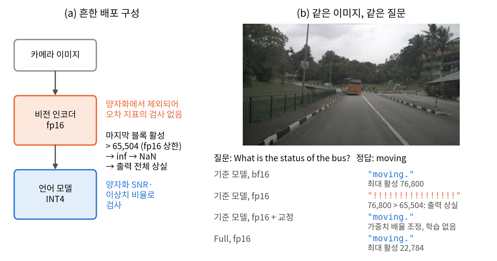
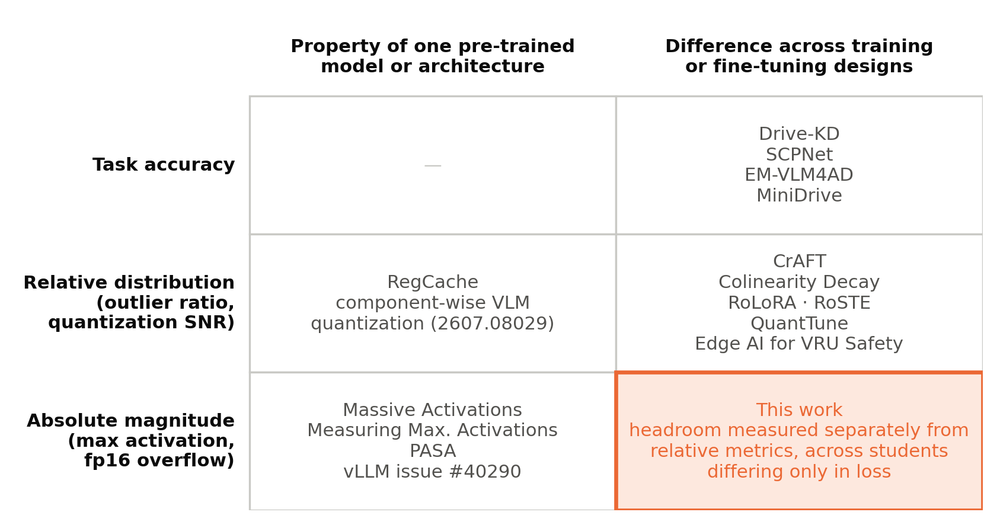

<!-- 자동 생성: scripts/build_thesis.py (2026-10-25). 직접 고치지 말 것 — 장별 초안을 고치고 다시 생성한다. -->

# 비전-언어 모델의 저정밀 배포를 위한 표현 범위 기반 오버플로 진단 및 교정

*Representable-Range-Based Overflow Diagnosis and Correction for Low-Precision Deployment of Vision-Language Models*

석사학위논문 초안 · 합본 생성 2026-10-25 · 학교 양식 적용 전

---

# 차 례

국문 초록
Abstract
표 차례
그림 차례


Ⅰ. 서론
    1. 연구 배경
    2. 논지와 기여
    3. 연구 범위
    4. 논문의 구성


Ⅱ. 관련 연구
    1. 주행 VLM 경량화와 효율화 연구
    2. 저정밀 배포와 활성 이상치
    3. 평가 데이터셋
    4. 선행 연구 공백


Ⅲ. 손실 항별 증류 모델 구성
    1. 증류 파이프라인 구성
    2. 비교 변형과 통제 조건
    3. 평가 프로토콜
    4. 변형별 정확도 비교 결과


Ⅳ. fp16 표현 범위 초과와 출력 상실
    1. 표현 범위 여유의 정의와 측정 규칙
    2. 활성 크기와 출력 상실
    3. 표준 압축 지표와 출력 상실 위험
    4. 오버플로 지점과 곱셈 이전 교정
    5. 여유의 영향 요인


Ⅴ. 출력 상실의 오인과 공개 배포 모델의 위험
    1. INT4 정확도 저하의 원인
    2. 공개 양자화 저장소 조사와 위험 구성
    3. 여유의 사전 예측 가능성


Ⅵ. TensorRT 배포 검증과 엣지 보드 실측
    1. ONNX 내보내기
    2. 정밀도 조건별 측정 프로토콜
    3. TensorRT 측정 결과와 교정 검증
    4. bf16 전환과 지연 비용
    5. Jetson Orin Nano 실측 결과


Ⅶ. 배포 전 진단·교정 도구 headroom_guard
    1. 도구 구성과 설계 판단
    2. 판정 기준의 데이터 기반 설정
    3. 검증과 배포 조건 정확도
    4. 정리


Ⅷ. 종합 논의와 한계
    1. 기여별 근거와 강도
    2. 결과의 일반화 범위
    3. 한계


Ⅸ. 결론
    1. 요약과 기여
    2. 적용 범위와 미해결 문제
    3. 실무 권고
    4. 향후 연구
참고 문헌
부록
    A. 측정 환경
    B. 엣지 보드의 측정 절차
감사의 글

---

# 국문 초록

**비전-언어 모델의 저정밀 배포를 위한 표현 범위 기반 오버플로 진단 및 교정**

비전-언어 모델(VLM)을 엣지 장치에 배포하려면 지식 증류로 모델을 줄이고 반정밀도(fp16)로 연산해야 한다.
그러나 비전 인코더의 활성값이 fp16 상한(65,504)을 넘으면 그 이미지에 대한 출력 전체가 상실되며, 압축 모델의
평가에 쓰이는 과제 정확도와 양자화 오차 지표는 이 위험을 판별하지 못한다. 양자화 오차 지표는 절대 크기를
보지 않는 스케일 불변량이고, 정확도는 오버플로가 일어나지 않는 조건(bf16, 평가 해상도)에서 측정되기 때문이다.

본 논문은 층별 **표현 범위 여유**(형식 최댓값 ÷ 최대 활성 크기)를 정의하고, 형식 상한을 넘는 이미지의 비율로
출력 상실률을 예측하는 진단 지표와, 게이트형 MLP의 곱셈 이전 단계에서 가중치를 축소하는 학습 없는 교정 방법을
제안한다.

Qwen2.5-VL-7B 교사로부터 손실 함수만 달리하여 증류한 3B 학생 모델로 검증하였다. 정확도(50.30~51.69%)로
구별되지 않는 모델들의 여유가 원본 해상도에서 0.88~2.94배로 달랐고, 여유가 1 미만인 모델은 fp16에서 이미지의
96.0%에 대해 출력을 상실하여 정확도가 48.47%(bf16)에서 1.34%로 떨어졌다. 텐서 단위 INT8 양자화 SNR은 이 모델을
상실이 없는 모델보다 오히려 높게 평가하였다(32.28 대 22.78 dB). 제안 지표는 6개 모델의 상실률을 평균 1.1%p의
오차로 예측하였고, 제안 교정은 정확도를 48.76%로 회복하여 bf16 실행과 유의한 차이가 없으면서 fp16 형식을
유지하였다. 같은 상실과 교정 효과는 TensorRT 엔진과 Jetson Orin Nano(메모리가 허락한 해상도)에서도 확인되었다.

이상의 결과는 압축된 VLM을 저정밀로 배포하기 전에 배포 해상도에서 표현 범위 여유를 측정하여 출력 상실 위험을
진단하고 교정해야 함을 보여 준다.

**주요어**: 표현 범위 여유, 수치 오버플로, 저정밀 추론, 가중치 교정, 비전-언어 모델, 자율주행


---

# Abstract

**Representable-Range-Based Overflow Diagnosis and Correction for Low-Precision Deployment of
Vision-Language Models**

Deploying vision-language models (VLMs) on edge devices requires both knowledge distillation and
half-precision (fp16) inference. When an activation in the vision encoder exceeds the fp16 limit
(65,504), the model's entire output for that image is lost, yet the task accuracy and
quantization-error metrics used to evaluate compressed models cannot detect this risk:
quantization-error metrics are scale-invariant and ignore absolute magnitude, and accuracy is
measured under conditions where overflow does not occur (bf16, evaluation resolution).

This thesis defines a per-layer **representable-range headroom** (format maximum ÷ maximum
activation magnitude) and proposes a diagnostic that predicts the collapse rate as the fraction of
images exceeding the format limit, together with a training-free correction that scales the
weights before the multiplication in the gated MLP.

We validated both on 3B students distilled from a Qwen2.5-VL-7B teacher with different loss
functions. Students indistinguishable in accuracy (50.30–51.69%) differ in headroom from 0.88× to
2.94× at native resolution; the student below 1× loses its output on 96.0% of images in fp16, and
its accuracy falls from 48.47% (bf16) to 1.34%. Per-tensor INT8 quantization SNR rates this student
higher than the collapse-free one (32.28 vs. 22.78 dB). The proposed diagnostic predicts the
collapse rate of six models with a mean error of 1.1 percentage points, and the proposed correction
restores accuracy to 48.76%, not significantly different from bf16 execution, while keeping fp16.
The same collapse and correction were confirmed on TensorRT engines and a Jetson Orin Nano (at the
resolutions its memory allows).

These results show that representable-range headroom must be measured at the deployment
resolution to diagnose and correct the collapse risk before deploying compressed VLMs in low
precision.

**Keywords**: representable-range headroom, numerical overflow, low-precision inference, weight
correction, vision-language model, autonomous driving

---

# 표 차례

표 1. 다섯 학생 변형의 손실·가중치·교사 입력
표 2. 변형 간 통제 조건
표 3. 변형별·질문 유형별 NuScenes-QA 검증 정확도
표 4. 측정 형식에 따른 여유와 판정
표 5. 비전 인코더 블록별 최대 활성 크기
표 6. 입력 해상도별 fp16 상실률
표 7. 원본 해상도에서의 모델별 여유와 해석
표 8. 여유·상실률과 표준 압축 지표
표 9. 양자화 검사 대상과 fp16 실행 대상
표 10. 마지막 블록 최댓값의 성분 분해
표 11. 사후 개입 위치에 따른 활성과 상실률
표 12. 정렬 손실 가중치 λ_align에 따른 활성과 여유
표 13. 정렬 대상에 따른 마지막 블록 활성
표 14. 실행 조건에 따른 INT4 정확도
표 15. 공개 양자화 저장소의 설정 패턴
표 16. 위험 구성 공개 저장소의 실측 여유
표 17. 기반 모델과 양자화 파생본의 여유 상속
표 18. Qwen 세대·크기별 여유
표 19. ONNX 내보내기의 제약과 처리
표 20. ONNX 그래프와 대조 결과
표 21. TensorRT 정밀도 조건별 상실률·메모리·지연
표 22. 네 가지 배포 선택지의 비교
표 23. 실행 경로별 상실률과 초과 비율
표 24. Orin Nano 실측 결과
표 25. headroom_guard의 명령
표 26. 초과 비율과 실제 상실률
표 27. 도구의 판정 기준
표 28. 모델 계열별 도구 적용 결과
표 29. λ 스윕 체크포인트의 여유와 실제 상실
표 30. 배포 조건 정확도의 종단 검증
표 31. fp16과 bf16의 짝 정확도 비교
표 32. 기여별 근거와 강도
표 33. 형식과 스케일 방식에 따른 위험의 성격

---

# 그림 차례

그림 1. 문제의 개요
그림 2. 선행 연구의 위치
그림 3. 비전 인코더 블록별 최대 활성의 크기
그림 4. 입력 해상도에 따른 (a) 마지막 블록 활성 크기와 (b) fp16 상실률
그림 5. 마지막 블록 fp16 여유와 INT8 양자화 SNR
그림 6. 정렬 손실 가중치 λ_align에 따른 (a) 블록별 활성 크기와 (b) 마지막 블록 fp16 여유
그림 7. 실행 경로별 fp16 상실률과 엣지 보드 지연
그림 8. 최악 이미지 여유에 따른 판정 기준 보정

---

# Ⅰ. 서론

## 1. 연구 배경

자율주행 인지에 비전-언어 모델(vision-language model, VLM)을 쓰면 장면 이해를 자연어로
설명할 수 있다. 판단의 근거를 사람이 읽을 수 있는 형태로 남긴다는 점은 사고 원인 규명과
운전자·규제 기관의 신뢰 확보에서 기존 인지 모듈이 주지 못하던 이점이다. 그러나 실용
성능을 내는 VLM은 수십억 개의 파라미터를 가지며, 차량에 탑재되는 엣지 가속기의 메모리와
연산 예산은 데이터센터 GPU와 비교할 수 없이 작다.

따라서 탑재까지는 통상 두 단계를 거친다. 지식 증류[1]로 모델 자체를 줄이고, **양자화와
반정밀도(fp16) 연산**으로 계산을 줄인다. 두 단계는 서로 다른 문헌에서 발전해 왔고 평가
방식도 다르다. 증류는 과제 정확도로, 양자화는 이상치 비율(max/rms)이나 양자화
신호대잡음비(SNR) 같은 수치 지표로 평가한다. 각 단계가 자기 지표에서 합격하면 배포 준비가
된 것으로 본다.

fp16의 표현 상한은 65,504다. 같은 16비트인 bf16(bfloat16)은 지수 범위가 fp32와 같아 상한이 약 3.4×10³⁸이다. 어떤 층의 활성값이 이를 넘으면 그 값은 무한대가 되고(fp16
오버플로), 이후 연산에서 NaN으로 번져 그 이미지에 대한 출력 전체가 상실된다. 정확도가
조금 떨어지는 것이 아니라 생성 자체가 실패한다. 이 실패는 **활성값의 절대 크기**에만
달려 있다.

그러나 압축 평가에 쓰이는 지표는 대부분 스케일 불변량이다. 텐서 전체에 상수를 곱해도
이상치 비율은 변하지 않고, 정수 양자화의 SNR도 변하지 않는다.
절대 크기로 결정되는 fp16 초과와 스케일 불변 지표는 수학적으로 직교하며,
한 축으로 다른 축을 판단할 수 없다. 직교성만으로는 두 축이 무관하다는 것까지만 예측된다.
본 논문은 실제 배포 조건에서 **표준 지표가 이 위험을 예고하지 못함**을 보인다.

구체적으로, Qwen2.5-VL-7B[2] 교사를 3B 학생으로 증류하면서 손실 항만 달리한 다섯 학생을
만들었다(Ⅲ장). 그중 특징 정렬 손실을 쓰지 않은 학생은 비전 인코더 마지막 블록의 fp16 여유가
0.88배(원본 해상도, 799장, p50, 크기는 bf16에서 측정. 해상도 정의는 Ⅲ장 3절·Ⅳ장 1절)로 이미 상한을 넘어 원본 해상도에서
96.0%의 이미지가 출력을 상실하고, 정렬 손실을 쓴 학생은 2.94배로 상실이 없다(0.0%). 그러나
같은 두 학생의 INT8 양자화 SNR은 출력을 상실하는 학생이 32.28 dB, 출력을 상실하지 않는 학생이
22.78 dB(원본 해상도)로, 표준 지표로는 출력을 상실하는 모델이 오히려 더 안전한 것으로 평가된다(Ⅳ장).
과제 성능으로 보면 출력을 상실하는 학생은 원본 해상도에서 bf16으로 실행할 때 48.47%이던
정확도가 fp16에서 1.34%로 떨어진다(NuScenes-QA[3] 11,309문항, Ⅶ장).
이 배포 구성과, 같은 이미지·같은 질문에 대한 네 조건의 실제 출력을 [그림 1]에 보인다.



**[그림 1]** 문제의 개요. (a) 흔한 배포 구성에서 언어 모델은 INT4로 양자화되어 양자화 SNR·이상치 비율로 검사받지만, 비전 인코더는 양자화에서 제외되어 fp16으로 실행되고 그 검사를 받지 않는다. 비전 인코더 마지막 블록 MLP의 활성이 fp16 상한(65,504)을 넘으면 무한대와 NaN이 되어 그 이미지에 대한 출력 전체가 상실된다. (b) 같은 이미지(DriveLM 검증 키프레임 전방 카메라, 원본 해상도)와 같은 질문에 대한 네 조건의 실제 출력. 기준 모델(Task only)은 bf16에서 정답을 내지만, 마지막 블록 최대 활성이 76,800으로 상한을 넘어 fp16에서는 토큰 0(`!`)만 반복한다. 곱셈 이전 교정을 적용한 기준 모델과, 정렬 손실로 학습해 최대 활성이 22,784인 Full은 fp16에서도 정답을 낸다. 크기는 bf16에서 측정하였다.

## 2. 논지와 기여

저정밀 배포를 다루는 기존 연구는 크게 두 갈래다. 양자화 연구는 활성 이상치를 줄이거나 우회해
양자화 오차를 낮추는 방법을 제안하고, 그 효과를 양자화 SNR과 이상치 비율로 평가한다(Ⅱ장 2절).
반정밀도 수치 안정성 연구는 언어 모델의 어텐션처럼 특정 연산의 오버플로를 알고리즘으로
완화한다(Ⅱ장 2절). 증류 연구는 압축된 모델의 품질을 과제 정확도로 보고한다(Ⅱ장 1절).

그러나 이 평가 체계는 활성값의 절대 크기가 fp16 상한을 넘어 출력이 상실되는지를 판별하지
못한다. 이유는 세 가지이다. 첫째, 양자화 오차 지표는 텐서 내 값의 상대적 분포만을 반영하는 스케일
불변량이어서 절대 크기를 보지 않는다. 둘째, 증류 연구의 정확도는 평가 해상도와 bf16 형식, 즉
오버플로가 일어나지 않는 조건에서 측정된다. 셋째, 실무에서는 언어 모델을 INT4로 양자화하면서 비전
인코더는 양자화 대상에서 제외해 fp16으로 실행하므로(Ⅴ장 2절), 양자화 오차 평가는
정작 fp16으로 실행되는 비전 인코더에 적용되지 않는다. 결과적으로 압축된 VLM이 fp16 배포에서
출력을 상실할지를 **배포 전에 판별하는 기준이 없다**(Ⅱ장 4절).

이 문제를 해결하기 위해 본 논문은 두 가지를 제안한다.

첫째는 **표현 범위 여유 기반 진단 지표**이다. 층별 표현 범위 여유 `format_max ÷ max|activation|`을
오버플로가 일어나지 않는 형식(bf16)에서 측정하고, 배포 형식의 상한을 넘는 이미지의 비율로
출력 상실률을 예측한다. 계산 비용은 순전파 한 번이다(Ⅳ장 1절, Ⅶ장 2절).

둘째는 **곱셈 이전 가중치 교정**이다. 오버플로가 비전 인코더 마지막 블록 MLP의 출력 투영 안에서 일어남을
규명하고, 그 입력이 만들어지는 게이트형 MLP의 곱셈 이전 단계에서 가중치를 축소하여 학습 없이
출력 상실을 제거한다(Ⅳ장 4절). 오버플로가 일어나는 연산 앞에서 줄인다는 같은 원리를
블록 뒤 연산(pooler·표준화)에서 오버플로가 일어나는 두 번째 계열인 Gemma 4(이하 「두 번째 구조」)에 적용하면, 잔차 흐름을
재조정하는 가중치 편집으로 출력을 바꾸지 않고 상실을 제거한다(Ⅴ장 3절).

두 방법을 배포 전 진단·교정 도구 `headroom_guard`로 구현하고(Ⅶ장), 비전 인코더를 고정 형상 ONNX로
내보내 TensorRT 엔진과 엣지 보드에서 검증하는 절차를 함께 제시한다(Ⅵ장).

본 논문의 기여는 다음 네 가지이다.

1. 표준 압축 지표가 fp16 출력 상실 위험을 예고하지 못함을 손실 항만 다른 통제 비교로 보이고, 그
   원인이 지표의 스케일 불변성과 검사 대상·실행 형식의 불일치에 있음을 규명하였다(Ⅳ장).
2. 출력 상실을 예측하는 표현 범위 여유 기반 진단 지표를 제안하고 6개 모델에서 검증하였다(Ⅳ장·Ⅶ장).
3. 학습 없는 곱셈 이전 가중치 교정을 제안하고, PyTorch·TensorRT·엣지 보드에서 출력 상실 제거를,
   PyTorch 배포 조건에서 정확도 회복을 확인하였다(Ⅳ장·Ⅵ장·Ⅶ장). 같은 원리가 구조가 다른 두 번째 계열(Gemma 4의 블록 뒤 연산)에서도
   가중치 편집만으로 작동함을 확인하였다(Ⅴ장 3절).
4. 특징 정렬 손실의 가중치를 높이면 여유가 1.79배에서 4.61배로 커짐을 보여(평가 해상도), 증류
   설계 단계에서도 위험을 줄일 수 있음을 확인하였다(Ⅳ장 5절).

지식 증류는 새로운 증류 방법으로서가 아니라, **손실 항만 다른 다섯 학생이라는 통제 실험 기반**으로
쓰였다(Ⅲ장).

## 3. 연구 범위

본 연구의 대상은 Qwen2.5-VL-7B 교사에서 증류한 Qwen2.5-VL-3B 학생 다섯 가지이며, 학생들은 손실 함수만 다르다(Ⅲ장).
배포 형식은 fp16을 중심으로 bf16·fp32와 비교하고, 기존 지표인 INT8 양자화 오차와 공개 INT4 배포본을 함께 다룬다.
평가 데이터는 nuScenes[4] 기반 DriveLM[5]·NuScenes-QA 검증 분할 전부(799장·11,309문항)와, 도메인이 다른 CODA-LM[6] 143장이다.
실행 환경은 PyTorch, A100의 TensorRT, 엣지 보드 Jetson Orin Nano[7] 8GB이다. 오버플로 지점이 다른 두 번째 구조로 Gemma 4를,
형식 범위의 경계를 확인하는 대상으로 언어 모델 백본을 함께 측정한다. 결과의 일반성과 한계는 Ⅷ장에서 다룬다.

## 4. 논문의 구성

Ⅱ장은 선행 연구를 주행 VLM 경량화와 저정밀 배포의 두 계열로 정리하고, 평가 데이터셋과 선행 연구 공백을
밝힌다. Ⅲ장은 논지를 검증하기 위한 실험 기반(손실 항만 다른 다섯 학생)을 만들고, 출력 증류를 뺀 네 학생이
**정확도로는 구별되지 않음**을 먼저 인정한다. Ⅳ장은 정확도가 보지 못하는 차이, 즉 fp16 표현 범위 초과와 그 앞에서
표준 지표가 뒤집히는 현상을 측정하고, 오버플로 지점을 특정해 곱셈 이전 교정을 제안하며, 여유를
움직이는 수단들을 보인다. Ⅴ장은 그 실패가 이산적이어서 집계 지표(양자화 정확도 표, 공개
저장소에 선언된 설정)가 위험을 판별하지 못함을 보이고, 공개 양자화 모델에서 같은 조건이 얼마나
흔한지 조사한다. Ⅵ장은 배포 검증 절차와 런타임·실기기(엣지 보드, 그래프에 적힌 자료형대로 빌드하는 강타입 엔진)에서의 확인을,
Ⅶ장은 진단·교정 도구와 그 종단 검증(배포 조건 정확도, 생성 단위의 이산성 확인)을 다룬다. Ⅷ장은
결과를 종합하고 한계를 정리하며, Ⅸ장에서 결론을 맺는다.

---

# Ⅱ. 관련 연구

## 1. 주행 VLM 경량화와 효율화 연구

중간층 특징을 학습 가능한 사상(projection)과 함께 정합시키는 설계는
FitNets[8] 이래 확립된 방법이다. 본 연구의 정렬 손실 `L_align`도 이 계열에 속하며, 그 구조를
새로운 기여로 주장하지 않는다.

Drive-KD[9]는 두 교사–학생 조합(InternVL3-8B[10] → 1B,
Qwen2.5-VL-7B[2] → 3B) 가운데 하나로 본 연구와 같은 조합을 쓰며, 층별 어텐션 신호(주로 텍스트에서
비전으로의 어텐션)를 증류한다. 배포 정밀도는 다루지 않는다. EM-VLM4AD[11]는 DriveLM[5]으로 학습한 경량 주행 VQA 모델로, 코드와 가중치가 공개되어
있어 본 연구에서 참조 비교에 사용하였다(Ⅲ장 4절). MiniDrive[12]는 코드와 가중치가
공개되지 않아 인용으로만 비교한다.

SCPNet[13]은 멀티프레임 교사의 시간 지식을 단일프레임 학생에 증류해, 배포 시 추론 비용을 늘리지 않으면서
시간 정보를 전이하는 구조를 자율주행에서 이미 제시하였다. 본 연구의 시간 맥락 손실 `L_atc`는
그 구조를 LiDAR 기반 시맨틱 장면 완성에서 **카메라 기반 생성형 VQA**로 옮긴 것이며,
참신성을 주장하지 않는다.

이 계열은 증류의 결과를 정확도로 평가한다. 본 연구는 같은 증류
설계가 학생 비전 인코더의 **활성 크기**를 부수적으로 바꾸며, 그 크기가 저정밀 배포의
성패를 가른다는 점을 다룬다.

최근 서베이들은 주행용 VLM·VLA의 효율화를 주요 과제로 다룬다. 「A Survey on Vision-Language-Action
Models for Autonomous Driving」[14]은 모델이 수십억 파라미터로 커질수록 증류나 MoE
희소화가 필요해질 것이라 본다. 「Vision-Language-Action Models for Autonomous Driving: Past, Present,
and Future」[15]는 모델 구조와 시스템 효율 절에서 지연과 연산 부담을 과제로 든다.
「A Survey on Efficient Vision-Language-Action Models」[16]는 구조적 희소화와 행동
표현의 충실도 사이에 절충이 있어 과도한 가지치기와 저비트 양자화가 행동 충실도를 해칠 수 있다고
지적한다. 「Rethinking Language's Role in Efficient VLA for Autonomous Vehicles」[17]는
효율–안전 프론티어가 정량화되어 있지 않고, 효율 지표와 주행 성능 지표가 같은 논문에 함께
등장하는 일이 드물다고 지적한다.

본 논문은 이 공백 중 좁은 한 자리, 즉 **저정밀 연산이 출력 상실을
일으키는지를 배포 전에 판단하는 값**을 채운다. 효율–안전 프론티어 전체를 다루지 않는다.

## 2. 저정밀 배포와 활성 이상치

미세조정 방식이 사후 압축의 성패에 영향을 준다는 점은
CrAFT[18]가 sharpness 최소화 목적함수로 이미 보였다. 학습·미세조정 단계에서
활성 이상치를 다루는 방법들도 제안되어 왔다. 가중치 행렬 사이의 구조적 증폭을 제어해 극단적
활성을 완화하는 Colinearity Decay[19], 회전으로 이상치를 제거한 뒤 미세조정하는
RoLoRA[20]와 RoSTE[21], 문제 활성의 동적 범위를 제한하는
QuantTune[22]이 그 예이다.
이들은 모두 **양자화 친화성을 목적으로 설계한 기법**이며, 대상은 영상 분류용 ViT 또는 언어
모델이다.

트랜스포머의 특정 채널에 매우 큰 활성이 나타나는 현상은 Massive Activations[23]와 후속 연구들이 보고해 왔고, 암묵적 편향으로 기능한다는 해석이 제시되었다.
모델 계열에 따라 최대 활성이 네 자릿수까지 차이 난다는 측정도 있다(Measuring Maximum
Activations[24]). 그러나 이들 연구는 활성 크기를 아키텍처와 사전학습의 산물로
다루며, **같은 아키텍처를 서로 다른 목적함수로 미세조정하였을 때 크기가 달라지는지는 측정하지
않았다.** 비전 인코더에서는 RegCache[25]가 대규모 사전학습 비전 인코더의
이상치를 학습 없이 완화하는 활성 양자화 방법을 제안하였지만, 서로 다르게 미세조정한 체크포인트를
비교하지는 않는다. 소형 VLM을 비전 인코더·프로젝터·언어 모델로 나눠 양자화하고 Jetson Orin
NX·AGX에서 평가한 연구[26]는 구성 요소별 양자화 오차와 지연을 분리해 보였다.
본 연구가 보는 것은 그와 달리 양자화에서 제외되어 반정밀도로 남는 비전 인코더다.

fp16 추론에서의 수치 오버플로 자체는 알려진 문제다. PASA[27]는 어텐션 입력의 큰 진폭을 원인으로 지목하고 알고리즘적 완화를 제안하였다. vLLM
이슈 #40290[28]은 Gemma 4 비전 인코더를 fp16으로 실행하면 모든 이미지의 출력이 상실되는 현상을
보고하였으며, 이는 본 연구와 같은 기전이다. 이슈는 SigLIP 표준화 `(h − std_bias) × std_scale`를
오버플로 지점으로 지목하였으나, 본 연구의 측정에서는 그 앞 pooler의 `× √1152`에서 처음 상한을
넘었다(Ⅴ장 3절). 기준 구현은 이 연산들을 fp32로 승격하여 계산함으로써 오버플로를 방지한다. 이
사례는 **개입 위치가 성패를 가른다**는 본 연구의 관찰(Ⅳ장)과 처방 구조까지 같다. 다만 두 사례
모두 한 모델의 사전학습이 만든 성질을 다룬다.

자동차 영역에서는 증류한 소형 모델이 교사보다 INT8 양자화에
강건하다는 관측이 있다(Edge AI for VRU Safety[29]). 다만 손실 종류를 통제
비교하지 않았고 메커니즘을 제시하지 않았으며, 과제는 객체 검출이다.

이 계열의 지표는 대부분 이상치 비율(동적 범위)을 본다. 본 연구는
절대 크기(표현 범위 여유)를 동적 범위와 분리해 측정하고, 두 축이 같은 모델에서 반대 방향을
가리킬 수 있음을 보인다. 또 차이가 한 모델의 사전학습 가중치가 아니라 **같은 기반 모델을 다른
손실로 학습한 결과**에서 생긴다는 점(두 체크포인트 중 하나만 출력을 상실한다는 점)에서
구별된다. 오버플로 현상 자체의 선례는 인정한다.

## 3. 평가 데이터셋

**DriveLM**(nuScenes[4] 기반)은 장면별 키프레임에 인지·예측·계획·행동 네 과제의 질의응답을
붙인 데이터셋으로, 본 연구의 학습 데이터이자 활성 측정 이미지의 출처다. 공개된 검증 분할
(`v1_1_val_nus_q_only.json`, 149개 장면·799개 키프레임)은 **정답이 비어 있고**, 정답 채점
경로였던 공식 리더보드는 CVPR 2024 챌린지와 함께 종료되었다. 따라서 정확도 평가에는 사용할 수 없다.

**NuScenes-QA[3]**는 nuScenes 장면에 대한 짧은 답의 질의응답으로, 검증 분할에 정답이 있다.
본 연구는 그 가운데 DriveLM 검증 키프레임과 표본 토큰이 일치하는 11,309문항을 주 정확도
평가에 쓴다(Ⅲ장 3절). DriveLM 검증 장면은 학습에 쓴 696개 장면과 겹치지 않으므로 장면 단위로
분리된 평가다.

**CODA-LM[6]**은 자율주행 코너 케이스 VQA로, 본 연구에서는 활성 크기의 도메인 일반성을 확인하는
보조 축으로 쓴다. CODA[30] 자체는 이미지의 약 9%를 nuScenes에서 가져왔으므로 완전히 독립된
도메인은 아니다. 본 연구가 확인한 것은 사용한 143장이 **본 연구의 학습 이미지와 겹치지 않는다**는
것(이미지 해시 대조)이며, 두 데이터셋의 독립성이 아니다.

## 4. 선행 연구 공백

본 연구가 조사한 범위(위 문헌들, arXiv 전문 검색, 공개 양자화 저장소 197개의 config)에서
다음 두 가지를 함께 다룬 연구를 찾지 못하였다.

하나는 절대 크기(표현 범위 여유)와 동적 범위(이상치 비율·양자화 SNR)를 **같은 모델에서 분리해
측정하고** 두 축의 순위가 뒤집힘을 보인 연구이다. 다른 하나는 그 절대 크기가 학습 설계에 따라 달라지고,
생성형 주행 VLM에서 출력 전면 상실로 이어짐을 이미지 단위로 정량화한 연구이다.
Ⅱ장 1절과 Ⅱ장 2절의 선행 연구를 평가 대상과 비교 축으로 정리하고 이 공백의 위치를 [그림 2]에 보인다.



**[그림 2]** 선행 연구의 위치. 행은 압축 모델을 무엇으로 평가하는지(과제 정확도, 상대 분포, 절대 크기), 열은 한 사전학습 모델·아키텍처의 성질을 보는지 학습·미세조정 설계에 따른 차이를 보는지를 나타낸다. 각 칸에는 Ⅱ장 1절과 Ⅱ장 2절에서 다룬 연구를 두었다. 절대 크기를 학습 설계 사이에서 비교한 연구는 찾지 못하였으며(강조한 칸), 본 연구는 손실 항만 다른 학생들에서 표현 범위 여유를 상대 분포 지표와 분리해 측정한다.

이 부재는 조사 범위 안의 진술이다. 검색어 몇 개의 부재가 문헌 전체의 부재를 뜻하지는 않는다.

---

# Ⅲ. 손실 항별 증류 모델 구성

**이 장은 기여 장이 아니다.** Ⅰ장의 논지를 검증하려면 **손실 항만 다르고 나머지는 모두 같은
학생들**이 필요하다. 이 장은 그것을 만들고, 통제가 실제로 지켜졌음을 학습 기록으로 확인하며,
출력 증류를 뺀 네 학생이 정확도로는 서로 구별되지 않는다는 점을 먼저 인정한다. 뒤의 네 장은 정확도가
포착하지 못하는 차이가 있다는 점에서 출발한다.

## 1. 증류 파이프라인 구성

**교사**는 Qwen2.5-VL-7B-Instruct[2]를 LoRA[31]로 미세조정한 모델이다(rank 16, alpha 32, dropout
0.05, 학습 가능 파라미터 47,589,376개). **학생**은 Qwen2.5-VL-3B-Instruct이며, 다섯 변형 모두
같은 LoRA 구성(rank 16, alpha 32, dropout 0.05)을 쓴다. 대상 모듈은 언어 디코더의
`q/k/v/o_proj`와 `gate/up/down_proj`에 더해 비전 인코더의 어텐션(`qkv`, `proj`)까지다.
Qwen2.5-VL 비전 인코더의 MLP도 `gate/up/down_proj`라는 같은 이름을 쓰므로, 비전 MLP는
이름이 겹쳐 함께 적응된다. 그 결과 학생의 학습 가능 파라미터는 다섯 변형 모두
41,124,224개(전체 3,795,747,200개의 1.08%)로 같다.

두 모델 모두 전체 미세조정이 아니라 LoRA 어댑터만 학습하며, 체크포인트는 어댑터와 학습
상태만 저장한다. 교사와 학생의 비전 인코더는 구조가 같다(깊이 32, 은닉 크기 1,280).

학습 데이터는 두 출처를 합친다.

**DriveLM[5]**(nuScenes[4] 학습 분할)은 696개 장면, 4,072개 키프레임에서 네 과제의 질의응답
377,983개를 제공한다. 각 (키프레임, 과제, 질문) 조합이 한 표본이다.

**NuScenes-QA[3]**(학습 분할)에서는 전체 376,604문항 중 DriveLM 키프레임과 표본 토큰이 일치해
이미지를 붙일 수 있는 54,607문항을 쓴다. NuScenes-QA는 자체 이미지 경로가 없으므로 DriveLM
키프레임을 통해서만 이미지를 얻는다.

두 출처는 크기가 크게 다르므로, 가중 무작위 표본기로 배치 안 비율을 DriveLM 40% ·
NuScenes-QA 60%로 고정한다. 입력 이미지는 전방 카메라(CAM_FRONT) 한 장이다. 질문과 답을
한 시퀀스로 토큰화하고, 답 앞부분의 레이블은 가려 답 토큰에만 과제 손실을 적용한다.

DriveLM 안에서는 장면 위험도 점수(교사가 1~5로 매긴 값)에 따라 표본 확률을 조정한다
(드문 점수를 대략 `(n/count)^0.5`로 더 많이 추출하되 40:60 비율은 유지). 이것은 **데이터 분포만
바꾸는 설정**이며 어떤 손실에도 들어가지 않는다. 다섯 변형 모두에 같은 값으로 적용되어 있어,
변형들은 같은 데이터 분포를 본다.

학생의 손실은 다음 형태다.

```
L_total = L_task + λ_align · L_align + λ_atc · L_atc        (증류 변형)
L_total = L_task + λ_kd · L_kd                              (출력 증류 변형)
L_total = L_task                                            (기준 모델)
```

**`L_task`**는 학생 자신의 답 토큰 교차 엔트로피이며, 모든 변형에 들어간다.

**`L_align`(특징 정렬)**은 교사와 학생 비전 인코더의 24번째 블록(인덱스 23, 32개 중)
출력을 패치 단위로 맞춘다. 학생 패치를 학습 가능한 선형 사상(1,280→1,280)에 통과시킨 뒤
교사 패치와의 코사인 거리 `1 − cos`를 평균한다. 교사가 여러 프레임을 볼 때는 **현재 프레임의
패치만** 잘라 비교한다. 두 모델의 특징 공간은 구조가 같아도 정합되어 있지 않으므로 사상을 둔다.

**`L_atc`(비대칭 시간 맥락)**에서 교사는 현재 프레임과 직전 키프레임, 모두 **두 장**을 보고
학생은 현재 프레임 한 장만 본다. 답 생성 직전 위치에서 두 모델의 마지막 디코더 은닉 상태를
비교하되, 학생의 은닉 상태를 학습 가능한 선형 사상(2,048→3,584)으로 교사 차원에 맞춘 뒤 코사인 거리를
쓴다. 학생의 추론 비용은 늘지 않는다. DriveLM 키프레임은 평균 약 3.1초 간격이며, 프레임
순서는 파일명의 시각 정보로 정렬한다.

**`L_kd`(출력 증류)**는 답 토큰 위치에서 교사와 학생의 다음 토큰 분포 사이 KL 발산을
온도 T로 계산하고 T²를 곱한다. 두 모델의 어휘 크기가 달라(151,936 대 152,064) 작은 어휘에
맞춰 자른다. 온도는 T = 1.5다. 관행적 값 T = 4는 약 15만 개 어휘 전체에 확률을 분산시켜
교사의 종료 토큰 신호를 지운다.

두 사상(`L_align`·`L_atc`의 선형 층)은 학습에만 쓰이고 추론 시에는 제거된다. 따라서 추론
시점의 학생은 다섯 변형 모두 **같은 구조**다.

## 2. 비교 변형과 통제 조건

다섯 학생의 손실 구성과 교사 입력은 [표 1]에 정리하였다.


| 변형 | 체크포인트 | 손실 | λ | 교사 입력 |
|---|---|---|---|---|
| Full | `student_full` | `L_task + L_align + L_atc` | 1.0 · 1.0 | 2프레임 |
| Task + L_align | `student_spatial` | `L_task + L_align` | 1.0 · 0 | 1프레임 |
| Task + L_atc | `student_temporal` | `L_task + L_atc` | 0 · 1.0 | 2프레임 |
| Task only | `student_baseline_v2` | `L_task` | — | 교사 없음 |
| Task + out.KD | `student_kd_only_v4` | `L_task + L_kd` | λ_kd 1.0, T 1.5 | 1프레임 |

**[표 1]** 다섯 학생 변형의 손실·가중치·교사 입력

표와 그림의 변형 이름은 손실 구성을 그대로 쓴다. 본문 서술에서는 각각 **Full · 정렬만 ·
시간만 · 기준 모델 · 출력 증류**로 줄여 부르고, 미세조정하지 않은 사전학습 모델은 Pre-trained
(사전학습)로 적는다.

학생의 사전학습 모델, LoRA 구성과 대상 모듈, 학습률 2×10⁻⁵, 워밍업 비율 0.05,
유효 배치 16, 에폭 1, 데이터와 표본기 설정, 평가 프로토콜을 다섯 변형에서 동일하게 고정하였다.

**통제를 학습 기록으로 확인하였다.** 설정 파일이 아니라 **실제로 실행된 학습의 로그와 체크포인트**를
대조하였다([표 2]).

| 항목 | Full | Task + L_align | Task + L_atc | Task only | Task + out.KD |
|---|---|---|---|---|---|
| 학습 가능 파라미터 | 41,124,224 | 41,124,224 | 41,124,224 | 41,124,224 | 41,124,224 |
| DriveLM 표본 | 377,983 | 377,983 | 377,983 | 377,983 | 377,983 |
| NuScenes-QA 표본 | 54,607 | 54,607 | 54,607 | 54,607 | 54,607 |
| 최적화 스텝 | 27,037 | 27,037 | 27,037 | 27,037 | 27,037 |
| 워밍업 스텝 | 1,351 | 1,351 | 1,351 | 1,351 | 1,351 |
| 마이크로 배치 × 누적 | 2 × 8 | 2 × 8 | 2 × 8 | **4 × 4** | 2 × 8 |
| 시드 | 고정 안 함 | 〃 | 〃 | 〃 | 〃 |

**[표 2]** 변형 간 통제 조건

(표본 합 432,590 ÷ 유효 배치 16 = 27,036.9 → 27,037스텝, 즉 한 에폭)

**다른 것은 두 가지이다.**

첫째, 기준 모델의 마이크로 배치가 4 × 4다. 교사를 적재하지 않아 메모리가 남으므로 마이크로 배치를
키웠다. 유효 배치(16)와 스텝 수는 같고, 모델에 배치 정규화가 없으므로 한 번의 갱신이 보는
기울기는 부동소수점 누적 순서를 제외하면 같다.

둘째, 손실 항과 그에 딸린 것(교사의 유무와 입력 프레임 수, λ 값)이 다르다. 이것은 통제 실패가 아니라
이 비교가 측정하려는 변인 자체다.

기준 모델에는 비교 조건 v1(비전 어텐션 LoRA와 위험도 기반 표본 조정이 모두 없는 설정)을 따로 두었다.
v1과 다섯 변형의 설정(v2)은 **비전 어텐션 LoRA와 위험도 기반 표본 조정 두 가지가 함께
다르므로**, v1 대 v2 비교를 LoRA 용량 하나의 효과로 해석하지 않는다. 다섯 변형 비교는
모두 v2 설정이다.

## 3. 평가 프로토콜

정확도는 NuScenes-QA 검증 분할 83,337문항 가운데 DriveLM 검증 키프레임(149개 장면, 799개
키프레임)과 표본 토큰이 일치하는 11,309문항에서 정확 일치로 측정한다. 답은 정규화(소문자화
등) 후 비교한다. 문항은 존재(exist) 3,308 · 개수(count) 2,212 · 대상(object)
2,359 · 비교(comparison) 1,780 · 상태(status) 1,650의 다섯 유형으로 나뉜다.

평가 조건은 다섯 변형 모두 같다. 처리기는 항상 사전학습 모델에서 만들어 평가 해상도(`max_pixels`
200,704, `min_pixels` 50,176)를 고정하고, LoRA 경로의 연산 dtype은 bf16이다. 탐욕 디코딩으로
최대 16토큰을 생성한다. Ⅳ장 이후의 원본 해상도(`max_pixels` 1,440,000) 측정과 구별해야 한다.
표현 범위 초과는 해상도가 높을수록 심해지므로, 해상도 조건 없이 수치를 옮기면 잘못된 비교가
된다. 원본 해상도 조건의 정확도도 부분집합이 아니라 같은 11,309문항 전부에서 측정한다(Ⅳ장 1절
표본 규칙).

## 4. 변형별 정확도 비교 결과


| 변형 | 전체 | 비교 | 개수 | 존재 | 대상 | 상태 |
|---|---|---|---|---|---|---|
| Full | 51.69% (5,846) | 64.72% | 7.46% | 80.17% | 43.87% | 51.03% |
| Task + L_align | 51.40% (5,813) | 63.09% | 10.58% | 81.38% | 37.86% | 52.79% |
| Task + L_atc | 51.34% (5,806) | 64.44% | 7.73% | 81.17% | 39.89% | 52.24% |
| Task only | 50.30% (5,688) | 64.49% | 7.96% | 80.26% | 36.67% | 51.15% |
| Task + out.KD | 46.74% (5,286) | 63.88% | 10.40% | 67.68% | 35.48% | 51.09% |

**[표 3]** 변형별·질문 유형별 NuScenes-QA 검증 정확도

(NuScenes-QA 검증 11,309문항, 평가 해상도, bf16, 각 변형 1회 학습. 괄호는 정답 수)

[표 3]의 결과는 다음과 같이 해석한다.

**Full · 정렬만 · 시간만은 전체 정확도에서 구별되지 않는다.** 세 값의 폭은 0.35%p이고,
각 변형을 시드 고정 없이 한 번씩 학습하였으므로 이 차이는 시드 잡음과 구별할 수 없다.
"Full이 단일 손실 변형보다 낫다"고 주장하지 않는다.

**증류하지 않은 기준 모델도 크게 뒤지지 않는다.** 특징 증류 세 변형과의 차이는 1.4%p 이내다.
특징 증류의 정확도 이득은 있더라도 작다.

**대상(object) 유형의 차이는 방향성 관찰로만 적는다.** Full이 43.87%로 나머지(35.48~39.89%)
보다 폭이 크고, 그 방향은 패치 단위 정렬이라는 `L_align`의 목적과 맞는다. 그러나 이것도
한 번의 학습에서 나온 값이라 구간을 붙일 수 없으며, 순위 주장으로 해석하지 않는다.

**출력 증류는 존재(exist) 유형에서 뚜렷이 낮다**(67.68% 대 나머지 80.17~81.38%).

**개수(count)는 다섯 변형 모두 7~11%로 낮다.** 이 규모와 데이터에서 정확한 개수 집계는
손실 설계로 개선되지 않는 제약으로 보인다.

참고로, 같은 11,309문항에서 EM-VLM4AD[11](T5-Base 계열)를 같은 NuScenes-QA 학습 분할로
미세조정하고 입력 조건(전방 카메라 한 장, 최대 16토큰)을 맞춰 평가하면 54.08%다. 이 값은
본 연구 파이프라인의 통제된 변형이 아니라 **모델 계열이 다른 참조점**이므로 [표 3]에 넣지
않는다. 본 연구의 기여는 정확도 경쟁이 아니며, 다섯 변형의 내부 비교는 이 값과 무관하다.

다섯 학생은 같은 데이터, 같은 LoRA 구성, 같은 스텝으로 학습되었고, 출력 증류를 뺀 네 학생은 정확도로는 사실상
구별되지 않는다. 그러나 그 가운데 하나는 fp16으로 배포하는 순간 원본 해상도에서 **대부분의 이미지에
대해 출력을 상실한다.** 정확도 표는 그것을 보여 주지 않고, 다음 장에서 보이듯 양자화 지표도
그것을 예고하지 못한다. Ⅳ장은 이 차이를 비전 인코더의 활성 크기에서 측정하는 데서 시작한다.

---

# Ⅳ. fp16 표현 범위 초과와 출력 상실

Ⅲ장에서 출력 증류를 뺀 네 학생은 정확도로 구별되지 않았다. 이 장은 같은 학생들이 **비전 인코더의 활성
크기**에서는 수십 배 차이가 나며, 그 차이가 fp16 배포에서 이미지 단위의 출력 상실로 이어지고,
표준 압축 지표는 그것을 예고하지 못한다는 것을 보인다. 이어 오버플로 지점을 특정하고,
여유에 영향을 주는 요인이 여럿임을 보인다.

## 1. 표현 범위 여유의 정의와 측정 규칙

층 ℓ의 출력에 대해 여유를 다음으로 정의한다.

> **여유(ℓ) = format_max ÷ max|activation(ℓ)|**

fp16에서 format_max = 65,504다. 여유가 1에 가까우면 그 층은 표현 상한에 근접해 있고, 1 미만이면
이미 넘었다. 이미지마다 최대 절댓값을 구한 뒤 이미지들에 대한 **중앙값(p50)**과 최악값을
통계량으로 쓴다. 계산 비용은 순전파 한 번이다.

**측정 형식을 나눈다 — 크기는 bf16에서, 상실은 fp16에서.** 측정하려는 값이 이미 fp16을
넘기 때문에 fp16에서 크기를 측정해서는 안 된다. 기준 모델을 원본 해상도에서 fp16으로 측정하면 799장 중
32장만 유한하고, 살아남은 32장의 중앙값은 64,000이고 여유는 1.02배로 「안전」해 보인다([표 4]).


| 측정 형식 | 유한 표본 | 활성 중앙값 | 여유 | 판정 |
|---|---|---|---|---|
| **bf16 (참값)** | **799/799** | **74,752** | **0.88배** | 위험 |
| fp16 | 32/799 | 64,000 | 1.02배 | 「안전」(틀림) |

**[표 4]** 측정 형식에 따른 여유와 판정

(Task only 학생, 원본 해상도, 마지막 블록, 799장. fp16 활성 중앙값은 유한한 32장의 중앙값으로, 가운데 두 값의 평균이다)

상한을 넘은 표본이 측정에서 탈락하고 넘지 않은 표본만 남아 중앙값을 끌어내리는 생존 편향이다.
bf16은 상한이 약 3.4×10³⁸이라 이 크기에서도 오버플로가 일어나지 않으므로 참값을 준다. 따라서 본 논문의
모든 활성 크기는 bf16에서 측정하고, 상실 여부만 목표 형식(fp16)에서 관측한다. 틀리는 방향이
위험을 과소평가하는 방향이라는 점에서, "측정해야 한다"는 처방에는 **"어느 형식에서 측정해야 하는가"**가
함께 따라와야 한다.

**해상도를 병기한다.** Qwen2.5-VL[2]은 입력 해상도에 따라 패치 수가 바뀌고, 활성 크기와 상실은
해상도에 강하게 의존한다(Ⅳ장 2절). 본 논문은 평가 해상도(`max_pixels` 200,704, Ⅲ장의 정확도
조건)와 원본 해상도(`max_pixels` 1,440,000, nuScenes[4] 원본 1600×900이 줄지 않는 조건)의 두 조건을
사용한다. 조건이 다른 두 수치를 한 문장에 놓지 않는다.

**표본은 평가 데이터 전부다.** 이미지를 쓰는 모든 측정은 DriveLM[5] 검증 CAM_FRONT 키프레임 799장
전부(149개 장면)에서, 정확도는 NuScenes-QA[3] 검증 11,309문항 전부에서 측정한다. 후방 카메라는 같은
149개 장면의 CAM_BACK 799장, CODA-LM[6]은 143장 전부다. 측정마다 표본 수를 따로 선택하지 않는다. 출력
상실은 장면 단위로 집중되어 나타나므로(Ⅳ장 2절), 일부 장면에 편중된 표본은 상실률을 그 장면들의 값으로 만든다.

**불확실성은 장면 단위로 낸다.** 같은 장면의 이미지는 서로 독립이 아니다. 따라서 이미지별 값을 모두
남기고, 비율과 평균의 95% 신뢰구간을 **장면 군집 부트스트랩**으로 구한다. 149개 장면을 복원 추출하고,
10,000회 반복하여 백분위 구간을 쓴다. 한 건도 관측되지 않은 사건(예: 교정 후 상실)의 상한은 부트스트랩으로
구할 수 없으므로 장면 수 기준 이항 상한 1 − 0.05^(1/149) = 2.0%로 적는다. 이미지 수(799) 기준의 0.37%는
이미지가 독립이라는 가정에서만 맞으므로 쓰지 않는다. 두 조건의 비교는 같은 이미지·같은 문항끼리 짝지어
한다(McNemar[32], 짝지은 차이의 부트스트랩). 같은 모델·조건이라도 측정 스크립트가 다르면 출력 상실 이미지 수와
상한 초과 이미지 수가 조금씩 다르다(원본 해상도 기준 모델의 상실 766~769장, 사전학습 모델의 상실 565~571장과 초과 569~583장). 같은 스크립트를 다시 실행하면 결과는 완전히 같으므로, 비교는 같은 스크립트의 값끼리 한다.

## 2. 활성 크기와 출력 상실

DriveLM 검증 키프레임 799장(평가 해상도)에서 비전 인코더 블록별 최대 활성의 중앙값을 측정하였다([표 5]).


| 모델 | blk16 | blk24 | blk28 | **blk31 (마지막)** |
|---|---|---|---|---|
| Pre-trained | 840 | 8,256 | 8,256 | 33,792 |
| Task only | 876 | 8,096 | 8,096 | **50,176** |
| Task + out.KD | 604 | 7,712 | 7,712 | 30,336 |
| Task + L_atc | 932 | 7,872 | 7,872 | 34,304 |
| Task + L_align | 56 | 124 | 187 | 18,432 |
| Full | 59 | 130 | 177 | 17,920 |
| 교사 7B | 458 | 9,024 | 9,024 | 27,904 |

**[표 5]** 비전 인코더 블록별 최대 활성 크기

(799장, 평가 해상도, bf16, 이미지별 최대의 중앙값; [그림 3])


**[그림 3]** 비전 인코더 블록별 최대 활성의 크기. 이미지마다 블록 출력의 max|activation|을 구해 799장(DriveLM 검증 키프레임 전방 카메라, 평가 해상도 `max_pixels` 200,704)에 대한 **중앙값**을 그렸다. 크기는 bf16에서 측정하였다. 강조한 두 모델(Task only, Full)에는 p50~p95 구간을 띠로 표시하였다. 세로선은 정렬 손실이 적용되는 24번째 블록, 가로 점선은 fp16 상한(65,504)이다. 24번째 블록에서 정렬 손실을 쓴 두 변형의 활성은 나머지보다 약 62배 작다(8,096 대 130).

세 가지가 보인다.

**중간층에서는 정렬 손실을 쓴 두 변형만 수십 배 낮다**(blk24에서 8,096 대 130, 약 62배).

**마지막 블록에서는 차이가 줄지만 사라지지 않는다**(50,176 대 17,920, 약 2.8배). fp16 상한을
결정하는 것은 이 층이다.

**교사는 오히려 높다**(blk24 9,024). 정렬 손실은 코사인 거리라 **방향만** 제약하므로, 학생의
활성이 작아지는 것은 교사를 닮아서가 아니라 부수 효과다.

기준 모델의 마지막 블록이 사전학습 모델보다 크다(33,792 → 50,176). 이것을 "과제 손실 미세조정이
활성을 키운다"로 해석할 수 없다. 언어 디코더에만 LoRA[31]를 적용한 비교 조건 v1(Ⅲ장 2절)은 사전학습
대비 활성이 오히려 7.6% 낮았고, 증가는 **비전 어텐션 LoRA와
표본 조정이 함께 다른 v2에서** 나타났다. 두 요인은 분리되지 않는다(Ⅲ장 2절, Ⅳ장 5절).

fp16에서 마지막 블록의 활성이 65,504를 넘으면 그 값은 무한대가 되고 이어지는 연산에서 NaN이
된다. 언어 모델은 NaN 특징을 받아 토큰 0(`!`)만 반복한다. 이 실패는 **이미지 단위로 전부 아니면
전무**이며, 같은 장면의 연속 키프레임에 집중되어 나타난다. 본 논문은 이것을 출력 상실(collapse)이라
부르고, 한 이미지의 출력에 NaN이 생긴 경우를 집계하여 상실률로 적는다. 그림의 축 레이블
`collapse rate`가 이 값이다. 입력 해상도별 상실률은 [표 6]에 정리하였다.


| 입력 픽셀 상한 | 패치 수 | Task only | Task + out.KD | Task + L_atc | Pre-trained | Task + L_align | Full |
|---|---|---|---|---|---|---|---|
| **1,440,000 (원본)** | 7,296 | **96.0%** | 26.8% | 38.9% | 70.7% | **0.0%** | **0.0%** |
| 802,816 | 3,864 | 31.7% | 0.1% | 0.4% | 0.4% | 0 | 0 |
| 401,408 | 1,920 | 15.1% | 0.1% | 0.1% | 0.1% | 0 | 0 |
| 200,704 (평가) | 924 | 4.8% | 0 | 0.1% | 0 | 0 | 0 |
| 100,352 | 480 | 2.4% | 0 | 0 | 0 | 0 | 0 |

**[표 6]** 입력 해상도별 fp16 상실률

(fp16 상실률, 799장, 이미지 단위로 출력이 NaN이면 상실; [그림 4])


**[그림 4]** 입력 해상도에 따른 (a) 마지막 블록 활성 크기와 (b) fp16 상실률. 799장, (a)는 이미지별 최대의 **중앙값·bf16**, (b)는 fp16에서 출력이 NaN이 된 이미지의 비율이다. 가로축은 1600×900 이미지가 실제로 만드는 비전 토큰 수(120 · 231 · 480 · 966 · 1,824, 각각 `max_pixels` 100,352 · 200,704 · 401,408 · 802,816 · 1,440,000)이며, 세로선은 학습·평가 해상도다. 정렬 손실을 쓴 두 변형만 모든 해상도에서 출력을 상실하지 않는다.

상실은 802,816 → 1,440,000 구간에서 급격히 증가한다. 상실이 시작되는 해상도는 모델마다 달라, 기준 모델은 100,352에서도
2.4%가 출력을 상실한다.
동적 해상도를 지원하는 최신 VLM에서 이 축이 특히 중요하다는 뜻이다. 원본 해상도에서 **정렬 손실을 쓴
두 변형만** 출력을 상실하지 않는다. 따라서 이 조건에서는 "여유가 크다"가 아니라 "교정하지 않은 이 여섯 모델 가운데서는
정렬 손실을 쓴 두 변형만 상실을 피한다"는 데까지 주장할 수 있다.

**미세조정이 안전한 모델을 위험하게 만든다고 주장하지 않는다.** 사전학습 모델도 원본 해상도에서 70.7%가
출력을 상실한다. 정확한 서술은 여유 비율 기준이다(원본 해상도, 799장, p50, [표 7]).


| 모델 | 여유 | 해석 |
|---|---|---|
| Pre-trained | 0.95배 | 사전학습 상태에서 이미 여유가 없다 |
| Task only | 0.88배 | 남은 여유마저 없앤다 |
| Task + L_atc · Task + out.KD | 1.03배 · 1.07배 | 여유를 1 위로 조금 높인다 |
| **Task + L_align · Full** | **2.89배 · 2.94배** | 약 3배의 여유를 만든다 |

**[표 7]** 원본 해상도에서의 모델별 여유와 해석

**같은 순서가 다른 시점과 다른 데이터에서도 유지된다.** 같은 149개 장면의 후방 카메라(CAM_BACK 799장)에서
기준 모델은 여유 0.86배로 96.9%가 출력을 상실하고, 정렬 손실을 쓴 두 변형은 0%다. nuScenes 밖의 CODA-LM
143장에서도 기준 모델은 0.94배로 72.0%가 출력을 상실하고 정렬 손실을 쓴 두 변형은 0%다(`max_pixels` 1,440,000).

## 3. 표준 압축 지표와 출력 상실 위험

원본 해상도에서 마지막 블록의 여유와 fp16 상실률, 그리고 **같은 텐서**의 INT8 양자화
지표를 같은 799장에서 함께 측정한다.


| 변형 | 여유 | 상실률 | max/rms | INT8 SNR (텐서 단위) |
|---|---|---|---|---|
| Pre-trained | 0.95배 | 70.7% | 173.5 | 31.52 dB |
| Task only | **0.88배** | **96.0%** | 143.9 | **32.28 dB** |
| Task + out.KD | 1.07배 | 26.8% | 204.4 | 30.42 dB |
| Task + L_atc | 1.03배 | 38.9% | 204.5 | 30.60 dB |
| Task + L_align | 2.89배 | **0.0%** | 172.0 | 25.75 dB |
| Full | **2.94배** | **0.0%** | 236.2 | **22.78 dB** |

**[표 8]** 여유·상실률과 표준 압축 지표

(원본 해상도, 마지막 블록, 799장, 여유는 p50·bf16 측정; [그림 5])


**[그림 5]** 마지막 블록 fp16 여유와 INT8 양자화 SNR. 원본 해상도 (`max_pixels` 1,440,000). 가로축은 이미지별 최대의 중앙값으로 계산한 여유(크기는 bf16, 799장), 세로축은 INT8 양자화 SNR의 중앙값(같은 799장)이다. 채운 점은 fp16에서 상실이 있는 모델, 속 빈 점은 상실 0%이며 라벨의 %가 원본 해상도 상실률이다. (a) **텐서 단위** SNR은 여유가 작은 모델일수록 높고, (b) 채널 단위에서는 Task + L_atc → Task + out.KD와 Task + L_align에서 단조성이 성립하지 않지만 두 끝점의 순서는 같다. 통계량·입도에 따른 단서는 Ⅳ장 3절에 적었다. 여섯 모델은 색이 아니라 직접 붙인 이름으로 구별한다.

**텐서 단위 INT8 SNR은 출력 상실 위험을 예고하지 못한다.** 여유(p50)가 작을수록 SNR이 오히려 높다
(0.88배 → 32.28 dB, 2.94배 → 22.78 dB). 사이 세 점과 사전학습 모델도 같은 경향이다. 상실률 96.0%인 기준 모델이 상실 0%인 Full보다 9.50 dB 높게 평가된다.

**이 경향은 여유를 중앙값으로 측정할 때 다섯 변형 모두에서 성립한다.** 여유를 최악값으로 측정하면 정렬 손실을 쓴
두 변형의 순서가 바뀌고(정렬만 1.80배, Full 1.64배), 사전학습 모델과 시간만이 0.735배로 같아진다. 여유 1 안팎의
네 모델이 정렬 손실을 쓴 두 모델보다 SNR이 높다는 점은 어느 통계량에서도 같다. [표 8]에서는 여유를 **상실률**과 짝지으므로 분포의 중심(p50)을 쓰고, 배포 판정은 "한 장이라도
넘는가"이므로 최악을 쓴다(Ⅶ장 2절). 어느 통계량인지 항상 병기한다.

**단, 완전한 단조성은 양자화 입도에 의존한다.** 채널 단위로 측정하면 다섯 학생이 여유 오름차순(기준 모델 ·
시간만 · 출력 증류 · 정렬만 · Full)으로 40.74 / 37.73 / 37.78 / 39.23 / 36.47 dB여서 시간만 → 출력 증류(0.05 dB,
95% 신뢰구간이 겹친다)와 정렬만에서 성립하지 않는다. 상실률 96.0%인 모델이 0%인 모델보다 SNR이 높다는 점은
같다(40.74 대 36.47 dB). 실무 INT8 배포는 채널
단위가 흔하므로 입도를 밝히지 않으면 유리한 입도를 선택한 것으로 읽힌다.

**이상치 비율(max/rms)은 여유와 순서 관계가 없다.** 두 끝점만 보면 같은 방향으로 보이지만
(143.9 대 236.2), 다섯 변형 전체로는 143.9 → 204.5 → 204.4 → 172.0 → 236.2로 순서가 없다.
따라서 두 지표 모두 여유의 순서, 곧 출력 상실 위험을 예고하지 못한다.

**이 실패는 지표의 정의에서 나온다.** INT8 양자화는 `scale = amax/127`로 나눈 뒤 반올림하므로,
텐서를 10⁶배 키워도 SNR은 소수점 넷째 자리까지 같다(24.0065 dB 고정). 같은 구간에서 fp16 여유는
2.28×10³배에서 2.28×10⁻³배로 여섯 자릿수 움직인다. 스케일 불변 지표가 절대 크기에만 의존하는
실패를 예측하지 못한다는 것은 간단히 증명된다.

**그러므로 이 장의 주장은 "지표가 틀렸다"가 아니다.** 그렇게 주장하면 fp16으로 배포하면서 INT8 지표를
보는 이유가 무엇이냐는 반문에 반박되고, 자명한 명제만 남는다. 실제 주장은 **검사받는 부분과 출력을 상실하는 부분이
서로소**라는 것이다. 공개 양자화 VLM에 쓰이는 설정(조사한 197개 중 13.7%, Ⅴ장 2절)은 비전 인코더를 양자화
대상에서 제외하고(`modules_to_not_convert`), 저장 dtype을 fp16으로 둔다. 양자화 도구는 자기가 양자화한
층만 보고한다. 비전 인코더는 평가 대상에서 제외되기 때문에 양자화 오차 평가가 그 위험에 적용되지
않는다. 그러나 제외되었다는 바로 그 이유로 비전 인코더는 fp16으로 실행된다([표 9]).

| | 양자화 검사를 받는가 | fp16으로 실행되는가 |
|---|---|---|
| 언어 디코더 | **예** | 아니오 (INT4) |
| **비전 인코더** | **아니오** | **예** |

**[표 9]** 양자화 검사 대상과 fp16 실행 대상

직교성만으로는 두 축이 무관하다는 것까지만 예측된다. 이 실패가 위험한 것은 실무에서 그 수치를
근거로 안전하다고 판단하기 때문이며, 그 수치가 가리키는 대상은 정작 fp16으로 남는 부분이 아니다.
이 설정이 공개 저장소에서 얼마나 흔한지는 Ⅴ장 2절에서 집계한다.

## 4. 오버플로 지점과 곱셈 이전 교정

마지막 블록의 큰 활성이 앞 블록에서 운반된 것인지, 마지막 블록에서 생성된 것인지를
판별하였다. 비전 블록은 `h₁ = h + attn(norm1(h))`, `out = h₁ + mlp(norm2(h₁))` 구조다.

마지막 블록 최댓값 좌표에서 각 성분의 부호 있는 값(799장, 평가 해상도, 이미지별 값의 중앙값)을 [표 10]에 정리하였다.


| 변형 | 잔차 | attn | **mlp** | 합 |
|---|---|---|---|---|
| Task only | −90 | 2.8 | **−50,176** | −50,176 |
| Task + out.KD | −102 | −10.7 | **−30,336** | −30,464 |
| Task + L_atc | −99.5 | −9.3 | **−34,048** | −34,048 |
| Task + L_align | −146 | −17.4 | **−18,304** | −18,432 |
| Full | −134 | −25.1 | **−17,920** | −18,048 |

**[표 10]** 마지막 블록 최댓값의 성분 분해

잔차 기여는 전체의 0.2~0.8%에 불과하다. 큰 활성은 **마지막 블록 MLP가 생성**하며, 정렬 손실을
쓴 두 변형은 그 생성량 자체가 절반 이하다.

직전 블록 출력에 스칼라를 곱해 잔차 운반분만 1/34로 줄이면 마지막 블록 최대가 오히려 138%로 커진다.
`norm2`의 입력은 잔차와 어텐션 출력의 혼합이라 잔차만 줄이면 **방향이 바뀌고**(코사인 0.646,
799장), 방향이 바뀌면 MLP 생성량이 크게 달라지기 때문이다. 따라서 크기 매개 전파
("중간층 활성이 크므로 마지막 블록도 크다")는 기각되고, 방향 매개 전파("중간층 표현의 방향이 바뀌어
MLP 생성량이 준다")는 이 실험이 지지한다.

확실한 것은 **생성 위치**가 마지막 블록 MLP라는 점이다. "중간층 변화가 마지막 블록에 영향을 주지
않는다"고 주장하지 않는다. 정렬 손실이 코사인 거리로 방향을 바꾸므로, 가장 개연성 있는 해석은
"중간층 표현의 방향 변화 → 마지막 블록 MLP 생성량 감소"이다.

마지막 블록 MLP는 `down_proj(act(gate_proj(x)) ⊙ up_proj(x))`다. LoRA를 병합한 뒤 이 층의 가중치
행 노름을 측정하면, 849번 행이 중앙값의 9.33배로 2위(1.06배)와 큰 차이를 보인다. 이 값은
여섯 모델(사전학습과 다섯 학생)에서 표기 자릿수까지 같다. LoRA가 비전 MLP에도 적용되어 있지만 그 델타는
무시할 수준이다. 따라서 변형 간 차이는 증폭기가 아니라 **증폭기로 들어가는 입력**에서 온다.

**849번 행은 32개 블록 전부에서 최상위**다. 0~30번 블록에서는 1.58~2.84배로 평탄하다가
마지막 블록에서만 9.33배로 불연속적으로 증폭된다. "깊이에 따라 증폭된다"가 아니라 "모든
블록이 쓰는 전용 채널을 마지막 블록만 특별히 크게 쓴다"가 정확하다.

**활성 이상치도 같은 채널이다.** 원본 해상도 799장에서 마지막 블록 출력의 최대 활성 채널은
799장 전부 849번이고, 그 값의 중앙값은 74,774(fp32에서 측정)로 fp16 상한을 넘는다.

**이 행은 이 체크포인트 고유가 아니다.** Qwen2.5-VL-7B(교사)도 849번(9.55배), 이전 세대
Qwen2-VL-2B[33]는 759번(14.80배)에서 같은 형태의 단일 행 이상치를 보인다. 3B와 7B는 비전 설정이
같지만 노름 벡터를 대조하면 가중치가 다르다(최대 차이 0.949). 즉 독립적으로 학습된 두 모델이
같은 번호에 이상치를 만들었다.

**왜 849번인가**는 사전학습 과정에 접근해야 답할 수 있어 본 연구 범위 밖이다. 다만 논증은 그
답을 필요로 하지 않는다. 증폭기가 존재하고, 여섯 모델에서 같으며, 달라지는 것은 거기 들어가는
입력이라는 세 사실로 완결된다. 메커니즘을 네 단계로 정리하면 다음과 같다. ① 사전학습 가중치의 849번
행이 증폭기다 → ② 미세조정은 증폭기를 바꾸지 않는다 → ③ 변형 간 차이는 증폭기로 가는 입력의
크기다 → ④ 정렬 손실은 중간층 표현을 바꿔 그 입력을 줄인다.

오버플로 지점이 `down_proj` 계산 **안**이라면, 줄이는 위치에 따라 결과가 달라져야 한다. 기준 모델에
두 가지 사후 개입을 적용하였다([표 11]).


| 개입 | 곱 `act(gate)⊙up` | `down_proj` 출력 | 상실률 (원본 해상도) |
|---|---|---|---|
| 없음 | 4,612 | 63,520 | 95.9% |
| 출력 측 축소(fixB): MLP **출력**을 1/3 | 4,608 | 63,776 | 96.4% |
| 곱셈 이전 교정(fixA): **gate·up을 각각 1/√3** (곱이 1/3) | **1,535** | **24,928** | **0.0%** |

**[표 11]** 사후 개입 위치에 따른 활성과 상실률

(799장, fp16. 세 행은 같은 실행이다. 곱과 출력 크기는 그 단계까지 유한하였던 이미지의 중앙값이다)

출력 측 축소는 실패한다. 오버플로가 `down_proj` 안에서 이미 일어나므로 무한대를 나누는
것과 같다. 곱이 만들어지기 전에 줄이면(곱셈 이전 교정) 상실이 사라진다. **이 비대칭이 오버플로 지점에 대한
가설을 검증한다.** 위치가 틀렸다면 두 개입이 같은 결과를 냈어야 한다.

곱셈 이전 교정(fixA)은 가중치 편집으로 구현할 수 있다. 비전 MLP에는 편향(bias)이 있으므로, 훅(출력
`Wx+b`의 스케일 조정)과 등가인 편집은 가중치와 편향을 **함께** 나누는 것이다. Ⅵ장의 TensorRT 검증과 Ⅶ장의 도구는 이 가중치 편집판을 쓴다.

**정확도 변화는 통계적으로 유의하지 않다.** 배포 조건(원본 해상도·fp16)의 교정본을 오버플로가 없는 bf16
무교정본과 같은 11,309문항으로 짝지으면 +0.29%p(95% 신뢰구간 −0.24~+0.83%p), McNemar p = 0.24다(Ⅶ장). 비유의는 동등성의 증거가
아니므로 정확도 비용이 없다고 주장하지 않는다. 두 조건의 답이 다른 문항이 실제로 있다.

## 5. 여유의 영향 요인

정렬 손실 가중치 λ를 0 / 0.5 / 1.0 / 2.0으로 두고, 시드와 학습률
궤적을 고정한 채 각 5,000스텝 학습하였다.

| λ | blk24 | **blk31** | λ=0 대비 | fp16 여유 |
|---|---|---|---|---|
| 0 | 8,512 | 36,608 | — | 1.79배 |
| 0.5 | 5,856 | 26,112 | −28.7% | 2.51배 |
| 1.0 | 124 | 19,072 | −47.9% | 3.43배 |
| 2.0 | 128 | **14,208** | −61.2% | **4.61배** |

**[표 12]** 정렬 손실 가중치 λ_align에 따른 활성과 여유

(799장, 평가 해상도, bf16, p50; [그림 6])


**[그림 6]** 정렬 손실 가중치 λ_align에 따른 (a) 블록별 활성 크기와 (b) 마지막 블록 fp16 여유. 각 λ에서 시드와 학습률 궤적을 고정하고 5,000스텝 학습하였다. 799장, 평가 해상도, 이미지별 최대의 **중앙값·bf16**. 마지막 블록은 λ에 따라 단조 감소하고(여유 1.79 → 4.61배), 중간층은 λ = 1.0에서 포화한다. 이 스텝 수와 해상도에서는 네 점 모두 상실이 없다(Ⅳ장 5절: 인과를 두 단계로 나눈 이유).

마지막 블록은 단조 감소하며 구간별 감소율이 거의 일정하고, λ = 2.0까지 포화 조짐이 없다. 중간층은
λ = 1.0에서 급락한 뒤 포화한다. 상실률은 네 점 모두 0%이다. 5,000스텝 모델은 활성이 아직 작고
평가 해상도라 상한을 넘지 않기 때문이다. 따라서 인과를 두 단계로 나누어 검증한다. ① λ → 활성 크기는 이
스윕이 연속 변수로 보여 주고, ② 활성 크기 → 상실은 Ⅳ장 2절의 해상도 스윕이 보여 준다. 같은 체크포인트를 원본 해상도에서
측정하면 λ = 0만 12.9%가 출력을 상실하여, λ → 상실도 직접 관측된다([표 29], Ⅶ장 3절).

같은 조건(799장, 평가 해상도)에서 기준 모델과 정렬만의 중간 체크포인트를 비교하면
감소율은 5,000스텝 68.4%에서 완만히 줄어 20,000스텝 부근에서 약 63%로 포화한다. 효과의 방향은 바뀌지 않는다. 이 비교는 시드를 고정한 λ 스윕이 아니라
본 학습의 중간 체크포인트이므로, 같은 5,000스텝인 [표 12]의 감소율(λ = 1.0에서 −47.9%)과는 기준 실행이 다르다.

정렬 대상을 7B 교사가 아니라 **3B 학생 자신의 동결 사본**으로
바꾸고 나머지를 같게 학습하였다(λ = 1.0, 5,000스텝). 같은 799장으로 짝지어 비교한 결과는 [표 13]에 정리하였다.


| 변형 | 정렬 대상 | blk31 p50 | λ=0 대비 |
|---|---|---|---|
| λ=0 | — | 36,608 | — |
| **자기 정렬** | **3B 자기 자신** | **27,904** | **−23.8%** |
| 교사 정렬 λ=0.5 | 7B 교사 | 26,112 | −28.7% |
| 교사 정렬 λ=1.0 | 7B 교사 | 19,072 | −47.9% |
| 교사 정렬 λ=2.0 | 7B 교사 | 14,208 | −61.2% |

**[표 13]** 정렬 대상에 따른 마지막 블록 활성

(799장 짝, 평가 해상도, bf16. 교사 정렬 행은 [표 12]의 값과 같다)

같은 λ = 1.0에서 자기 정렬이 교사 정렬 효과의 49.6%(95% 신뢰구간 47.8~52.4%)를 재현한다. 효과의 절반은 교사 표현의
특수성이 아니라 **정렬 제약 일반**에서 온다. 나머지 절반은 교사 표현에서 오므로, 두 요인이 대략 절반씩 기여한다.

언어 디코더에만 LoRA를 적용한 비교 조건 v1에 비해, 비전 어텐션까지 LoRA를 넓히고 표본 조정을 바꾼 v2는
활성이 1.61배 크고 여유가 2.10배에서 1.31배로 작으며, 상실이 0/799에서 38/799(4.8%)이다(평가
해상도). 두 요인이 함께 바뀌어 어느 요인의 효과인지 분리되지 않으므로, **방향이 반대인 수단이 존재한다**는
것까지만 확인된 사실이다. 실무적으로는 LoRA 범위와 표본 조정을 함께 바꾸는 선택이 여유를 줄일 수 있다는 뜻이다.

학습 없이 가중치를 재조정하는 곱셈 이전 교정(fixA, Ⅳ장 4절), 그리고 같은
가중치를 bf16으로 실행하는 형식 전환(Ⅵ장)도 상실을 없앤다. Ⅴ장에서 보듯 같은 제작사가 다음 세대
모델에서 여유를 크게 늘린 사례도 있다.

**부족한 것은 수단이 아니라 측정이다.** 정렬 손실, 정렬 제약 일반, 사후 가중치 편집, 형식 전환이
모두 여유를 늘리고, LoRA 범위와 표본 조정을 함께 바꾸면 줄어든다(요인 미분리). 수단이 이렇게 여럿인데도 상실이 배포까지 간다면, 그
이유는 측정하지 않기 때문이다.

정리하면, 다섯 학생 가운데 출력 증류를 뺀 네 학생은 정확도로 구별되지 않지만, 비전 인코더 마지막 블록의 여유는 0.88배에서 2.94배까지 차이가
나고(원본 해상도), 그 차이는 출력 상실률 96.0%와 0%로 나타난다. 표준 INT8 지표는 이 위험을
예고하지 못하며, 이는 지표가 틀려서가 아니라 지표가 스케일 불변량이고 검사받는 부분과 출력을 상실하는 부분이 다르기 때문이다. 오버플로는 마지막
블록 MLP의 `down_proj` 안, 사전학습 가중치에 내재된 849번 행에서 일어나며, 줄이는 위치가 맞으면 학습 없이도
사라진다. 여유에 영향을 주는 요인은 여럿이다.

---

# Ⅴ. 출력 상실의 오인과 공개 배포 모델의 위험

이 장은 별개의 기여가 아니라 Ⅳ장의 직접적 귀결이다. 실패가 이미지 단위로 전부 아니면 전무이기
때문에, **교란 조건 하나가 정확도 표 전체를 뒤집을 수 있고**, 저장소에 적힌 설정만으로는 위험을
알 수 없다. 두 사례를 차례로 본다.

## 1. INT4 정확도 저하의 원인

다섯 학생의 AWQ[34] INT4 체크포인트를 두 조건에서 평가하였다. 첫째는 흔한 배포 구성으로, (i) AWQ 저장본을
fp16으로 로드해 비전 인코더가 fp16으로 실행되고, (ii) 처리기를 체크포인트에서 만들어 입력 해상도가
원본 해상도가 된다. 둘째는 같은 AWQ 체크포인트를 bf16으로 로드하고 처리기를 사전학습 모델에서 만든다(평가
해상도). 두 조건 모두 전체 11,309문항으로 측정하였다([표 14]). 첫째 조건에서 기준 모델은 1.39%, 시간만은
30.49%여서, INT4 양자화가 특정 학생의 정확도를 크게 떨어뜨린 것처럼 보인다.

| 변형 | INT4 교란 | **INT4 정정** | bf16 원본 | 정정−원본 |
|---|---|---|---|---|
| Task only | **1.39%** | **48.30%** | 50.30% | −2.00%p |
| Full | 51.60% | 51.86% | 51.69% | +0.17%p |
| Task + L_align | 50.82% | 50.64% | 51.40% | −0.76%p |
| Task + L_atc | **30.49%** | **50.31%** | 51.34% | −1.03%p |
| Task + out.KD | **32.99%** | **47.96%** | 46.74% | +1.22%p |

**[표 14]** 실행 조건에 따른 INT4 정확도

(NuScenes-QA[3] 11,309문항)

두 변수만 고정한 결과 1.39% → 48.30%, 30.49% → 50.31%로 회복되었다. **상실은 양자화 때문이 아니었다.**

**무엇 때문이었는지를 직접 가리키는 대조**도 있다. 양자화 없이 비전 인코더만 fp16·원본 해상도로
실행한 기준 모델의 정확도는 1.34%로, 같은 11,309문항에서 INT4 교란 실행의 1.39%와 거의 같다. AWQ는 언어
모델의 선형 층만 INT4로 만들고 비전 인코더는 로드 dtype 그대로 실행되기 때문에, 두 실행 모두 상실은
fp16 비전 인코더에서 일어났다.

**정정 뒤의 차이를 순위로 해석하지 않는다.** "정정−원본" 열에는 일관된 방향이 없다(−2.00~+1.22%p).
정렬 손실이 없는 출력 증류가 가장 많이 상승하였다. 쓸 수 있는 진술은 **"교란을 제거하면 다섯 변형이 모두 48~52%대로
모이며 파국적 값은 사라진다"**까지다.

이산적 실패는 정확도라는 집계 지표 안에서 **다른 원인으로 오인되기 쉽다.**
1.39%라는 숫자는 "양자화에 약한 모델"처럼 보였고, 실제로는 양자화와 무관한 fp16 표현 범위 초과였다.

## 2. 공개 양자화 저장소 조사와 위험 구성

Ⅳ장 3절의 "서로소" 설정이 공개 저장소에서 얼마나 흔한지 집계하였다. 검색으로 얻은 공개 양자화 VLM 저장소
후보 281개 중 config에서 양자화 설정과 VLM 구조가 확인된 197개를 조사하였다([표 15]).


| 패턴 | 비율 |
|---|---|
| `torch_dtype == float16` | 55/197 (28%) |
| 비전 인코더를 양자화에서 제외 | 67/197 (34%) |
| **둘 다 — 비전 인코더가 fp16으로 실행되도록 적혀 있음** | **27/197 (13.7%)** |
| 처리기 `max_pixels` > 4M | 56/197 (28%) |

**[표 15]** 공개 양자화 저장소의 설정 패턴

위험 구성 27개에는 모델 제작사 공식 저장소 3개(`Qwen/Qwen2-VL-{2B,7B,72B}-Instruct-AWQ`)가
포함되며, 그중 7B는 `max_pixels`까지 12,845,056이어서, 이미지를 줄이지 않는다는 점에서 본 연구의 실험 조건과 같은 구성이다.

**13.7%는 노출의 하한이다.** 이 27개는 fp16이라고 적혀 있는 저장소다. 본 논문이 다루는 것은
"배포하려고 fp16으로 바꾸면"이고, fp16 변환은 엣지 배포의 표준 경로다(`trtexec --fp16`, ONNX
fp16 변환, fp16 로드). 배포자가 선언된 dtype을 덮어쓴다. 본 연구의 출발점도 이 27개 밖에 있다.
`Qwen/Qwen2.5-VL-3B-Instruct`는 `bfloat16`으로 선언되어 있지만 fp16으로 바꾸자 원본 해상도에서
70.7%가 출력을 상실하였다. 따라서 두 문장으로 나누어 쓴다. 이미 fp16으로 실행되도록 적혀 있는 것이 13.7%다.
그러나 이는 하한이며, 나머지도 **fp16으로 변환하는 순간 같은 조건이 된다**.

**분모를 정확히 적는다.** 13.7%의 분모는 후보 281개가 아니라 config에서 양자화 설정과 VLM 구조가 확인된 197개다. 나머지 84개는
config를 읽지 못하였거나 config에 양자화 설정이 없는 저장소이며, 표본의 범위는 Ⅷ장 3절 한계 8에 적었다.

위험 구성 27개를 **모두 직접 측정하였다**(799장, 이미지를 줄이지 않는 원본 해상도, 마지막 블록, bf16 측정).
고정 해상도 인코더(Phi[35]·LLaVA[36]·InternVL3[10])에는 해상도 설정이 적용되지 않는다([표 16]).


| 저장소 | 여유 p50 | 최악 | 판정 |
|---|---|---|---|
| **`AngelSlim/Qwen2.5-VL-3B-Instruct-INT4-AWQ`** | **0.95배** | 0.74배 | **위험** |
| **`AngelSlim/Qwen2.5-VL-72B-Instruct-AWQ`** | **1.13배** | 0.88배 | **위험** |
| `AngelSlim/Qwen2.5-VL-7B-Instruct-AWQ` | 1.73배 | 1.27배 | 안전 |
| `AngelSlim/Qwen2.5-VL-32B-Instruct-AWQ` | 1.97배 | 1.38배 | 안전 |
| `Qwen/Qwen2-VL-2B-Instruct-AWQ` (공식) | 3.91배 | 3.55배 | 안전 |
| `Qwen/Qwen2-VL-7B-Instruct-AWQ` (공식) | 4.51배 | 3.88배 | 안전 |
| `QuantTrio/Qwen3-VL-235B-A22B-Thinking-AWQ` | 4.97배 | 4.55배 | 안전 |
| `QuantTrio/Qwen3-VL-235B-A22B-Instruct-AWQ` | 4.99배 | 4.69배 | 안전 |
| `QuantTrio/Qwen3-VL-32B-Instruct-AWQ` | 6.09배 | 5.30배 | 안전 |
| `QuantTrio/Qwen3-VL-32B-Thinking-AWQ` | 7.42배 | 6.24배 | 안전 |
| `Qwen/Qwen2-VL-72B-Instruct-AWQ` (공식) | 10.23배 | 8.39배 | 안전 |
| `QuantTrio/Qwen3-VL-30B-A3B-Thinking-AWQ` | 40.33배 | 32.75배 | 안전 |
| `QuantTrio/Qwen3-VL-30B-A3B-Instruct-AWQ` | 41.99배 | 33.42배 | 안전 |
| `RichardErkhov/muhtasham_-_Phi-3.5-vision-instruct_*-awq` (3개) | 240.82 · 250.02 · 308.98배 | 216.90 · 227.44 · 257.89배 | 안전 (고정 해상도) |
| `Isotr0py/Phi-3.5-vision-instruct-AWQ` | 282.34배 | 244.42배 | 안전 (고정 해상도) |
| `lurker18/Phi_3_Vision_128k_Instruct_AWQ_4bit` | 293.74배 | 255.88배 | 안전 (고정 해상도) |
| `ybelkada/llava-1.5-7b-hf-awq` | 319.53배 | 291.13배 | 안전 (고정 해상도) |
| `ELVISIO/SenseNova-SI-InternVL3-8B-AWQ` | 419.90배 | 385.32배 | 안전 (고정 해상도) |

**[표 16]** 위험 구성 공개 저장소의 실측 여유

(판정은 Ⅶ장 2절의 도구 기준이다: 초과 비율이 0보다 크면 위험, 초과가 0건이고 최악 여유가 1.25 미만이면 경계, 그 밖은
안전. 나머지 재양자화본 7개는 같은 기반의 표 안 저장소와 p50·최악이 같다. 해당 저장소는
`p-christ/Qwen2-VL-7B-Instruct-AWQ`, `CYF200127/Qwen3-VL-32B-Instruct-AWQ`, `remodlai`·`xxxSHADOWxxx`·`ticoAg`의
`Qwen3-VL-30B-A3B-Instruct-AWQ`, `gsting/Qwen3-VL-235B-A22B-Instruct-AWQ`, `lurker18/Phi_3.5_Vision_Instruct_AWQ_4bit`이다.)

결과는 양쪽으로 나뉜다. 계열과 세대에 따라 여유가 두 자릿수 배 이상 차이 나고, 같은 구성에서도
안전과 위험이 모두 나타나므로 **구성만으로는 알 수 없고 측정해야 한다.** 위험 구성 27개 안에도 위험한 실례가 두 건 있다. 본 연구의
학생과 같은 아키텍처의 공개 INT4-AWQ 배포본이 0.95배로 상한을 넘고, 같은 세대의 72B 배포본도 799장 중
51장(6.4%)에서 상한을 넘는다.

**제작사 공식 배포본도 여유가 1 미만이다.** 27개 필터는 `torch_dtype == float16`을 요구하나, Qwen 공식
Qwen2.5-VL[2] AWQ 저장소는 `bfloat16`으로 선언되어 있어 전부 빠져 있었다. 배포 시 fp16으로 바꾼다는
전제에서는 선언이 무관하므로 직접 측정하였다(원본 해상도, 799장, [표 17]).


| 저장소 | 활성 p50 | 여유 p50 | 최악 |
|---|---|---|---|
| `Qwen/Qwen2.5-VL-3B-Instruct` (기반) | 68,608 | 0.95 | 0.74 |
| **`Qwen/Qwen2.5-VL-3B-Instruct-AWQ`** (공식) | **68,608** | **0.95** | **0.74** |
| `AngelSlim/Qwen2.5-VL-3B-Instruct-INT4-AWQ` | 68,608 | 0.95 | 0.74 |
| `Qwen/Qwen2.5-VL-7B-Instruct-AWQ` (공식) | 38,144 | 1.72 | 1.248 |
| `AngelSlim/Qwen2.5-VL-7B-Instruct-AWQ` | 37,888 | 1.73 | 1.27 |

**[표 17]** 기반 모델과 양자화 파생본의 여유 상속

(799장, 원본 해상도, bf16. 공식 7B AWQ는 최악 여유가 1.25 아래라 도구 판정이 「경계」다)

**여유는 기반 모델에서 상속된다.** 기반과 공식 AWQ가 자릿수까지 같다. AWQ가 비전 인코더를 양자화에서
제외하므로 비전 가중치가 기반 그대로이기 때문이다. 서로 다른 두 양자화 주체가 같은 값을 내는 것도
같은 이유다(1.72 대 1.73). 이 상속을 다른 세 계열에서도 확인하였다(799장).

LLaVA-1.5-7B는 기반과 AWQ가 여유 p50 319.53배·최악 291.13배로 같고 비전 가중치 텐서 391개가
모두 비트 단위로 동일하다. Phi-3.5-vision은 282.34배·최악 244.42배로 같되 bf16→fp16 재저장이라 가중치가
비트 단위로는 다르다(최대 차이 2.98×10⁻⁸). InternVL3는 기반(`SenseNova-SI-1.1-InternVL3-8B`)과 AWQ가
419.90배·최악 385.32배로 같고, 비전 가중치는 fp16 변환 뒤 340개가 모두 비트 단위로 동일하다. 위험 구성의 재양자화본 7개
(Qwen2-VL[33] 1개, Qwen3-VL[37] 5개, Phi-3.5 1개)도 모두 같은 기반의 측정값과 p50·최악이 같다.

Phi와 InternVL3는 가중치가 비트 단위로 같지 않은데도 여유가 같다. 재저장 반올림이 활성 최대에 영향을
미치지 않기 때문이다. 세 계열 모두 여유가 수백 배인 고정 해상도 인코더이므로, 확인한 것은 **상속**이지 위험이
아니다.

상속은 집계 방식을 바꾼다. "저장소 27개 중 몇 개가 위험한가"가 아니라 **"기반 모델이 위험하면
비전 인코더를 양자화 대상에서 제외한 그 파생본 전부가 위험하다"**이다. 실무 권고도 명확해진다. 파생본마다
측정할 필요 없이 기반 모델의 비전 인코더를 한 번 측정하는 것으로 충분하다. 다만 상속은 같은 기반의 파생본
사이에서만 성립한다. 비전 키 개수가 같은 두 Qwen3-VL 저장소(dense 32B와 MoE 30B-A3B)는 여유가
6.09배 대 41.99배로 약 7배 다르고, 같은 크기의 Instruct와 Thinking 판도 여유가 다르다(32B, 6.09배 대 7.42배).

(모든 저장소는 가중치가 실제로 적재되었는지 검사한 뒤 측정하였다. Ⅶ장 1절 ⑨ 참조.)

## 3. 여유의 사전 예측 가능성

Qwen3-VL은 `transformers` 5.20.2에서 측정하였다(부록 A: 같은 모델의 p50은 버전 간 차이가 없다). 세대별 여유는 [표 18]에 정리하였다(원본 해상도, 799장, p50).

| 세대 | 모델 | 여유 |
|---|---|---|
| Qwen2-VL | 2B · 7B · 72B (공식 AWQ) | 3.91 · 4.51 · 10.23 |
| **Qwen2.5-VL** | **3B · 7B · 32B · 72B** | **0.95 · 1.72 · 1.97 · 1.13** |
| Qwen3-VL | 32B (dense) · 30B-A3B (MoE) · 235B-A22B (MoE) | 6.09 · 41.99 · 4.99 |

**[표 18]** Qwen 세대·크기별 여유

(Qwen2.5-VL 3B·7B는 기반, 32B·72B는 AngelSlim AWQ. Qwen3-VL은 Instruct 판)

**Qwen2.5-VL 세대만 상한 근처다.** 이전 세대도 안전하고 다음 세대는 더 안전하다. 그 세대 안에서는 크기와
순서가 맞지 않는다. 3B와 72B는 상한을 넘고(최악 0.74·0.88배) 7B와 32B는 넘지 않는다(7B는 공식 AWQ 1.248배·기반 1.236배로 둘 다 「경계」, 32B는 1.38배). 같은 제작사가
세대를 넘기며 여유를 실제로 늘렸다는 점은 Ⅳ장 5절의 "수단은 여럿"에 증거를 하나 더한다.

Qwen 밖에서 같은 설계(해상도에 따라 패치 수가 변하는 단일
시퀀스 인코더)를 쓰는 모델을 찾아 측정하였다. Mistral의 Pixtral-12B[38]는 35.91배, Zhipu의 GLM-4.1V-9B[39]는
38.08배, Moonshot의 Kimi-VL-A3B[40]는 40.14배다. 서로 무관한 세 제작사의 값이 35.91~40.14배로 모이고,
Qwen2.5-VL은 이들보다 약 40배 낮다. GLM-4.1V는 처리기 출력 형상이 Qwen2-VL과 같지만 여유는 38.08배 대
3.91배로 약 10배 다르다. 즉 **설계는 같고 학습이 다르다**. 가변 해상도 설계는 전제일 뿐 원인이 아니다.

**블록 뒤까지 측정하였다.** 위 값은 비전 블록의 마지막 출력에서 측정한 것이다. 블록 뒤 연산이 크기를 키우는
계열이 있다면(vLLM #40290[28]의 Gemma 4) 위 「안전」은 과대평가다. 이에 다섯 계열(Qwen2-VL·Qwen2.5-VL·Qwen3-VL·GLM-4.1V·Kimi-VL)의 블록 뒤 연산을 따로
측정한 결과 **전부 크기를 줄였다**(배율 0.0008~0.0987). 비전 인코더의 마지막 단계가 패치 표현을 언어 모델의
임베딩 차원으로 투영하는 단계라 구조적으로 감쇠하며, 블록 뒤에 LayerNorm 하나만 있어 차원을 줄이지
않는 Kimi-VL의 배율이 가장 크다는 점이 이 설명을 뒷받침한다. 판정은 모두 바뀌지 않았다.

**가중치의 증폭기 비율로도 예측할 수 없다.** 여섯 계열에서 MLP 출력층의 최대 행 노름 비를 측정한 결과,
Qwen2-VL-2B가 14.80배로 가장 크지만 여유는 3.91배로 안전하고, Qwen2.5-VL은 9.33배에 0.95배로
출력을 상실한다. 증폭기 비율의 순서는 여유의 순서와 맞지 않는다. 활성은 증폭기와 입력의 곱이고,
입력은 가중치만으로는 알 수 없다.

저장소 설정(선언된 dtype), 인코더 설계, 가중치의 증폭기 비율, 모델 계열의 네 가지 사전
정보 모두 여유를 예측하지 못하였다. 남는 방법은 **측정하는 것**이다(반증의 범위는 Ⅷ장 3절 한계 9).

**본 논문에 불리한 면을 그대로 적는다.** 블록 안에서 상한 근처인 것은 **Qwen2.5-VL 한 세대뿐**이고, 그 안에서도 3B와 72B뿐이므로 그 현상의
일반성은 좁다. 그 세대가 왜 활성이 컸고, 같은 세대 안에서 왜 크기마다 다르며, 다음 세대에서 왜 줄었는지는 공개
정보로 알 수 없다. 다만 Qwen2.5-VL은 조사한 197개 중 54개로 둘째로 큰 집단이고, 비전 인코더를 양자화 대상에서
제외한 그 파생본은 기반의 여유를 상속한다(3B 0.95배, 7B 1.72~1.73배).

vLLM 이슈 #40290이 보고한 Gemma 4(31B·26B-A4B, `standardize=True`)를 같은 규칙으로 측정하였다(평가 데이터 전부,
처리기의 두 해상도, `transformers` 5.20.2, 부록 A).

**오버플로는 블록 뒤에서 일어난다.** 블록 출력의 최악 여유는 19.1~20.1배로 충분하지만, 블록 뒤
pooler가 `× √1152`를 곱하는 지점에서 799장 모두(100%)가 fp16 상한을 넘는다(최대 96,121, 블록 뒤 연산은 기준 구현대로 fp32에서 측정). 이어지는 표준화
`(x − std_bias) × std_scale`의 뺄셈 중간값은 1.3~2.3%(10~18장)에서만 넘는다. 블록만 보는 판정은 이 계열을 안전으로 오판한다(Ⅶ장 1절 ④). 크기를 줄여 줄 `× std_scale`은 두 연산
**뒤에** 온다.

**기준 구현은 형식 승격으로 오버플로를 방지한다.** transformers는 이 두 연산을 fp32로 승격하여 계산하므로 상실이 없다. 그
승격이 없는 fp16 경로(수정 전 vLLM, 그리고 fp16 엔진이 캐스트를 fp16으로 바꾸는 경우)에서는 모든
이미지(100%)가 출력을 상실하였다. 초과 비율의 예측은 100% 대 실측 100%로, 모든 이미지가 상한을 넘는 극단에서의 일치다.

**교정은 두 번째 구조에서도 가중치 편집만으로 가능하다.** 블록 뒤에서 크기를 키우는 연산(평균·`× √d`)은
선형이고, 잔차 흐름에 값을 쓰는 곳은 패치 임베딩과 층마다 두 사후 정규화뿐이며, 층 입력 정규화는
RMSNorm(`x·w`)이라 스케일에 불변이다. 따라서 이 세 곳의 가중치에 c를 곱하고 `std_bias`를 c배, `std_scale`을
1/c배 하면 최종 출력은 그대로이고 상한을 넘던 두 지점만 c배로 줄어든다. 「오버플로가 일어나는 연산
**앞에서** 줄인다」는 점에서 곱셈 이전 교정(Ⅳ장 4절)과 같은 원리이다. c는 목표 여유 2.0을 넘는 가장 큰 2의
거듭제곱(0.25 = 2⁻²)으로 정해 가중치 곱셈에 반올림이 생기지 않게 하였다. 교정 후 상실은 0/799(장면 기준
95% 상한 2.0%)이고, fp32에서 교정 전후 출력의 코사인은 0.99999996 이상으로 등가다. 교정한 fp16 경로의 출력은 fp32
원본에 대해 기준 구현의 fp32 승격 경로와 같은 수준이다(최소 코사인 0.9956~0.9971 대 0.9957~0.9971).
종단에서는 26B-A4B 전체로 이미지마다 그 키프레임의 첫 문항 하나씩, NuScenes-QA 799문항으로 질의하여, 무교정 fp16은 100%가 무효
출력(비유한 로짓 또는 빈 답), 교정은 0%, bf16 기준과의 정오 차이는 McNemar[32] p = 0.34(7 대 3)였다.

처음 정한 bf16 등가성 기준(교정 전후 코사인 ≥ 0.9999)은 충족하지 못하였다(0.994~0.997, 799장). bf16
원본과 fp32 원본의 코사인이 0.97~0.98대여서 이 기준은 bf16 자체의 잡음보다 엄격하다. 따라서 등가성은 fp32에서, 배포 경로는
fp32 원본에 대한 비열등으로 판정한다.

실무 구성에서 언어 모델은 INT4 가중치여도 활성은 fp16으로 흐른다. 따라서 사전학습
모델과 다섯 학생의 디코더 36층의 층 출력(잔차), MLP 출력, 어텐션 출력, 마지막 정규화를 같은 규칙으로 측정하였다(원본
해상도, 이미지마다 NuScenes-QA 문항 하나, 순전파만). 최악 여유는 14.52~14.94배, fp16 상실은 여섯 모델 모두
0/799였고, 최댓값은 모두 30층 출력의 글자 토큰에 있었다. 기준 모델의 비전 인코더(최악 0.70배, p50 0.88배)보다 한 자릿수 이상
여유가 크므로, 이 모델들에서 **위험은 비전 인코더에 집중된다.** 생성 단계의 활성은 측정하지 않았다.

정리하면, 이산적 실패는 집계 지표 안에서 다른 원인으로 오인된다. INT4 정확도 1.39%는 양자화가 아니라 fp16
비전 인코더의 표현 범위 초과였다. 공개 저장소의 설정은 위험을 드러내지 않는다. 13.7%가 이미 fp16
실행으로 적혀 있지만 이는 하한이고, 적힌 설정만으로는 안전과 위험이 구별되지 않는다. 설정·설계·
가중치·계열 어느 것도 여유를 예측하지 못하였고, 기반 모델의 여유는 파생본에 그대로 상속된다.
따라서 처방은 하나다. **배포 전에, 목표 해상도에서, bf16으로 크기를 측정하여 여유를 확인한다.**
Ⅵ장은 이 처방이 실제 배포 런타임에서도 필요한지를, Ⅶ장은 그것을 도구로 만드는 일을 다룬다.

---

# Ⅵ. TensorRT 배포 검증과 엣지 보드 실측

Ⅴ장까지의 상실은 모두 A100의 PyTorch fp16 경로에서 관측하였다. 이 장은 두 가지 질문을 검토한다. 첫째,
실제 배포 런타임이 이 오버플로를 자동으로 방지하는지를 검토한다. TensorRT 같은 추론 엔진은 fp16 빌드에서도
레이어별로 fp32를 남길 수 있으므로, 런타임이 이를 방지한다면 "측정해야 한다"는 처방이 약해진다. 둘째,
상실이 PyTorch에 한정된 현상인지를 검토한다. 그렇다면 상실은 배포와 무관한 실험실 현상이 된다.

이를 검토하려면 비전 인코더를 배포 형식으로 내보내 런타임에서 실행할 수 있어야 한다. 본 논문은 그 절차를
제시하며, 그것이 이 장의 두 번째 산출물이다. 부수적으로 이 장은 경량화를 다루는 논문에 필요한
**지연시간과 메모리** 수치를 채운다.

## 1. ONNX 내보내기

검증 대상은 비전 인코더 마지막 블록의 활성 크기이므로 언어 모델은 필요 없다. 비전 인코더는 깊이 32,
은닉 크기 1,280, 약 6억 3천만 파라미터로 fp16 가중치가 1.17 GiB이므로 8GB 엣지 보드에도 적재할 수 있다.
본문의 "비전 인코더"는 코드와 파일 이름에서 관례대로 *vision tower*로 불린다(`tower_*.onnx`). 두 용어는 같은 대상을 가리킨다.

Qwen2.5-VL[2] 비전 인코더는 입력 해상도에 따라 형상이 변하는 동적 로직을 갖고 있어 그대로는 ONNX로
내보낼 수 없다. 배포 형식으로 내보낼 때 결과에 영향을 주는 제약 두 가지와 그 처리는 다음과 같다(파일 크기·파서 처리를 포함한 전체 절차는
`scripts/export_vision_tower_onnx.py`, [표 19]).


| 제약 | 처리 | 확인 |
|---|---|---|
| `grid_thw`에 의존하는 동적 로직(회전 위치 임베딩, 윈도우 인덱스, `cu_seqlens`)을 ONNX로 내보낼 수 없다 | 배포 해상도를 고정하고 그 해상도의 값을 **상수로 고정하는 래퍼** | 원본 대비 오차 0 |
| 어텐션 마스크의 채움값(`finfo.min`)이 fp16에서 −∞가 되어 **무관한 NaN**을 만든다 | 채움값을 −10⁴으로 (exp(−10⁴)은 fp32에서도 0) | 상수화 대조 통과 |

**[표 19]** ONNX 내보내기의 제약과 처리

둘째 항목은 본 연구의 주제와 같은 부류의 함정이다. 마스크의 −∞는 모델의 활성과 무관하게 fp16에서 NaN을
만들므로, 이를 고치지 않으면 **출력을 상실하지 않을 모델도 출력을 상실하는 것처럼** 보인다.

**검증은 절대오차가 아니라 토큰별 코사인으로 한다.** 블록 32개를 지나며 누적되는 fp32 연산 순서 차이만으로
최대 절대오차가 수 단위까지 벌어지고, 이는 **같은 PyTorch 코드를 CPU와 CUDA에서 실행해도** 똑같이 나타난다
(실측 0.8394). 따라서 토큰별 코사인 유사도로 판정하고, CPU와 CUDA 사이의 차이를 비교 기준으로 함께 보고한다([표 20]).

| 파일 | `max_pixels` | 패치 | 상수화 대조 | ONNX 코사인 |
|---|---|---|---|---|
| `tower_baseline_v2_native` | 1,440,000 | 7,296 | 0 | 0.999920 |
| `tower_full_native` | 1,440,000 | 7,296 | 0 | 0.999999 |
| `tower_baseline_v2` | 200,704 | 924 | 0 | 0.999978 |
| `tower_full` | 200,704 | 924 | 0 | 1.000000 |

**[표 20]** ONNX 그래프와 대조 결과

## 2. 정밀도 조건별 측정 프로토콜

TensorRT의 `--fp16`은 fp16을 허용하는 것이지 강제하는 것이 아니다. 빌더는 정확도를 위해 레이어별로
fp32를 남길 수 있다. 따라서 두 조건을 둔다. **관행**(약타입 빌드)은 `--fp16`만 주어 *실제 배포 관행에서 어떤 결과가
나타나는지*를, 대조군은 fp32로 *상실이 정밀도에서 비롯되는지*를 검토한다.

A100에서는 TensorRT 10.13.3.9를 사용하고 형식 비용은 10.16.1.11에서도 측정한다(측정 환경은 부록 A). 평가 데이터 799장을 원본 해상도로 입력하고 출력에 NaN·Inf가 생긴 이미지의 비율을 상실률로 집계한다.

## 3. TensorRT 측정 결과와 교정 검증

원본 해상도에서 정밀도 조건별 결과는 [표 21]에 정리하였다.


| 조건 | 상실률 | 가중치 메모리 | 지연 p50 |
|---|---|---|---|
| fp32 대조군 | **0.0%** | 2,760 MiB | 445.9 ms |
| **fp16 관행** | **95.1%** | **1,385 MiB** | 147.9 ms |

**[표 21]** TensorRT 정밀도 조건별 상실률·메모리·지연

(Task only 학생, 원본 해상도, 799장, TensorRT 10.13, A100)

**원본 해상도의 관행 설정에서 그대로 출력을 상실한다.** 이 해상도에서 빌더는 해당 레이어를 fp32로 남겨 상실을 피하지 않는다. 가중치 메모리가 거의 절반(2,760 →
1,385 MiB)이므로 네트워크가 실제로 fp16으로 변환되었고, 빌드 로그에서 트랜스포머 블록 전체를 하나로 융합한
노드의 입출력 경계 텐서도 fp16(`Half`)으로 배치되어 있다.

**PyTorch만의 현상이 아니다.** 같은 모델·같은 799장에서 PyTorch fp16 상실률 96.0%와 TensorRT 95.1%가
0.9%p 차이로 거의 같다. 원본 해상도에서 본 논문의 주장은 **실제 배포 도구에서도 성립한다.** 다만 802,816에서는
관행 엔진의 상실률이 7.9%로 PyTorch(31.7%)보다 크게 낮아, 빌더의 정밀도 선택이 상실 대부분을 피한다([표 23]).

Ⅶ장의 도구 `headroom_guard fix`가 저장한 교정 가중치(PyTorch 배포 조건에서 정확도를 1.34%에서 48.76%로
되돌린 바로 그 파일)를 같은 절차로 내보내 fp16 엔진을 빌드하고 같은 799장을 입력한 결과 상실률은 0.0%이다.
수작업으로 고정한 상수가 아니라 도구의 산출물 자체가 PyTorch → ONNX → TensorRT를 통과한다. 이로써
**진단 → 교정 → 내보내기 → 엔진 → 배포 조건 검증**이 하나의 경로로 완결된다.

## 4. bf16 전환과 지연 비용

bf16으로 빌드하는 것으로 충분하다는 반론은 정당하다. 같은 그래프를 bf16으로 빌드하면 가중치 메모리는
fp16과 같은 1,385 MiB이면서 상실이 0.0%로 사라진다. 활성 크기는 그대로 두고 형식의 상한만 약 3.4×10³⁸으로
높인 결과 상실이 사라졌으므로, 이는 **표현 범위 가설의 독립적인 확인**이기도 하다.

**지연은 같은 그래프·같은 세션으로만 비교한다.** 교정 그래프 하나에서 두 형식을 모두 측정하면 네 경우 모두
상실이 0%이므로 차이는 형식에서만 비롯된다.

교정 그래프에서 bf16은 fp16보다 1.30배(TensorRT 10.13, 149.3 대 194.3 ms) 느렸고, 버전을
높여도 1.36배(10.16, 138.6 대 188.7 ms)로 격차가 해소되지 않았다(799장, 원본 해상도, A100).

**그 비용은 형식의 산술 비용이 아니다.** A100은 규격상 fp16과 bf16의 텐서코어 처리량이 같다. 비전 인코더의
실제 행렬곱 형상(qkv, gate, down, 어텐션의 두 곱)으로 순수 행렬곱을 측정하면 두 형식이 기하평균 1.001배로
동등하다. 빌드 로그도 같은 결론을 가리킨다. fp16 빌드는 커널 후보(tactic) 탐색 로그가 bf16보다 약 2.7배 많고,
fp16에서만 벡터화 레이아웃을 시도한다. 즉 격차는 **이 런타임 버전의 bf16 커널 적용 범위**에서 온다.

**이것은 본 논문에 불리하다.** 커널이 성숙하면 이 비용이 사라지고, bf16으로 빌드하는 것이 여유를 측정하지 않고도
유효한 처방이 될 수 있다(Ⅷ장 3절 한계 3). 두 버전에서 격차가 해소되지 않은 것(1.30배, 1.36배)은 관측된 범위의 사실일 뿐이다. 다만 fp16이 범위 안에서 bf16보다 8배 정밀하다는 점은
규격에 따른 것이므로 커널과 무관하게 유지된다.

네 가지 배포 선택지를 비교하면 다음과 같다.


| 선택 | 상실률 | 지연 p50 | 가중치 메모리 | 정확도 (원본 해상도, 11,309문항) |
|---|---|---|---|---|
| fp32 | 0.0% | 445.9 ms | 2,760 MiB | — |
| fp16 무교정 | 95.1% | 147.9 ms | 1,385 MiB | 1.34% (PyTorch) |
| **fp16 + 도구 교정** | **0.0%** | **149.3 ms** | 1,385 MiB | **48.76%** (PyTorch) |
| bf16 무교정 | 0.0% | 188.4 ms | 1,385 MiB | 48.47% (PyTorch) |

**[표 22]** 네 가지 배포 선택지의 비교

(상실률·지연·메모리는 TensorRT 10.13·799장. 지연은 측정 실행이 다르다. fp32와 fp16 무교정은 같은 실행, 교정 fp16은
Ⅵ장 4절 형식 비교(1.30배)와 같은 실행 짝, bf16 무교정은 별도 실행이다. 정확도는 같은 가중치의 PyTorch 배포 조건 측정, Ⅶ장 3절)

fp32는 안전하지만 교정 fp16보다 약 3.0배 느리고 메모리가 2배다. fp16 무교정은 출력을 상실한다. 교정 fp16과
bf16은 정확도로 구별되지 않으므로(+0.29%p, McNemar[32] p = 0.24), 선택 기준은 지연 대 가중치 편집의 위험으로
좁혀진다. 교정은 fp16의 속도를 지키지만 완전한 등가가 아니고(Ⅶ장 3절 ③), bf16은 가중치를 변경하지 않지만 이
런타임에서는 느리다. **어느 방식을 선택하든 먼저 여유를 측정해야 선택지가 생긴다**는 것이 [표 22]의 요지다.
또한 대상이 bf16을 지원하지 않는 경우(DLA[41] 오프로드)에는 마지막 행(bf16)이 선택지에서 빠진다.

TensorRT 11[42]은 fp16·bf16·INT8 등 정밀도 허용 빌더 플래그와 정밀도 제약 플래그, 레이어별 정밀도 지정
(`setPrecision`) 같은 약타입 API를 모두 제거하였고, 이제 모든 네트워크를 강타입으로 빌드해 정밀도를 그래프의
자료형으로 정한다. 이는 fp16을 허용하고 빌더가 정밀도를 선택하는 방식에서 그래프에 지정된 자료형을 따르는
방식으로의 이행이다. 따라서 빌더가 위험한 레이어를 fp32로 남길 여지가 줄어들므로, 여유를 사용자가
직접 확인해야 할 이유는 커진다.

## 5. Jetson Orin Nano 실측 결과

Jetson Orin Nano[7] 8GB(Ampere GPU 1,024코어, DLA 없음, L4T R36.4.7, TensorRT 10.3.0, 15W 모드)에서
Ⅵ장 1절의 절차로 내보낸 802,816·401,408 분할 그래프 세 개(기준 모델, Full, 기준 모델 교정본, 교정본은 Ⅵ장 3절)로 엔진을 만들고, A100과 같은 799장을 같은 순서로 입력하였다. 전처리가
A100과 비트 단위로 같음은 해상도별 기준 해시로 확인하였다.

**관행 `--fp16` 엔진은 이 보드에서 빌드되지 않는다.** 가중치를 fp16으로 저장한 그래프에서도 빌더가 1.26 GB의
fp32 가중치 사본을 다시 만들어 공유 메모리를 넘긴다. `--fp16`은 fp16을 **허용**할 뿐이라 빌더가 fp32 구현도
후보로 시험하고, 그 과정에서 fp32 상수가 필요한 것으로 해석하기 때문이다.

**보드 측정은 강타입 엔진으로 한다.** 같은 fp16 그래프를 강타입(`--stronglyTyped`)으로 빌드한다. 강타입에서는 정밀도를
그래프의 자료형이 정한다. 가중치와 활성은 fp16이며, softmax와 RMSNorm 내부는 그래프에 지정된 fp32이다. 이것은 PyTorch fp16
추론(`model.to(float16)`)과 같은 의미이고, TensorRT 11은 모든 네트워크를 이렇게 빌드한다(Ⅵ장 4절). 즉 관행
조건이 아니라 **앞으로의 기본 배포 경로**다. 강타입 엔진이 PyTorch fp16과 같은 상실률을 보이는지는 A100에서 대조하였다(799장, [표 23]).


| 해상도 | 초과 비율 (bf16) | PyTorch fp16 | **TensorRT 강타입** | TensorRT 관행 (fp32 그래프) | TensorRT 관행 (fp16 그래프) |
|---|---|---|---|---|---|
| 1,440,000 (원본) | 96.5% | 96.0% | **94.9%** | 95.1% | 94.1% |
| 802,816 | 34.0% | 31.7% | **30.2%** | 7.9% | 7.1% |
| 401,408 | 16.6% | 15.1% | **14.8%** | 16.4% | 15.5% |

**[표 23]** 실행 경로별 상실률과 초과 비율

(Task only 학생, 799장, TensorRT 10.13, A100. Full과 교정본은 모든 칸에서 0%. 관행 열이 두 개인 것은
빌더에 넣은 그래프가 다르기 때문이고, 강타입 열은 fp16 그래프다)

강타입 엔진은 세 해상도 모두 PyTorch fp16과 1.5%p 이내로 일치하고, 관행 엔진은 802,816에서 PyTorch보다 크게
낮다(7.9%·7.1% 대 31.7%, Ⅶ장 2절). 보드에서는 메모리 때문에 빌드와 측정을 나누고 두 분할 엔진을 차례로 적재하여 측정한다(부록 B).
엔진과 측정 조건은 A100과 같다.

보드에서도 같은 상실과 같은 교정 효과가 나타난다([표 24]).


| 해상도 | 모델 | Orin Nano | A100 강타입 | 지연 p50 (Orin) |
|---|---|---|---|---|
| 802,816 | Task only | **30.7%** (245/799) | 30.2% (241/799) | 1,081 ms |
| 802,816 | Full | **0.0%** | 0.0% | 1,074 ms |
| 802,816 | Task only 교정본 | **0.0%** | 0.0% | 1,074 ms |
| 401,408 | Task only | **14.5%** (116/799) | 14.8% (118/799) | 509 ms |
| 401,408 | Full · Task only 교정본 | **0.0% · 0.0%** | 0.0% · 0.0% | 510 · 512 ms |
| 1,440,000 (원본) | 세 모델 | **빌드 불가** — 0.64 GB 자원 할당 실패 | 94.9% · 0.0% · 0.0% | — |

**[표 24]** Orin Nano 실측 결과

(799장, 같은 순서, 15W 모드, TensorRT 10.3, 강타입. 지연은 두 분할 엔진의 합; [그림 7])


**[그림 7]** 실행 경로별 fp16 상실률과 엣지 보드 지연. (a) Task only 학생의 상실률을 실제 비전 토큰 수(480 · 966 · 1,824, 각각 `max_pixels` 401,408 · 802,816 · 1,440,000)에 대해 겹쳤다. 799장, 같은 순서. 점선은 bf16에서 측정한 형식 상한 초과 비율(추정), 파랑은 PyTorch fp16, 주황 선은 A100 TensorRT **강타입** 엔진(fp16 그래프), 청록은 A100 TensorRT 관행 `--fp16` 엔진(fp32 그래프), 속 빈 주황 마름모는 Orin Nano의 강타입 엔진이다. 강타입 엔진은 세 해상도 모두 PyTorch와 1.5%p 이내로 일치하고, Orin은 A100 강타입과 0.5%p 이내로 일치한다(802,816에서 245장 대 241장). 관행 엔진만 802,816에서 7.9%로 크게 낮다(Ⅶ장 2절). Full과 교정 엔진은 모든 경로·해상도에서 0%다. (b) Orin Nano의 지연 p50(15W 모드, 두 분할 엔진의 합). 원본 해상도는 강타입으로도 엔진을 빌드하지 못하였다(Ⅵ장 5절).

같은 강타입 그래프를 GPU와 TensorRT 버전이 다른 두 기기에서 실행한 결과, 상실률 차이는 802,816에서 0.5%p,
401,408에서 0.3%p였고, 이미지별로는 787/799장과 795/799장이 일치하였다. 상실이 실행 환경을 넘어
성립하고, Full과 교정 엔진은 보드에서도 출력을 상실하지 않는다. 802,816에서 기준 모델 30.7%와 0%의 차이는
245장 대 0장이라 판별력도 충분하다.

**원본 해상도는 강타입으로도 빌드되지 않는다.** 16번 블록을 경계로 나눈 앞쪽 분할 엔진(부록 B)의 마지막 자원 할당(≈ 0.64 GB)이 원본 해상도의 작업
메모리에 더해 할당되지 못한다.

이 비전 인코더를 Orin Nano 8GB에서 강타입 엔진으로 실행할 수 있는 해상도의 상한은
`max_pixels` 802,816(966토큰)과 1,440,000(1,824토큰) 사이이고, 지연은 토큰 수에 거의 비례한다(480토큰 509 ms,
966토큰 1,081 ms, 15W 모드). 그 범위 안에서 기준 모델의 상실률은 해상도와 함께 14.5% → 30.7%로 커지고, 교정 엔진과
Full은 0%다. 즉 **메모리가 허락하는 가장 높은 해상도가 여유가 가장 작은 해상도**이고, 그 지점에서
측정해야 한다(Ⅳ장 2절).

다만 이 결과는 다음을 뜻하지 않는다. (i) 보드 값은 **강타입 fp16 그래프** 조건이다. 관행 `--fp16`(약타입) 엔진은
보드에서 어느 해상도로도 빌드되지 않았으므로, "관행 빌드가 보드에서 출력을 상실한다"고 주장하지 않는다. (ii)
해상도는 메모리가 허락한 범위로 한정된다. 기준 모델이 가장 크게 출력을 상실하는 원본 해상도(A100 94.9%)는 보드에서
측정하지 못하였다. (iii) 측정은 보드 한 대, 전력 모드 하나, TensorRT 버전 하나에 한정된다.

정리하면, 비전 인코더를 배포 형식으로 내보낼 때의 제약 가운데 하나(마스크의 −∞)는 본 연구의
주제와 같은 부류다. 실제 배포 런타임인 TensorRT는 원본 해상도의 관행 fp16 빌드에서 이 오버플로를 방지하지 않았으며(95.1%),
PyTorch의 96.0%와 같은 현상이다. 802,816에서는 관행 빌드가 상실 대부분을 피하였으나(7.9% 대 31.7%) 이미지 단위로는 어긋났다. 도구가 만든 교정 가중치는 런타임에서도 상실을 없앴다. 엣지 보드(Jetson Orin
Nano 8GB)에서는 관행 엔진이 메모리 때문에 빌드되지 않았으나, 강타입 엔진은 A100과 상실률이 0.5%p 이내로 일치하였고(802,816,
30.7% 대 30.2%) Full과 교정 엔진은 0%였다. bf16은 상실을 없애지만
이 런타임에서는 1.30~1.36배 느렸고, 그 비용은 형식이 아니라 커널 적용 범위에서 왔다. 어느 방식이든 여유를 측정해야
선택할 수 있다.

---

# Ⅶ. 배포 전 진단·교정 도구 `headroom_guard`

Ⅳ장 5절의 결론은 "부족한 것은 수단이 아니라 측정"이다. 그렇게 주장하면서 측정 도구를 제시하지 않으면
주장이 불완전하다. 이 장은 Ⅳ~Ⅵ장의 진단을 실행 가능한 하나의 절차로 묶는다.

## 1. 도구 구성과 설계 판단

**입력**은 모델(학습한 체크포인트 또는 공개 저장소), 목표 형식(기본 fp16), 목표 해상도(기본은
모델 자신의 설정), 대표 이미지 N장(기본 100장)이다. **출력**은 배포 가부 판정, 층별 여유 표,
형식별 여유와 권고, 그리고 선택적으로 교정된 가중치와 교정 전후 비교다([표 25]).


| 명령 | 기능 |
|---|---|
| `diagnose` | 블록별 `max\|activation\|`을 측정하고 초과 비율과 여유를 계산해 판정한다 |
| `fix` | 위험 블록에 필요한 MLP 축소 배수를 산출해 가중치를 교정하고(`--verify`면 재측정) 교정 가중치를 저장한다 |
| `selftest` | 모델 없이 판정 세 분기와 배수 풀이를 시험한다 |

**[표 25]** headroom_guard의 명령

```
python scripts/headroom_guard.py diagnose --checkpoint checkpoints/student_baseline_v2/epoch_1
python scripts/headroom_guard.py diagnose --repo Qwen/Qwen2.5-VL-3B-Instruct-AWQ \
    --dtype float16 --max_pixels 1440000
python scripts/headroom_guard.py fix --checkpoint ... --target_headroom 2.0 --verify
```

도구의 설계 판단은 다음과 같다.

**① 크기는 bf16에서, 상실은 목표 형식에서 측정한다.** 여유 `format_max ÷ max|activation|`의 분모는
참값이어야 한다. 목표 형식이 fp16이면 도구는 크기 측정을 bf16으로 강제한다. fp16에서 크기를 측정하면
이미 상한을 넘은 이미지가 빠져 여유가 실제보다 크게 보이고(Ⅳ장 1절 [표 4]의 생존 편향), 그 값으로
교정량을 정하면 축소가 부족하다.

**② 모델 기본 설정을 기본값으로 쓴다.** `--max_pixels`를 주지 않으면 모델 자신의 처리기 설정을
쓴다. Qwen2.5-VL-3B[2]의 기본 상한은 12,845,056으로 nuScenes[4] 원본(1,440,000)보다 커서 이미지가
줄지 않는다. 즉 **"모델을 받아 그대로 쓰는 경로"의 위험을 기본으로 보여 준다.**

**③ 계열 차이는 이름 패턴으로 흡수하고, 모르는 것은 모른다고 적는다.** 블록 목록과 MLP 구조를
이름으로 찾으며, 대상은 게이트형 `(gate_proj, up_proj) → down_proj`(Qwen2.5-VL, LLaMA 계열)와 단순형
`fc1 → fc2`(Qwen2-VL[33], CLIP 계열)이다. 인식하지 못하는 구조는 건너뛰고 기록하며, **"미인식 = 안전"이
아님을 출력에 명시한다.** 블록 목록 이름이 `blocks`가 아닌 계열(Idefics3의 `encoder.layers`)과, 처리기가
5차원 입력(배치, 타일, 채널, 높이, 너비)을 내는 계열도 인식한다.

**④ 블록 뒤 출력도 측정하고 보수적으로 판정한다.** 비전 인코더의 마지막 블록 뒤에 크기를 키우는
연산이 있으면(vLLM #40290[28]의 Gemma 4) 블록만 보는 판정은 안전을 과대평가한다. 반대로 크기를 줄이는
계열(Qwen2.5-VL의 merger)에서 비전 인코더 출력만 보면 위험을 놓친다. 따라서 두 지점을 모두 측정하고 여유가
작은 값으로 판정한다. 측정한 다섯 계열은 모두 블록 뒤에서 크기를 줄였다(Ⅴ장 3절).

**⑤ 형식부터 검토하게 한다 — 대상이 지원할 때만.** 도구는 목표 형식만이 아니라 모든 부동소수
형식의 여유를 함께 보고한다. 측정한 모델들의 bf16 여유는 10³³배 이상이므로 표현 범위만 보면
bf16이 문제를 즉시 없앤다. 따라서 GPU 배포라면 가중치를 고치기 전에 bf16 빌드를 먼저 검토하라고
권고한다. 다만 형식을 자동으로 선택하지는 않는다. TensorRT에서 bf16 엔진은 fp16 대비 1.30~1.36배 느렸고(Ⅵ장 4절),
fp16은 범위 안에서 bf16보다 8배 정밀하다(Ⅷ장 3절 한계 3). 또한 **배포 대상이 bf16을 지원하지
않으면 이 권고는 실행할 수 없는 조언**이다. Jetson의 DLA[41]는 fp16과 INT8만 지원한다. 따라서 도구는 대상의 지원 형식을 입력으로 받는다.

```
python scripts/headroom_guard.py diagnose --dtype float16 --available_formats float16,int8
```

지원하지 않는 형식은 표에 "대상 미지원"으로 표시하고, 1순위 권고가 "형식 전환은 선택지가 아니다
— 남는 수단은 가중치 교정, 배포 해상도 하향, 대상 변경뿐"으로 바뀐다. 형식 전환이라는 대안이
없는 대상에서 이 도구의 가치가 오히려 가장 크다. 세 가지 수단 중 무엇을 선택할지는 여유를 측정해야 알 수 있기
때문이다.

**⑥ 스케일 형식은 입력으로 받되 평가 범위 밖임을 밝힌다.** INT8·INT4·fp8 추론은 거의 항상 스케일
인자와 함께 쓰므로 "절대 크기가 상한을 넘는가"라는 질문이 성립하지 않는다. 따라서 이 형식들을
여유 비교에 넣지 않고, 대상이 지원한다고 선언되면 "동적 범위 문제이므로 별도 평가가 필요하다"고
출력한다. 이는 도구가 자기 적용 범위를 스스로 밝힌다는 것을 뜻한다.

**⑦ 잔차를 분리해 축소량을 푼다.** 블록 출력은 `잔차 + MLP(...)`이므로 MLP 분기만 f배로 줄여도
잔차는 남는다. 블록 출력의 최대 지점에서 두 분기를 분리해 측정하고, 모든 이미지에 대해
`|r + f·m| ≤ format_max / target`을 f에 대해 풀어 가장 작은 f를 쓴다. 목표는 최악 여유 기준이며,
기준 모델에서 목표 2.0배에 대해 교정 후 최악 여유는 1.97배, p50은 2.46배였다(사전학습 모델은 최악 2.00배, p50 2.61배, Ⅶ장 3절). 잔차만으로 목표를 넘는 이미지가 있으면 "MLP 축소만으로는
도달 불가"를 경고한다. 게이트형 MLP에서는 곱셈 이전 두 선형층을 각각 `f^(1/2)`로 나누며, bias가 있으면
함께 나눈다(Ⅳ장 4절).

**⑧ 교정은 권하지 않고 비용과 함께 보고한다.** 곱이 만들어지기 전에 줄이면 오버플로는 사라지지만
잔차 분기와 MLP 분기의 비율이 바뀐다. 배포 조건에서 짝지어 측정한 정확도 변화는 +0.29%p(McNemar[32]
p = 0.24)로 통계적으로 유의하지 않지만, 두 조건의 답이 다른 문항 735쌍이 있다(Ⅶ장 3절). 따라서 도구는
"자동으로 교정해 준다"고 주장하지 않는다. 채택 여부는 사용자가 결정한다.

**⑨ 경고 없이 잘못된 값을 내는 적재를 방지한다.** 오류 없이 잘못된 값을 낼 수 있는 경로는 세 가지다. 공개 저장소의 키 규약 불일치로 인한 무작위 초기화, 교정 가중치를 LoRA[31] 미병합 모델에 적재,
비전 인코더 탐색이 언어 모델 임베딩을 잘못 선택하는 경우이다. 도구는 공개 저장소를 적재할 때 가중치가 실제로
적재되었는지 검사하고, 교정 가중치는 엄격 모드로 적재한다.

## 2. 판정 기준의 데이터 기반 설정

"여유 p50 < 2.0이면 위험" 같은 고정 임계값에는 **출처가 없으므로**, 이 절은 기준을 데이터로 정한다.

기준 모델의 마지막 블록 MLP를 여러 배수로 줄여 **여유 연속체**(합성 18점, 799장)를
만들고, 각 지점에서 도구가 보는 값과 실제 fp16 상실률을 함께 측정하였다.

**① 전이는 형식 상한 그 자체에서 일어난다.**

최악 여유 0.70~0.98에서 상실률이 96.2%에서 0.3%로 단조 감소하다가 1.019에서 0%가 된다.
전이가 형식 상한 그 자체에서 일어나므로 **따로 보정할 상수가 없다**. ([그림 8])


**[그림 8]** 최악 이미지 여유에 따른 판정 기준 보정. 파란 선은 Task only 학생의 마지막 블록 MLP를 여러 배수로 줄여 만든 합성 연속체(18점), 주황 마름모는 학습으로 여유가 달라진 λ 스윕 체크포인트(4점, 가중치 편집 없음)다. 모두 799장, 이미지를 줄이지 않는 원본 해상도(1600×900), 크기는 bf16·상실은 fp16. 상실은 최악 여유 0.98~1.02 사이에서 사라지며(합성 최초 무상실 1.019), 학습된 체크포인트도 1.0 아래의 하나(λ = 0)만 출력을 상실한다. **모델 간에 그대로 적용되는 것은 경계이지 상실률이 아니다**. λ = 0 점(0.82, 12.9%)이 같은 최악 여유의 합성 점(0.825, 31.8%)보다 낮은 것은 이미지별 크기 분포가 달라서이며, 상실률은 초과 비율로 추정한다(Ⅶ장 2절). 음영 구간(1.00~1.25)은 도구의 「경계」 판정 구간으로 측정이 아니라 설계 판단이고, 점선 2.0은 판정 기준이 아니라 `fix`의 교정 목표다.

**② 통계량(p50·p95·최악)은 이 데이터로 선택할 수 없다.** 분리 여백(상실 지점과 무상실 지점 사이의 간격)을 무차원 비율로 측정하면 세 통계량이
1.040~1.045로 사실상 같다. 도구가 최악을 쓰는 이유는 분리 여백이 아니라 **임계값이 물리적
의미(형식 상한 1.0)를 가져 모델 간에 그대로 적용되기 때문**이다. 예컨대 λ = 0 체크포인트는 원본 해상도에서 p50
여유 1.15로 상한 안에 있는 것처럼 보이지만 최악이 0.82라 12.9%가 출력을 상실한다.

**③ 임계값을 없앤다 — 초과 비율이 상실률을 직접 추정한다.** bf16에서 이미지별 최대 활성이 형식
상한을 넘는 비율은 그 자체로 상실률의 추정치다(원본 해상도, 799장).


| 모델 | 초과 비율 | 실제 상실률 | 오차 |
|---|---|---|---|
| Pre-trained | 73.0% | 70.7% | +2.3%p |
| Task only | 96.5% | 96.0% | +0.5%p |
| Task + out.KD | 27.7% | 26.8% | +0.9%p |
| Task + L_atc | 41.7% | 38.9% | +2.8%p |
| Task + L_align | 0.0% | 0.0% | 0.0%p |
| Full | 0.0% | 0.0% | 0.0%p |

**[표 26]** 초과 비율과 실제 상실률

평균 절대 오차 1.1%p(95% 신뢰구간 0.5~1.8%p), 최대 2.8%p다. 따라서 도구의 1차 판정은 초과 비율로 한다. 임계값도 통계량
선택도 필요 없고, 사용자가 받는 값이 곧 "몇 %의 이미지가 출력을 상실하는가"다.

**런타임에서는 빌드 방식에 따라 달라진다.** [표 26]의 상실률은 PyTorch fp16 추론에서 측정하였다.
TensorRT 엔진([표 23])에서는 정밀도를 그래프가 정하는 강타입 엔진만 추정과 일치하고(초과
비율보다 1.6~3.8%p 낮다), 빌더가 정밀도를 선택하는 관행 `--fp16`
(약타입) 엔진은 802,816에서 크게 어긋나고(추정 34.0% 대 7.9%), 401,408에서는 비율이 일치하여도(16.6% 대 16.4%)
상실한 131장 가운데 초과 이미지와 겹치는 것이 46장뿐이다. 따라서 초과 비율은 **PyTorch fp16과 강타입
엔진의 상실률 추정치**이자 "0이면 안전"의 판정으로 쓰고, 약타입 빌드의 상실률은 그 엔진에서
직접 측정한다. TensorRT 11[42]부터는 모든 빌드가 강타입이므로 추정이 성립하는 빌드 방식이 기본값이 될 것으로 예상하나,
TensorRT 11에서 검증하지는 않았다(Ⅵ장 4절).

**여유와 초과 비율의 역할을 나눈다.** *"출력을 상실할 것인가"는 초과 비율로 답하고, "왜·얼마나 교정해야
하는가"는 여유로 답한다.* 초과 비율은 표본 전체의 분포 요약이라 기전과 처방을 제시하지 못한다.
교정 배수를 풀려면 목표 여유가 필요하고, 형식을 바꾸었을 때의 결과도 여유로만 답한다. 여유는
연속량이라 학습이 그것을 움직이는 모습을 볼 수 있지만(Ⅳ장 5절의 용량-반응), 초과 비율은 0과 1에서
포화한다. 두 지표는 `여유 < 1 ⟺ 초과 비율 > 0`이라는 불변식으로 묶여 있으며, 어긋나면 두 값을 다른
통계량·형식·표본에서 측정한 것이므로 측정을 의심해야 한다.

**④ 표본 수는 이항 상한으로 답한다.** N장에서 초과가 0건일 때 참 초과 비율의 95% 상한은 `1 − 0.05^(1/N) ≈ 3/N`이다. 10장이면 25.9%, 30장 9.5%, 100장 3.0%, 250장 1.2%다. 10장으로 「안전」이라 판정하면 참 초과 비율 26%까지 허용하는 것과 같으므로 기본 표본을 100장으로 두었고, 초과가 0건이면 이 상한을 함께 출력한다.

**판정은 세 갈래로 나온다**([표 27]).

| 판정 | 조건 |
|---|---|
| 위험 | 초과 비율 > 0 |
| 경계 | 초과 0건, 그러나 최악 여유 < 1.25 |
| 안전 | 초과 0건, 최악 여유 ≥ 1.25 (참 초과 비율의 95% 상한을 함께 표시) |

**[표 27]** 도구의 판정 기준

**1.25는 측정값이 아니라 설계 판단이다.** 관측된 경계는 0.98~1.02(형식 상한)뿐이고, 1.25는 거기에
모델 안 이미지별 편차 15~20%를 더하여 표본 밖 이미지를 대비한 값이다. 고정 임계값 2.0보다 논거가 낫지만
종류는 같다. 즉 근거 없는 상수를 더 작은 근거 없는 상수로 바꾼 것이다. `fix`의 목표 여유 기본값 2.0도
판정에는 쓰이지 않는 **교정 목표치**이며 같은 성격의 설계 판단이다.


## 3. 검증과 배포 조건 정확도

도구를 본 연구의 체크포인트와 공개 모델에 그대로 적용하였다(각 모델의 기본 설정, [표 28]).


| 모델 | 계열 | 블록 구조 | 마지막 블록 여유 | 판정 |
|---|---|---|---|---|
| Task only 학생 | Qwen2.5-VL | `blocks`, gate·up→down | **0.88배** | **위험 → 교정** |
| Qwen2-VL-2B-Instruct-AWQ | Qwen2-VL | `blocks`, fc1→fc2 | 3.91배 | 안전 |
| Qwen2-VL-7B-Instruct-AWQ | Qwen2-VL | `blocks`, fc1→fc2 | 4.51배 | 안전 |
| SmolVLM-Instruct[43] | Idefics3 | `encoder.layers`, fc1→fc2 | 50.86배 | 안전 |

**[표 28]** 모델 계열별 도구 적용 결과

(799장, 원본 해상도, 여유는 p50)

세 안전 모델은 가중치를 변경하지 않았고 위험 모델 하나에서만 교정이 발동하였다. 오탐도 미탐도 없었다.
**다만 범위를 정확히 적으면, 검출은 3개 계열, 교정은 1개 계열이다.** 단순형 `fc1 → fc2` 교정
경로는 구현되어 있지만 그 계열 모델이 모두 안전해 한 번도 실행된 적이 없다. "교정이 3계열에서
동작한다"고 주장하지 않는다. 또한 3개 계열에서 실행되었다는 것은 탐색과 패턴 매칭이 계열 차이를 흡수하였다는
뜻이지 모든 VLM에서 동작한다는 뜻이 아니다.

검증 모델 가운데 위험 모델이 본 연구에서 만든 기준 모델 하나뿐이면 판정력을 보일 수 없다. 본 연구에서 학습하지 않은 사전학습 모델에 적용한 결과, 여유는
0.95배에서 2.61배로(최악 0.73배에서 2.00배로), 상실률은 71.5%에서 0%로 바뀌었다. 기준 모델은 0.88배에서 2.46배로(최악 0.71배에서
1.97배로), 상실률은 96.1%에서 0%로 바뀌었다(799장, 도구 측정).

Ⅶ장 2절의 전이 곡선은 가중치를 직접 줄여 만든 합성 연속체라, 스스로
만든 교란으로 임계값을 보정하였다는 반론이 성립한다. λ 스윕 체크포인트 네 개는 가중치를 편집한 적
없이 학습으로 서로 다른 여유에 놓여 있다. 원본 해상도·fp16·799장에서 측정하였다.

| λ | 여유 p50 | **최악** | 초과 비율 | **실제 상실** |
|---|---|---|---|---|
| **0** | 1.15 | **0.82** | 14.5% | **12.9%** |
| 0.5 | 1.91 | 1.19 | 0.0% | 0.0% |
| 1.0 | 2.39 | 1.41 | 0.0% | 0.0% |
| 2.0 | 4.00 | 2.56 | 0.0% | 0.0% |

**[표 29]** λ 스윕 체크포인트의 여유와 실제 상실

(λ = 0.5는 초과 0건이나 최악 여유가 1.25 아래라 도구 판정이 「경계」다)

최악 여유가 1.0 아래인 하나만 출력을 상실하고 넘는 세 개는 모두 0%다. 합성 교란으로 얻은 경계가 학습된
모델에서 그대로 재현된다. 초과 비율 추정기도 보정에 쓰지 않은 이 네 모델에서
오차 1.6 / 0 / 0 / 0%p였다.

[표 29]의 여유(원본 해상도)는 Ⅳ장 5절 용량-반응([표 12])의 1.79~4.61배(평가 해상도)와 같은 체크포인트이지만
값이 다르다. 해상도만 높여도 여유가 감소한다는 것을 λ 축과 무관하게 보여 준다.

교정의 정확도 비용은 오버플로가 실제로 일어나는 배포 조건(원본 해상도·fp16)에서
측정해야 한다. 평가 해상도·bf16에서는 오버플로가 본래 일어나지 않고 배포 형식인 fp16도 쓰지 않으므로, 그 조건의
비용은 **교정이 필요 없는 조건의 비용**이다.

표본은 NuScenes-QA[3] 검증 11,309문항 전부(799개 키프레임)이고, 결과는 [표 30]에 정리하였다.


| 모델 | 해상도 | 형식 | 교정 | 정확도 | 상실형 출력 |
|---|---|---|---|---|---|
| Task only | 원본 | fp16 | — | **1.34%** | 10,993 / 11,309 |
| Task only | 원본 | fp16 | **도구** | **48.76%** | **0** |
| Task only | 원본 | bf16 | — | 48.47% | 0 |
| Task only | 평가 | fp16 | — | 48.02% | 533 |
| Task only | 평가 | bf16 | — | 50.30% | 0 |
| Full | 원본 | fp16 | — | **51.86%** | **0** |
| Full | 원본 | bf16 | — | 52.00% | 0 |
| Full | 평가 | fp16 | — | 51.74% | 0 |
| Full | 평가 | bf16 | — | 51.69% | 0 |

**[표 30]** 배포 조건 정확도의 종단 검증

**① 상실은 정확도 0을 뜻한다.** 상실형 출력(토큰 0 반복) 10,993문항의 정답은 0개다.

**② 도구가 종단 검증되었다.** 도구가 배포 조건에서 초과 비율 96.5%로 진단(실측 상실률 96.1%)하고
MLP 축소 배수 0.3554를 산출해 교정한 가중치는 정확도를 1.34%에서 48.76%로 회복시킨다. 상실형 출력은 0개다.

**③ 교정 비용은 통계적으로 유의하지 않다.** 교정 하나만 다른 짝을 만들려면 오버플로가 없는 비교 조건이 필요하고,
bf16이 그 역할을 한다. 무교정 bf16 48.47% 대 교정 fp16 48.76%로 +0.29%p, McNemar p = 0.24(불일치 735쌍,
384 대 351)다. 정확도 비용이 없다고 주장하지 않는다. 비유의는 동등성의 증거가 아니며, 735쌍은 교정이 답을 실제로
바꾼다는 뜻이다. 교정 fp16과 bf16의 출력 문자열은 74.8%만 일치하여 Full의 두 형식(92.9%)보다 훨씬 낮다.
교정은 정확도를 지키지만 완전한 등가 변환이 아니다.

**④ 정렬 손실을 쓴 모델은 배포 조건에서 정상적으로 응답한다.** Full은 원본 해상도 fp16에서 51.86%, 상실형
출력 0개다.

**⑤ 이산성이 생성 단위에서 확인된다.** 원본 해상도 799개 키프레임 중 767개는 그 키프레임의 모든 문항이
출력을 상실하였고 32개는 모든 문항이 정상이었다. 즉 **한 키프레임 안에서 상실과 정상이 섞인 경우는 0건**이다.
평가 해상도에서도 출력을 상실한 39개 키프레임이 모두 출력 전체를 상실하였다.

**⑥ fp16의 정확도 비용은 전부 오버플로에서 나온다.** 오버플로가 없으면 형식 차이가 사라지는지 짝지은
검정으로 확인하였다([표 31]).

| 모델 | 해상도 | 여유 | fp16 | bf16 | 불일치 | McNemar | fp16 상실형 |
|---|---|---|---|---|---|---|---|
| Task only | 평가 | 1.31배 | 48.02% | 50.30% | 128 대 385 | p = 6.6×10⁻³¹ | 533 |
| Task only (상실 문항 제외) | 평가 | — | 50.40% | 50.30% | — | — | — |
| Full | 평가 | 3.66배 | 51.74% | 51.69% | 76 대 71 | p = 0.74 | 0 |
| Full | 원본 | 2.94배 | 51.86% | 52.00% | 78 대 94 | p = 0.25 | 0 |

**[표 31]** fp16과 bf16의 짝 정확도 비교

기준 모델의 평가 해상도 차이(−2.27%p)는 전부 출력을 상실한 533문항에서 나오고, 그것을 제외하면 차이가 없다. Full은
두 해상도 모두 상실형 0개에 차이가 비유의이며, 원본 해상도에서 두 형식의 출력 문자열이 11,309개 중
10,507개(92.9%) 완전히 일치한다. **오버플로 이전의 연속적 열화는 관측되지 않았다.**

**⑦ 표준 평가는 이 손실을 보여 주지 않는다.** Ⅲ장의 정확도 표는 bf16으로 측정하였으므로 출력 상실로 인한 정확도 손실이
반영되어 있지 않다. 같은 평가 해상도라도 실제 배포 형식인 fp16으로 실행하면 기준 모델의 4.7%(533문항, 이미지 기준 4.9%, 39장)가 출력을 상실한다(48.02%
대 50.30%). 평가와 배포를 가르는 것은 해상도만이 아니라 형식이기도 하며, 표준 평가는 둘 다를
반영하지 못한다.

**⑧ 해상도 자체의 효과는 주장하지 않는다.** 무상실 조건(bf16)끼리 비교하면 원본 해상도에서 기준 모델은
1.83%p 낮고(p = 3.7×10⁻⁶) Full은 0.31%p 높아(p = 0.37) 방향이 모델마다 다르다. 따라서 해상도의 일반적 효과로
해석하지 않는다.

## 4. 정리

`headroom_guard`는 Ⅳ~Ⅵ장의 진단을 명령 하나로 만든다. 크기는 오버플로가 일어나지 않는 형식에서 측정하고, 1차 판정은
임계값 없는 초과 비율(PyTorch fp16·강타입 TensorRT에서 검증)로 하며, 교정은 권하지 않고 비용과 함께 보고한다. 판정 기준은 합성 연속체로 정하고 학습된
모델로 검증하였으며, 배포 조건에서 1.34%를 48.76%로 되돌리는 것까지 종단으로 확인하였다. 도구가 할 수 없는
것(스케일 형식의 평가, 인식하지 못한 구조, 한 번도 실행되지 않은 교정 경로)은 도구가 스스로
출력하고 본문에 적었다.

---

# Ⅷ. 종합 논의와 한계

## 1. 기여별 근거와 강도

Ⅰ장 2절의 네 가지 기여를 근거 장과 대응시키고, 각각의 강도와 범위를 적는다([표 32]).


| 기여 | 근거 | 강도와 범위 |
|---|---|---|
| **1. 표준 압축 지표의 실패 규명** | Ⅳ장 3절 — 같은 모델·같은 이미지에서 INT8 SNR 32.28 대 22.78 dB, 상실률 96.0% 대 0.0%(원본 해상도), 이상치 비율은 상실률과 순서 관계가 없다. Ⅴ장 2절 — 검사받는 부분과 fp16으로 실행되는 부분이 서로소인 설정이 조사한 공개 저장소 197개 중 13.7%(하한)에 적혀 있다. Ⅳ장 2절·Ⅶ장 3절 — 상실이 이미지 단위로 일어나 집계 정확도가 이를 가린다. Ⅴ장 1절 — 그 결과 INT4 정확도 1.39%가 양자화 탓으로 오인되었다 | 가장 강하다. 원인이 지표의 정의(스케일 불변성)와 검사 대상·실행 형식의 불일치에 있으므로, 정의에서 따르는 부분은 측정으로 뒤집히지 않는다. |
| **2. 표현 범위 여유 기반 진단 지표** | Ⅳ장 1절 정의. Ⅶ장 2절 — 형식 상한 초과 비율이 6개 모델에서 PyTorch fp16 상실률을 평균 오차 1.1%p로 추정. Ⅵ장 5절 — 강타입 TensorRT 엔진(A100·Orin)에서도 일치한다 | 강하다. 관행 약타입 빌드에서는 802,816에서 크게 어긋나 엔진에서 직접 측정해야 한다(한계 10). 경계 판정의 1.25와 교정 목표 2.0은 측정이 아니라 설계 판단이다(한계 5) |
| **3. 곱셈 이전 가중치 교정** | Ⅳ장 4절 — 곱셈 이전 교정은 상실률 0.0%, 출력 측 축소는 96.4% 유지. Ⅶ장 3절 — 배포 조건 정확도 1.34% → 48.76%, 오버플로 없는 bf16(48.47%)과 McNemar[32] p = 0.24. 6.3~Ⅵ장 5절 — TensorRT·Orin 엔진에서 상실 0%, bf16 전환(1.30~1.36배 지연, Ⅵ장 4절)과 달리 fp16 유지. Ⅴ장 3절 — 두 번째 구조(Gemma 4의 블록 뒤 연산)에서 잔차 흐름 재조정으로 상실 100% → 0%, fp32 등가, 종단 무효 출력 100% → 0% | 강하다. 다만 완전한 등가 변환은 아니며 답이 다른 문항이 735쌍 있다. 실기기 확인은 한 보드·강타입·두 해상도 범위다(한계 4). 두 번째 구조는 한 계열(체크포인트 두 개)에서 확인하였고, 처음 정한 bf16 등가성 기준은 bf16 자체의 잡음보다 엄격해 충족하지 못하였고, fp32 등가성과 배포 경로의 비열등으로 판정하였다(Ⅴ장 3절) |
| **4. 증류 설계의 효과** | Ⅳ장 5절 — 정렬 손실 가중치에 따라 여유 1.79배 → 4.61배(평가 해상도), 자기 정렬로 효과의 절반(49.6%), LoRA[31] 범위와 표본 조정을 함께 바꾸면 반대 방향(요인 미분리) | 중간이다. 단일 모델 계열(한계 1)·단일 시드(Ⅲ장 2절)이고, 용량-반응 곡선은 5,000스텝에서만 측정하였다(한계 6) |

**[표 32]** 기여별 근거와 강도

기여 1이 문제를 규명하고, 기여 2와 3이 그 **해법**을 기존 방법과 비교해 검증하며, 기여 4는 학습
단계에서 쓸 수 있는 보완 수단을 보인다. 근거의 강도는 이 순서와 대체로 같다. 1은 지표의 정의에서
나오고, 2와 3은 여러 실행 경로에서 재현되었으며, 4는 단일 계열의 결과다.

## 2. 결과의 일반화 범위

본 논문은 **fp16 표현 범위 초과**라는 하나의 실패 양식을 깊이 분석한 사례 연구다. 일반 법칙을
주장하지 않는다.
또한 여유 지표는 탐색적으로 도출되었으며, 본문의 근거는 그 뒤의 측정(해상도 스윕, 지표 비교, 교정, 실기기 확인)으로
확인한 결과이다.

계열 간 편차는 이 범위 안에서 한계가 아니라 근거로 읽어야 한다. 같은 조건에서 측정한 여유가 Qwen2.5-VL[2]
0.95배부터 다른 제작사 인코더 35.91~40.14배, 고정 해상도 인코더 수백 배까지 차이를 보인다(Ⅴ장 3절). 모든
모델이 1.0배 근처였다면 비전 인코더에 fp16을 사용하지 않는 것으로 처방이 단순해지고 지표가 필요 없었을
것이다. 이렇게 크게 차이가 나기 때문에, 그리고 설정·설계·가중치·계열 어느 것으로도 예측되지 않기
때문에 **모델마다 측정해야 한다**가 성립한다.

**형식의 범위 — 이 문제는 스케일 없는 구간에 고유하다.** 표현 범위 여유는 절대 크기를 형식의 상한과
비교하므로, 값이 스케일 인자 없이 그대로 표현되는 형식(fp16·bf16)에서 성립한다. 스케일 인자와 함께
쓰는 형식에서는 문제가 달라진다([표 33]).


| 형식·스케일 | 절대 상한 초과 | 남는 위험 | 적합한 지표 |
|---|---|---|---|
| fp16·bf16 (스케일 없음, 본 논문) | inf → NaN, 출력 상실 | — | 표현 범위 여유 |
| fp8, 동적 텐서 단위 스케일 | 구조적으로 일어나지 않음(매번 최댓값으로 스케일) | 큰 값 때문에 작은 값의 정밀도가 떨어짐 | 상대 분포(이상치 비율·SNR) |
| fp8·INT8, 정적 스케일(보정) | 실행 중 크기가 보정 때의 최댓값을 넘으면 포화 또는 NaN | 보정 조건과 배포 조건의 차이 | 보정 대비 여유 |
| 블록 스케일(MXFP8·NVFP4) | 사실상 없음 | 블록 안 이상치가 같은 블록의 정밀도를 떨어뜨림 | 블록 내부 동적 범위 |

**[표 33]** 형식과 스케일 방식에 따른 위험의 성격

**동적 스케일에서는 표준 지표가 오히려 적합한 지표다.** 본 논문이 「위험을 판별하지 못한다」고 보인 스케일
불변 지표는 스케일이 크기를 흡수하는 형식에서는 바로 그 성질 때문에 적합한 지표가 된다. 따라서 Ⅳ장의 결론은
정확히는 **「표준 지표는 스케일 없는 형식의 위험을 판별하지 못한다」**이다. E4M3의 정규수 범위(최댓값 448 ÷
최소 정규수 2⁻⁶ ≈ 28,672배)는 Ⅳ장 3절의 이상치 비율보다 두 자릿수 크므로, 동적 스케일 fp8에서는 이 모델들도
값이 정규수로 남는다.

**다만 fp8로 바꾼다고 저절로 해결되지는 않는다.** fp8 추론은 대개 행렬곱의 입력만 fp8로 바꾸고 출력과
행렬곱 밖의 연산(정규화·잔차 덧셈)은 fp16이나 bf16으로 둔다. 본 논문의 오버플로는 `down_proj` 계산 안, 곧 행렬곱의
출력 단계에서 일어나므로(Ⅳ장 4절) 행렬곱의 출력 형식이 fp16이면 그대로 상한을 넘는다. 정적 스케일에서는 보정을 평가 해상도에서
하고 원본 해상도로 배포할 때 활성이 커져(Ⅳ장 2절) 보정 범위를 넘는다. 이는 같은 여유 개념을 보정 범위에 적용한
문제이다. 이 세 가지는 실측하지 않았다. A100과 Jetson Orin Nano[7]에는 fp8 텐서 코어가 없어(Ada·Hopper 이후) 실제 fp8
엔진을 실행할 수 없고, 모의 양자화로는 본 논문의 「배포 조건에서 측정한다」는 원칙을 지킬 수 없기 때문이다.

## 3. 한계

판정 기준은 **이 사실을 모르는 독자가 본문으로부터 잘못된 결론을 내리는지 여부**이다.

**0. 단일 실패 양식.** 본 논문은 fp16 표현 범위 초과 하나를 다룬다. 따라서 이산적 출력 상실이 일반적 실패 양식이라고 주장하지 않는다.

**1. 손실 설계 축은 단일 계열이다.** 지표의 실패는 스케일 불변성의 귀결이므로 계열과 무관해야 하나,
근거는 통제된 6개 모델이다. 또한 SNR의 절대 수준은 계열을 넘어 비교할 수 없으므로 "SNR 30 dB면 안전" 같은
절대 기준은 성립하지 않는다. 반면 **손실 설계가 여유를 움직인다는 주장은 Qwen2.5-VL에서만
검증하였다**. 다른 계열은 학습이 필요해 범위 밖이다.

**2. 현상이 소수 계열의 이상치일 수 있다.** 가변 해상도 인코더 16개를 네 제작사에서 측정한 결과 블록 안에서는
Qwen2.5-VL 세대만 상한 근처(0.95~1.97배)였고, 그 안에서도 3B와 72B만 상한을 넘었다(Ⅴ장 3절). 블록 뒤까지 보면 Gemma 4가 더해지나, 이 역시 한 계열이다. 설계가 원인이 아니라 그 세대의 학습이 만든 크기이며,
무엇이 그렇게 만들었는지, 같은 세대 안에서 왜 크기마다 다른지, 다음 세대에서 왜 줄었는지는 공개 정보로 알 수 없다. 따라서 **일반성을
주장하지 않고 범위를 좁혀 적는다.** 다만 Qwen2.5-VL은 조사한 197개 중 둘째로 큰 집단(54개)이고,
비전 인코더를 양자화 대상에서 제외한 그 파생본은 기반의 여유를 그대로 상속한다. 여유 상속은 Qwen2.5-VL 밖
세 계열(LLaVA-1.5[36], Phi-3.5-vision[35], InternVL3[10])에서도 확인하였다.

**3. 처방의 수명 — 관측 범위에서는 유지되었다.** bf16 엔진은 상실을 없애며, 그 지연 비용은 형식의
산술 비용이 아니라 런타임의 bf16 커널 성숙도에서 온다(Ⅵ장 4절). 커널이 성숙하면 bf16으로 빌드하는 것이
여유를 측정하지 않고도 유효한 처방이 될 수 있다. 관측한 TensorRT 두 버전에서 격차가 해소되지 않았다는
사실(1.30배, 1.36배)이 이 한계를 지우지는 않는다. 다만 두 가지가 범위를
좁힌다. fp16은 범위 안에서 bf16보다 8배 정밀하고(가수 10비트 대 7비트), DLA[41]는 bf16을 지원하지 않아 그 오프로드 배포에서는 형식 전환이
선택지가 아니다. 따라서
정확한 서술은 "처방의 가치가 사라진다"가 아니라 **"처방의 목적이 안전에서 성능으로 옮겨 간다"**이다.
그래도 이를 한계로 남긴다. 출력 상실을 방지하는 처방과 성능을 높이는 처방은 중요도가 다르다.

**지표의 실패(기여의 실체)는 이 한계와 무관하다.**

**4. 실기기 검증의 범위 — 강타입 엔진, 한 보드, 메모리가 허락한 해상도.** 엣지 보드(Jetson Orin Nano
8GB, TensorRT 10.3.0)에서 상실과 교정을 확인하였으나(802,816에서 기준 모델 30.7%, Full과 교정 엔진 0%, Ⅵ장 5절)
범위가 좁다. (i) 강타입 빌드 조건이고 관행 `--fp16` 엔진은 보드에서 어느 해상도로도 빌드되지 않아
그 조건의 상실률은 알 수 없다. (ii) 해상도는 메모리가 허락한 범위이고 **기준 모델이 가장 크게 출력을 상실하는 원본
해상도는 빌드되지 않아 측정하지 못하였다**. (iii) 보드 한 대·전력 모드 하나·런타임 버전 하나다. "실차 배포에서
출력을 상실한다"고 단정하지 않는다.

**5. 도구의 두 상수는 측정이 아니라 설계 판단이다.** 보조 경고의 1.25는 실측 경계(0.98~1.02)에 이미지별
편차를 더해 정한 값이고, 교정 목표 2.0은 근거가 없는 설계 목표치다. 둘 다 관측된 경계가 아니다. 또한 본 논문이 명명하여 제안한 여유와 도구의 1차
판정인 초과 비율이 다른 양이라는 점도 설계 판단이다. 여유는 설계·진단 변수(연속량, 형식 간 비교,
한 장으로 정의), 초과 비율은 배포 판정(표본 필요, 형식에 묶임)으로 역할을 나누었다(Ⅶ장 2절).

**6. λ 용량-반응 곡선의 모양은 5,000스텝에서만 측정하였다.** 두 끝점(정렬 없음과 λ = 1.0)은 전체 학습의 중간
체크포인트 다섯 곳에서 같은 방향임을 확인하였고(감소율 68.4% → 약 63%로 포화, 방향 유지), 효과가
사라지는 것이 아니라 안정화된다. 중간점의 모양을 전체 학습에서 다시 측정하지는 않았다.

**7. 데이터 출처가 두 가지이다.** nuScenes[4]가 주축이고 CODA-LM[6]으로 한 축을 더하였다(Ⅳ장 2절). CODA-LM 143장이
본 연구의 학습 키프레임의 6개 카메라 이미지 24,432장과 겹치지 않음은 양성 대조를 둔
이미지 해시 대조로 확인하였다. 다만 CODA[30] 자체는 약 9%를 nuScenes에서 가져왔다.

**8. 공개 저장소 조사의 분모와 측정 범위.** 13.7%의 분모는 config에서 양자화 설정과 VLM 구조가 확인된
197개이며(후보 281개 중), 자기선택 표본이다. 위험 구성 27개는 모두 직접 측정하였다.

**9. 「측정 외의 방법이 없다」는 주장의 범위.** 설정·설계·가중치의 증폭기 비율·계열의 네 가지가 여유를 예측하지
못하였다는 것은 처방을 정당화한다. 그러나 그것은 **이 네 가지를 반증하였을** 뿐 사전 선별이 원리적으로
불가능함을 보인 것이 아니다. 활성 통계를 쓰는 저비용 대리 지표 같은 다른 후보는 탐색하지 않았다.
따라서 "예측 불가"로 해석하지 않고 "이 네 가지로는 예측할 수 없다"로 서술한다.

**10. 상실률 추정기는 관행(약타입) TensorRT 빌드에서는 일치하지 않는다.** 초과 비율이 상실률을 평균 오차
1.1%p로 추정한 것은 PyTorch fp16에서이고, 강타입 TensorRT 엔진(A100 세 해상도, Orin 두 해상도)에서도
초과 비율보다 1.6~3.8%p 낮은 범위로 일치하였다. 그러나 관행 `--fp16` 엔진은 802,816에서 상실률을 크게
과대추정하였고(34.0% 대 7.9%·7.1%), 401,408에서는 비율로는 일치하는 것처럼 보여도(16.6% 대 16.4%·15.5%) 상실한 이미지가
초과 이미지와 거의 다르다(상실 131장 중 46장만 겹친다). 입력 그래프를 fp32에서 fp16으로 바꿔도 같으므로
([표 23]의 관행 두 열) 빌드 하나의 우연이 아니다. 강타입에서 사라지므로 빌더의 정밀도 선택에서 비롯된 것으로 추정되나 레이어
수준에서 규명하지 않았다. **비율이 일치하여도 이미지 단위로 어긋나므로 약타입 빌드에서는 이 추정치를 쓰지 말고
그 엔진에서 직접 측정해야 한다.** TensorRT 11[42]부터는 약타입 빌드가 없어지므로(Ⅵ장 4절) 이 한계는
TensorRT 10 이하에 해당한다.

---

# Ⅸ. 결론

## 1. 요약과 기여

비전-언어 모델(VLM)을 차량과 같은 엣지 장치에 배포하려면 지식 증류[1]로 모델을 줄이고 반정밀도로 연산을
줄인다. 기존 연구는 이렇게 압축된 모델의 배포 적합성을 과제 정확도와 양자화 오차 지표(이상치 비율, 양자화
신호대잡음비)로 평가한다. 본 논문은 이 평가 체계가 판별하지 못하는 실패로 **fp16 오버플로**(표현 범위
초과)를 제시하고, 이를 배포 전에 진단·교정하는 방법을 제안하였다. 사례로는 자율주행 VLM을 다루었다.

Qwen2.5-VL-7B[2] 교사로부터 손실 항만 달리한 다섯 3B 학생을 증류하여 통제 비교를 구성하였다. 특징 증류
학생들과 증류 없는 기준 모델은 정확도로 서로 구별되지 않았으나(Ⅲ장), 비전 인코더 마지막 블록의 표현
범위 여유는 원본 해상도에서 0.88배부터 2.94배까지 차이를 보였고, 여유가 1 미만인 학생은 fp16에서
이미지의 96.0%에 대해 출력을 상실하였다(Ⅳ장). 과제 정확도로 보면 같은 학생이 bf16에서 48.47%, fp16에서
1.34%였다(원본 해상도, 11,309문항, Ⅶ장).

0.88배와 2.94배의 두 학생에서 기존 지표인 INT8 양자화 SNR은 이 위험을 예고하지 못하였다. 출력을 상실하는 학생이
32.28 dB, 상실하지 않는 학생이 22.78 dB였다(원본 해상도). 이는 양자화 오차 지표가 스케일 불변량이고,
양자화 도구가 검사하는 부분과 fp16으로 실행되는 부분이 서로 다르기 때문이다. 비전 인코더를 양자화
대상에서 제외하고 fp16으로 실행하도록 적힌 설정은 조사한 공개 양자화 저장소 197개 중 13.7%였고, 이는
배포 시 fp16으로 변환하는 경우를 집계하지 않은 하한이다(Ⅴ장).

제안한 진단 지표는 형식 상한을 넘는 이미지의 비율로 상실률을 추정하며, 6개 모델에서 PyTorch fp16 상실률과의
평균 오차가 1.1%p였다(Ⅶ장). 오버플로는 마지막 블록 MLP 안, 사전학습 가중치에 고정된 한 채널에서 일어났으며, 그
입력을 곱셈 이전 단계에서 축소하는 제안 교정은 학습 없이 상실을 제거한 반면 출력 측 축소는 제거하지
못하였다(Ⅳ장). 배포 조건에서 교정한 가중치는 정확도 1.34%를 48.76%로 회복하였고, 이는 오버플로 없는 bf16
실행과 유의한 차이가 없었다(Ⅶ장). 기존 대안인 bf16 전환은 같은 그래프에서 TensorRT(A100)로 1.30~1.36배 느렸으나 제안 교정은
fp16을 유지하였다. 같은 상실과 교정 효과를 TensorRT 엔진과 엣지 보드(메모리가 허락한 802,816 이하 해상도)에서도 확인하였다(Ⅵ장). 아울러 여유는
특징 정렬 손실의 가중치에 따라 단조롭게 움직였고, 정렬 대상을 학생 자신으로 두어도 효과의 절반이
재현되었으며, LoRA[31] 범위와 표본 조정을 함께 바꾸자 여유가 줄었다(요인 미분리, Ⅳ장 5절). 저장소 설정, 인코더 설계,
가중치, 모델 계열 가운데 어느 것도 여유를 예측하지 못하였다(Ⅴ장).

본 논문의 기여는 다음 네 가지이다.

1. **표준 압축 지표의 실패 규명.** 정확도·양자화 SNR·이상치 비율이 fp16 출력 상실 위험을 판별하지
   못함을 통제 비교로 보이고, 그 원인을 지표의 스케일 불변성과 검사
   대상·실행 형식의 불일치로 규명하였다.
2. **표현 범위 여유 기반 진단 지표.** 여유를 무엇으로(마지막 블록과 블록 뒤 출력), 어느 형식에서(크기는
   bf16, 상실은 목표 형식), 어느 통계량으로(판정은 최악과 초과 비율) 측정하는지를 정하고, 초과 비율이 6개 모델에서
   상실률을 예측함을 검증하였다.
3. **곱셈 이전 가중치 교정.** 학습 없이 상실을 제거하는 교정을 제안하고, PyTorch·TensorRT·엣지 보드에서
   출력 상실 제거를, PyTorch 배포 조건에서 정확도 회복을 확인하였다. 오버플로가 일어나는 연산
   앞에서 줄인다는 같은 원리가, 블록 뒤 연산(pooler·표준화)에서 오버플로가 일어나는 Gemma 4에서도 잔차 흐름을
   재조정하는 가중치 편집으로 작동하였다(Ⅴ장 3절).
4. **증류 설계의 효과.** 특징 정렬 손실이 여유를 넓힘을 보여, 증류 단계에서도 위험을 줄일 수 있음을
   확인하였다(단일 계열 결과).

두 방법은 진단·교정 도구 `headroom_guard`와 비전 인코더의 TensorRT·엣지 보드 검증 절차로 구현하였다. 도구는
스스로 판정할 수 없는 경우(스케일 형식, 인식하지 못한 구조)를 별도로 출력한다.

이상의 결과는 압축된 VLM의 저정밀 배포 적합성을 정확도와 양자화 오차 지표만으로 판단할 수 없으며,
배포 해상도에서 표현 범위 여유를 측정하여(크기는 bf16, 출력 상실은 배포 형식에서) 출력 상실 위험을 사전에 진단하고 교정해야 함을
보여 준다.

## 2. 적용 범위와 미해결 문제

본 논문은 fp16 표현 범위 초과라는 **하나의 실패 양식**을 다룬 사례 연구다. 일반 법칙을
주장하지 않는다. 비전 블록 안에서 상한 근처의 여유는 측정한 모델 가운데 Qwen2.5-VL 세대에서만, 그 안에서도 3B와 72B에서만 관찰되었고(크기와 순서가 맞지 않는다), 블록 뒤까지 보면
Gemma 4가 더해진다(Ⅴ장 3절). 현상이 소수 계열의 특성일 가능성을 인정한다.

남는 한계는 다음과 같다.

**손실 설계 축은 단일 계열이다.** 지표의 실패는 스케일 불변성의 귀결이라 계열과 무관하지만, 손실
설계가 여유를 움직인다는 주장은 Qwen2.5-VL에서만 검증하였다.

상실과 교정을 단일 보드(Jetson Orin Nano[7] 8GB)·단일 런타임(TensorRT 10.3.0)에서 확인하였다
(**강타입** 엔진, 802,816·401,408 해상도). 원본 해상도와 관행 `--fp16` 엔진은 보드에서 빌드되지 않았다(Ⅵ장 5절). "실차 배포에서 출력을 상실한다"고 단정하지 않는다.

초과 비율의 상실률 추정은 PyTorch fp16과 강타입 TensorRT 엔진(A100·Orin)에서 일치하였다. 관행
약타입 빌드의 엔진은 상실률이 추정보다 802,816에서 크게 낮았고 401,408에서는 비율이 일치하여도 이미지 단위로 어긋났으므로,
그 빌드로 배포할 때는 엔진에서 직접 측정한다. TensorRT 11[42]부터는 모든 빌드가 강타입이다(그 판에서 추정이 성립하는지는 검증하지 않았다).

bf16 커널이 성숙해 지연 비용이 사라지면 bf16 빌드가 여유를 측정하지 않고도
유효한 처방이 될 수 있다. 관측한 두 런타임 버전에서는 격차가 유지되었고, fp16은 범위 안에서 bf16보다
8배 정밀하므로 그때도 측정은 fp16을 사용할 수 있는지를 판단하는 성능의 문제로 남는다. 다만 출력 상실을
방지하는 처방과 성능을 높이는 처방은 중요도가 다르다.

## 3. 실무 권고

저정밀 배포를 준비하는 실무자에게 본 연구의 권고는 다음과 같다.

1. **배포 전에, 배포할 해상도에서 비전 인코더의 여유를 한 번 측정한다.** 크기는 오버플로가 일어나지 않는
   형식(bf16)에서 측정하고, 마지막 블록과 그 뒤 출력을 모두 본다. 표본은 여러 장면에서 고르고, 0건일 때의 상한은 장면 수 기준으로 적는다.
2. **판정은 형식 상한을 넘는 이미지의 비율로 한다.** 0건이면 장면 수에 따른 상한을 함께 적는다.
3. **양자화 보고서가 비전 인코더를 다루는지 확인한다.** 양자화에서 제외된 부분은 양자화 오차 평가에서
   「안전」으로 판정되는 것이 아니라 평가 항목에 전혀 포함되지 않는다.
4. **상한을 넘는다면, 대상이 지원하는 형식부터 검토한다.** bf16을 쓸 수 있으면 그것이 가장 단순한 해법이고, 쓸 수
   없으면 곱셈 이전 가중치 교정, 해상도 하향, 대상 변경 가운데 선택한다. 어느 것을 선택할지는 측정한 여유로 판단한다.
5. **공개 양자화 모델은 기반 모델을 측정하는 것으로 충분하다.** 비전 인코더를 양자화 대상에서 제외한 파생본은 기반의 여유를
   그대로 상속한다.

## 4. 향후 연구

본 연구는 설정·설계·가중치·계열의 네 가지 요인이 여유를 예측하지 못함을 보였을 뿐,
사전 선별이 원리적으로 불가능함을 보이지 않았다. 활성 통계를 쓰는 저비용 대리 지표가 가능한지는 열린
질문이다.

정렬 손실이 여유를 넓히는 효과가 다른 비전 인코더에서도 나타나는지는
학습을 통해서만 답할 수 있다.

한 제작사의 연속된 세 세대 가운데 한 세대만, 그 안에서도 크기와 순서 없이 일부 모델만 활성이 컸던 이유가 학습 데이터,
정규화, 초기화 중 무엇인지는 공개 정보로 규명할 수 없다.

fp8처럼 스케일 인자와 함께 쓰는 형식에서는 절대 크기가 아니라 동적 범위가 문제가 된다.
그 영역에서 표준 지표와 실제 실패의 관계는 본 논문과 다른 질문이다.

비전 인코더만이 아니라 언어 모델을 포함한 전체 추론 경로, 여러 보드와 런타임에서의
검증이 남는다.

---

# 참고 문헌

[1] G. Hinton, O. Vinyals, J. Dean, "Distilling the Knowledge in a Neural Network," in *NIPS Deep Learning Workshop*, 2014. (arXiv:1503.02531)
[2] S. Bai, K. Chen, X. Liu, et al., "Qwen2.5-VL Technical Report," arXiv:2502.13923, 2025.
[3] T. Qian, J. Chen, L. Zhuo, et al., "NuScenes-QA: A Multi-Modal Visual Question Answering Benchmark for Autonomous Driving Scenario," in *Proc. AAAI*, vol. 38, no. 5, pp. 4542–4550, 2024.
[4] H. Caesar, V. Bankiti, A. H. Lang, et al., "nuScenes: A Multimodal Dataset for Autonomous Driving," in *Proc. CVPR*, 2020. (arXiv:1903.11027)
[5] C. Sima, K. Renz, K. Chitta, et al., "DriveLM: Driving with Graph Visual Question Answering," in *Proc. ECCV*, 2024.
[6] K. Chen, Y. Li, W. Zhang, et al., "Automated Evaluation of Large Vision-Language Models on Self-driving Corner Cases," in *Proc. WACV*, 2025. (arXiv:2404.10595)
[7] L. S. Karumbunathan, "Solving Entry-Level Edge AI Challenges with NVIDIA Jetson Orin Nano," *NVIDIA Technical Blog*, 2022. https://developer.nvidia.com/blog/solving-entry-level-edge-ai-challenges-with-nvidia-jetson-orin-nano/
[8] A. Romero, N. Ballas, S. E. Kahou, et al., "FitNets: Hints for Thin Deep Nets," in *Proc. ICLR*, 2015. (arXiv:1412.6550)
[9] W. Lian, Z. Tang, H. Li, et al., "Drive-KD: Multi-Teacher Distillation for VLMs in Autonomous Driving," arXiv:2601.21288, 2026.
[10] J. Zhu, W. Wang, Z. Chen, et al., "InternVL3: Exploring Advanced Training and Test-Time Recipes for Open-Source Multimodal Models," arXiv:2504.10479, 2025.
[11] A. Gopalkrishnan, R. Greer, M. Trivedi, "Multi-Frame, Lightweight & Efficient Vision-Language Models for Question Answering in Autonomous Driving," in *CVPR 2024 Workshop on Vision and Language for Autonomous Driving and Robotics*, 2024. (arXiv:2403.19838)
[12] E. Zhang, X. Dai, M. Huang, et al., "MiniDrive: More Efficient Vision-Language Models with Multi-Level 2D Features as Text Tokens for Autonomous Driving," arXiv:2409.07267, 2024.
[13] Z. Xia, Y. Liu, X. Li, et al., "SCPNet: Semantic Scene Completion on Point Cloud," in *Proc. CVPR*, 2023. (arXiv:2303.06884)
[14] S. Jiang, Z. Huang, K. Qian, et al., "A Survey on Vision-Language-Action Models for Autonomous Driving," arXiv:2506.24044, 2025.
[15] T. Hu, X. Liu, S. Wang, et al., "Vision-Language-Action Models for Autonomous Driving: Past, Present, and Future," arXiv:2512.16760, 2025.
[16] Z. Yu, B. Wang, P. Zeng, et al., "A Survey on Efficient Vision-Language-Action Models," *IEEE Trans. Pattern Anal. Mach. Intell.* (accepted), 2025. (arXiv:2510.24795)
[17] T. Guo, L. Su, "Rethinking Language's Role in Efficient VLA for Autonomous Vehicles: Toward Smarter, Trustworthy Driving," in *Proc. EMNLP*, 2026. (arXiv:2608.30144)
[18] J. H. Heo, S. Azizi, A. Fayyazi, et al., "CrAFT: Compression-Aware Fine-Tuning for Efficient Visual Task Adaptation," arXiv:2305.04526, 2023.
[19] J. Tong, G. Liang, P. Sun, et al., "Colinearity Decay: Training Quantization-Friendly ViTs with Outlier Decay," arXiv:2605.01330, 2026.
[20] X. Huang, Z. Liu, S.-Y. Liu, et al., "RoLoRA: Fine-tuning Rotated Outlier-free LLMs for Effective Weight-Activation Quantization," in *Findings of EMNLP*, 2024. (arXiv:2407.08044)
[21] Q. Wei, C.-Y. Yau, H.-T. Wai, et al., "RoSTE: An Efficient Quantization-Aware Supervised Fine-Tuning Approach for Large Language Models," in *Proc. ICML*, 2025. (arXiv:2502.09003)
[22] J.-M. Chen, Y.-H. Chao, Y.-J. Wang, et al., "QuantTune: Optimizing Model Quantization with Adaptive Outlier-Driven Fine Tuning," arXiv:2403.06497, 2024.
[23] M. Sun, X. Chen, J. Z. Kolter, et al., "Massive Activations in Large Language Models," in *Proc. COLM*, 2024. (arXiv:2402.17762)
[24] L. Chen, H. Tian, X. Chen, et al., "Measuring Maximum Activations in Open Large Language Models," arXiv:2605.15572, 2026.
[25] S. Kim, T. Yeom, J. Kim, et al., "Activation Quantization of Vision Encoders Needs Prefixing Registers," in *Proc. ECCV*, 2026. (arXiv:2510.04547)
[26] H. Shin, C. Kim, R. Kim, et al., "Rethinking Small VLM Quantization: From Component-Wise Analysis to Hardware-Aware Edge Deployment," in *ICML 2026 Workshop on Hypothesis Testing*, 2026. (arXiv:2607.08029)
[27] L. Cheng, Q. Liao, F. Wu, et al., "Online Pseudo-average Shifting Attention (PASA) for Robust Low-precision LLM Inference: Algorithms and Numerical Analysis," arXiv:2503.01873, 2025.
[28] vLLM Project, "[Bug]: Gemma 4 (31B/26B-A4B) vision outputs only \<pad\> under fp16 — vision_tower standardize overflows," *GitHub Issue* #40290, 2026. https://github.com/vllm-project/vllm/issues/40290 (accessed 2026-09-16)
[29] A. Karjol, D. M. Hanna, "Edge AI for Automotive Vulnerable Road User Safety: Deployable Detection via Knowledge Distillation," arXiv:2604.26857, 2026.
[30] K. Li, K. Chen, H. Wang, et al., "CODA: A Real-World Road Corner Case Dataset for Object Detection in Autonomous Driving," in *Proc. ECCV*, 2022. (arXiv:2203.07724)
[31] E. J. Hu, Y. Shen, P. Wallis, et al., "LoRA: Low-Rank Adaptation of Large Language Models," in *Proc. ICLR*, 2022. (arXiv:2106.09685)
[32] Q. McNemar, "Note on the Sampling Error of the Difference Between Correlated Proportions or Percentages," *Psychometrika*, vol. 12, no. 2, pp. 153–157, 1947.
[33] P. Wang, S. Bai, S. Tan, et al., "Qwen2-VL: Enhancing Vision-Language Model's Perception of the World at Any Resolution," arXiv:2409.12191, 2024.
[34] J. Lin, J. Tang, H. Tang, et al., "AWQ: Activation-aware Weight Quantization for On-Device LLM Compression and Acceleration," in *Proc. MLSys*, 2024.
[35] M. Abdin, J. Aneja, H. Awadalla, et al., "Phi-3 Technical Report: A Highly Capable Language Model Locally on Your Phone," arXiv:2404.14219v4, 2024.
[36] H. Liu, C. Li, Y. Li, et al., "Improved Baselines with Visual Instruction Tuning," in *Proc. CVPR*, 2024. (arXiv:2310.03744)
[37] S. Bai, Y. Cai, R. Chen, et al., "Qwen3-VL Technical Report," arXiv:2511.21631, 2025.
[38] P. Agrawal, S. Antoniak, E. B. Hanna, et al., "Pixtral 12B," arXiv:2410.07073, 2024.
[39] GLM-V Team, W. Hong, W. Yu, et al., "GLM-4.5V and GLM-4.1V-Thinking: Towards Versatile Multimodal Reasoning with Scalable Reinforcement Learning," arXiv:2507.01006, 2025.
[40] Kimi Team, A. Du, B. Yin, et al., "Kimi-VL Technical Report," arXiv:2504.07491, 2025.
[41] NVIDIA, "DLA Layer Restrictions," *TensorRT Documentation*. https://docs.nvidia.com/deeplearning/tensorrt/latest/inference-library/dla-layer-restrictions.html (accessed 2026-09-29)
[42] NVIDIA, "TensorRT 11.0.0 Release Notes," *TensorRT Documentation*. https://docs.nvidia.com/deeplearning/tensorrt/latest/getting-started/release-notes-11/11.0.0.html (accessed 2026-09-29)
[43] A. Marafioti, O. Zohar, M. Farré, et al., "SmolVLM: Redefining Small and Efficient Multimodal Models," arXiv:2504.05299, 2025.

---

# 부록

## A. 측정 환경

| 용도 | 환경 |
|---|---|
| 학습·PyTorch 측정 (주 환경) | Python 3.10, PyTorch 2.3.0, `transformers` 4.49.0, `peft` 0.14.0, NVIDIA A100 80GB |
| TensorRT 측정 (A100) | TensorRT 10.13, 형식 비용은 10.16에서도 측정. 주 환경과 분리한 가상환경 |
| Gemma 4·Qwen3-VL·GLM-4.1V 측정 | PyTorch 2.11.0+cu128, `transformers` 5.20.2 (Gemma 4는 5.5 이상, Qwen3-VL은 4.49.0보다 새 판이 필요하다) |
| 엣지 보드 | Jetson Orin Nano 8GB (Ampere GPU 1,024코어, DLA 없음), L4T R36.4.7, TensorRT 10.3.0, 15W 모드 |

**버전 간 대조 측정.** Qwen3-VL은 주 환경의 `transformers` 4.49.0이 아키텍처(`qwen3_vl`)를 인식하지 못해 새 버전에서만
적재된다. 본 논문에 두 버전의 수치를 섞지 않도록, 같은 모델(Qwen2.5-VL-3B)과 같은 이미지 목록을 두 버전에서 측정하였다.

| 항목 | 4.49.0 | 5.20.2 | 차이 |
|---|---|---|---|
| 활성 p50 | 68,608 | 68,608 | 0.0000% |
| 여유 p50 | 0.9548 | 0.9548 | 0.0000% |
| 활성 최악 | 89,088 | 88,064 | −1.15% |

**[부록 표 1]** `transformers` 버전에 따른 같은 모델의 측정값 (원본 해상도, 799장, bf16)

p50은 버전을 넘어 비교할 수 있고, 최악값은 약 1% 다르므로 버전이 다른 모델끼리 최악값을 비교하지 않는다.
한편 Kimi-VL은 주 환경(4.49.0)에서 측정하였다.

## B. 엣지 보드의 측정 절차

메모리 때문에 페이지 캐시를 비운 상태에서, 빌드한 엔진을 적재하지 않고 파일로만 저장하는 빌더로 엔진을
만들고, 측정은 16번 블록을 경계로 나눈 두 분할 엔진을 차례로 적재하여 수행한다. 지연은 두 분할 엔진의 합이다. 입력 전처리가 A100과
비트 단위로 같은지는 해상도별 기준 해시로 확인하였다.

---

# 감사의 글

 학위 과정을 마치며, 가장 먼저 지도교수이신 기석철 교수님께 깊이 감사드립니다. 자율주행
비전-언어 모델의 저정밀 배포라는 주제를 맡겨 주시고, 연구가 막힐 때마다 문제를 다시 세우는
방법을 일러 주셨습니다. 무엇보다 **측정이 예상을 빗나갔을 때 그것을 그대로 적는 일**이
연구에서 무엇을 뜻하는지 배웠습니다. 이 논문에서 제가 가장 아끼는 부분은 새로운 결과가 아니라,
틀렸던 기록을 지우지 않고 남긴 자리들입니다. 그 태도를 가르쳐 주신 교수님께 존경과 감사를
전합니다.

 연구실에서 함께한 분들께도 감사드립니다. (선배님 성함)께는 (도움받은 일 — 예: 실험 환경을
잡아 주신 일, 보드 측정을 함께 봐 주신 일)에 대해, (동기 성함)께는 (함께 고민한 일)에 대해
고마움을 전하고 싶습니다. 혼자였다면 한 라운드에서 멈췄을 문제를, 같이 들여다봐 준 덕분에
여러 번 다시 열어 볼 수 있었습니다. 연구실에서 보낸 시간은 학위 못지않게 남는 자산입니다.

 가족에게 이 논문을 바칩니다. 긴 과정 동안 걱정 대신 응원을 먼저 건네주셨고, 결과가 더디던
시기에도 묵묵히 기다려 주셨습니다. 그 믿음이 없었다면 여기까지 오지 못했을 것입니다.

 이 연구는 (지원 사업 표기 — 예: 한국연구재단 No. 2022R1A5A8026986, 정보통신기획평가원
지역지능화혁신인재양성사업 IITP-2026-RS-2020-II201462)의 지원을 받아 수행되었습니다.
받은 가르침을 잊지 않고, 재는 일을 게을리하지 않는 연구자가 되겠습니다. 다시 한번 감사드립니다.

2026년 (월)

최 준
